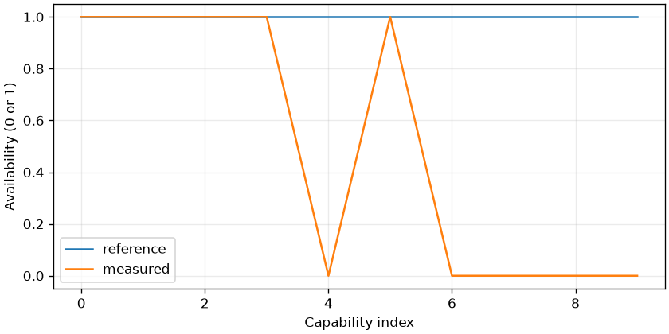

<!-- pal:language:start -->
<p align="right">
  <a href="../../ko/lessons/core-00.md" lang="ko">한국어</a> | <a href="core-00.md" lang="en">ENGLISH</a>
</p>
<!-- pal:language:end -->

# core-00 — Repository bootstrap and host audit

<!-- pal:metadata:start -->
| Field | Value |
|---|---|
| Stage / track | `core / common` |
| Legacy alias | `T00` |
| Platforms | `macos-arm64, linux-x86_64` |
| Capabilities | `python-3.12` |
| Prerequisites | `None` |
| Safety | `simulation` |
| Verification | `maintainer-checked` |
| Implementation | `implemented` |
<!-- pal:metadata:end -->

## Reader route

Read the Expected result first. Your task is to connect the measured values to the learning goal, then explain the calculation and the code that produced them.

[Terminal setup, resuming, opening results and camera controls](../READER_GUIDE.md)

Read the [simulation concept chapter](../concepts/simulation.md), then locate this lesson in the [equipment progression](../equipment-stages.md).

## Learning goals

Separate host readiness, local runs, and course completion.

## Preflight

On a fresh checkout, run `sh bootstrap.sh --plan`, read the plan, then use `--apply`. Activate `source .venv/bin/activate` before these commands. If the run directory already exists, use a new suffix such as 02.

```bash
pal host detect --json
pal lesson check core-00 --json
```

## Action

```bash
pal lesson run core-00 --headless --seed 7 --samples 64 --output-dir .local/runs/core-00/baseline-01 --json
```

## Expected

Measured development example. Read both axis units and the reference/measured difference first. Validate your own run separately.



Inspect platform_id, python and capability_status in host-audit.json. Repeating with seed 8 should not change OS or installed packages.

Common artifacts are summary.json, trace.csv, experiment.json, plot.png, run.json and lesson-report.md. Model lessons also produce frame.png or the external stack's evaluation/Isaac image. Inspect axes, units and camera framing, not only file size.

```bash
pal lesson check core-00 --run-dir .local/runs/core-00/baseline-01 --json
```

## Observe

Read the metric units, observed_first/observed_last and checks first. Inspection validates saved files, exits, and leaves completion unchanged.

```bash
pal lesson inspect core-00 --run-dir .local/runs/core-00/baseline-01 --json
```

Open the plot on macOS (closing the image preserves the run):

```bash
open .local/runs/core-00/baseline-01/plot.png
```

On other systems, open the same PNG in your file manager. Read the raw values from this JSON:

```bash
python -m json.tool .local/runs/core-00/baseline-01/experiment.json
```

## How it works

A capability is available only when its probe succeeds. Python version is a major/minor constraint; a package import is weaker evidence than rendering or device computation.

$$
r=N_{available}/N_{checked}
$$

Symbols, units and assumptions: N: count; r: dimensionless.

Worked calculation (not a measured run result): 3/5=0.6.

Practical connection: A successful import does not prove rendering works.

### From input to observation

The first input to a robotics lesson is a fact about its execution host, not a joint command. Distinguishing installed package names from successful capability probes prevents missing rendering, CUDA or ROS from being mistaken for a mathematical or policy error. Available/unavailable/unverified are categories; both latter states plot as 0. Plotted 1/0 encodes availability rather than a physical quantity or performance score.

## Code connection

`examples/core-00/run.py` → `src/pai_lab/lessons/runner.py` → `src/pai_lab/lessons/physics.py`. The runner records the execution; the experiment module computes measurements from actual state. Match `experiment.json` payload fields to the corresponding calculations.

### Read the actual producer and artifacts

Compare [`physics.py`](../../../src/pai_lab/lessons/physics.py) with dispatch in [`runner.py`](../../../src/pai_lab/lessons/runner.py).

The core-00 branch of `physics.run` reads `detect_host().to_dict()` and encodes each `capability_status` entry as 1 when available. Match graph indices to `platform_id`, `python` and individual probe explanations in `host-audit.json`. The summary metric counts available capabilities; it is not ratio r above. For example, 3 available out of 5 gives ratio 0.6 and count 3(calculation). The lesson check requires Python 3.12, not every external stack.

## Try it

This is an environment or structure audit. A seed change is not required. Compare names, units, prerequisites and the actual artifact; record specific findings in the review notes.

<details>
<summary>Optional: what changes when the assumptions fail?</summary>

Choose one input in the equation and write its units. Inspect whether doubling it doubles the output or whether clipping, normalization or coordinate transforms change that relationship. Changing another assumption or model at the same time needs a separate experiment.

</details>

### Predict before changing a value

For a one-variable calculation, keep 5 checked items and change available count from 3 to 4: r changes from 0.6 to 0.8. Changing only execution seed should not change installed capabilities. This is an environment observation, not a reason to install missing stacks automatically.

## Recovery

For capability-unavailable, prepare exactly the reported Python, model, platform or external stack, then rerun this lesson in a new directory. Preserve the failed run.json and numerical evidence. Do not automatically install system packages, drivers, CUDA, ROS, Isaac or large models. Resolve checksum errors by restoring a pinned cache, never by editing vendor sources.

## Checkpoint

Replace `--notes` with the concrete measurements and interpretation you observed before running this command. Save, fix and reverify received feedback first. Unresolved feedback, changed execution code or corrupt artifacts block completion. Execution alone does not complete the lesson. Stop after finishing this lesson.

```bash
pal lesson review core-00 --run-dir .local/runs/core-00/baseline-01 --notes "Replace with inspected names, units, structure, limits and concrete evidence." --json
pal lesson finish core-00 --run-dir .local/runs/core-00/baseline-01 --json
```

### Check understanding and answer guide

Question: Why are count=3 and r=0.6 consistent? Answer: They summarize different quantities. Question: Does importing NumPy establish Isaac readiness? Answer: Runtime and GPU probes are separate. Record your platform, Python version, first missing capability and next check.

This structural audit is explicitly exempted by `evidence.comparison_errors` from a separate comparison run. The review command above passes only the baseline. Record actual audit evidence in notes; do not represent a paper calculation as an executed comparison artifact.

<!-- pal:navigation:start -->
## Next lesson

[core-01](./core-01.md)

This is catalog order. Use `pal course next --json` to select an eligible lesson.
<!-- pal:navigation:end -->
