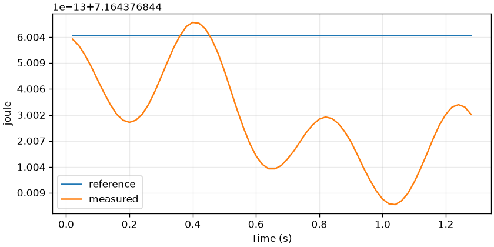

<!-- pal:language:start -->
<p align="right">
  <a href="../../ko/lessons/core-01.md" lang="ko">한국어</a> | <a href="core-01.md" lang="en">ENGLISH</a>
</p>
<!-- pal:language:end -->

# core-01 — Deterministic pendulum state and timestep

Imagine a robot arm with a single link hanging from its shoulder joint. With zero motor torque, gravity swings the link like a pendulum. This simple model lets you see how to record a joint angle and interpret motion caused by gravity. Later, you will use those ideas on the FR3 robot arm, where several joints move together and motors apply torque to reach a target angle.

**If you release the same pendulum from a larger angle, will it rise higher on the other side?**

<div class="core-01-pendulum" data-language="en"></div>

## Learning goals

Release a pendulum from two starting angles and compare how high it rises on the other side using MuJoCo replay and an angle plot. Use the same method to read a robot joint position at a particular time.

## Preflight

### Predict before running

Take the straight-down position as 0°. Imagine releasing the same pendulum from rest at about 20° and at about 40° to one side. Which will rise higher on the opposite side?

Make your prediction, then add it to the message in **Action** and request both runs together.

If you are unsure whether the environment is ready, ask in the chat first.

```text
Check whether my Core environment is ready to run core-01.
```

## How it works

In MuJoCo, `data.qpos[0]` is the pendulum joint angle $q$ in radians, measured from zero at the hanging pose. `data.qvel[0]` is its angular velocity $\dot q$ in rad/s. The model has one hinge, so both arrays have length 1.

### Equation of motion for one pendulum

The mass $m=1\,\mathrm{kg}$ is distributed throughout a capsule. $I_H$ is its moment of inertia about the hinge axis (kg·m²), and $\ell_c=0.5\,\mathrm m$ is the distance from the axis to the center of mass. With angular acceleration $\ddot q$ (rad/s²), gravitational acceleration magnitude $g=9.81\,\mathrm{m/s^2}$ and motor torque $\tau$ (N·m), the frictionless joint follows

$$
I_H\ddot q + mg\ell_c\sin q = \tau,\qquad \tau=0\quad\text{(in this experiment)}.
$$

When you release the pendulum at a positive angle, gravity applies a negative torque $-mg\ell_c\sin q$ and swings it back down. Both runs start with an angular velocity of 0 rad/s. The tip height is $z_{\mathrm{tip}}=z_H-L\cos q$, where $z_H=1.2\,\mathrm m$ is the hinge height and $L=1\,\mathrm m$ is the distance from the hinge to the tip. On the opposite side, a lower angle means a larger $|q|$. Over the range in this experiment, a lower point on the angle plot represents a higher tip.

Even without friction, a larger release angle gives a longer period. The period is nearly independent of amplitude only at small angles, where $\sin q\approx q$. At 40°, $\sin q$ is smaller than $q$, so gravity provides less restoring torque per radian than the small-angle approximation predicts.

### Extending the equation to a robot arm

For a fixed-base robot arm without contact or friction, the same torque balance applies to all the joints together.

$$
M(\mathbf q)\ddot{\mathbf q}
+ C(\mathbf q,\dot{\mathbf q})\dot{\mathbf q}
+ \mathbf g(\mathbf q)
= \boldsymbol{\tau}.
$$

$\mathbf q$ is the vector of joint angles, $M$ is a pose-dependent inertia matrix, $C\dot{\mathbf q}$ describes inertia-related torques due to joint motion, and $\mathbf g$ is the joint torque needed to counter gravity. $\boldsymbol{\tau}$ is the vector of motor torques. The FR3 has seven joints, so $\mathbf q$ contains seven angles and $M$ is a $7\times7$ matrix. For the pendulum, $M$ reduces to the scalar $I_H$, the velocity-dependent term vanishes, and the gravity term is $mg\ell_c\sin q$. In [FR3 joint-space PD control](core-fr3-02.md), you will use an angle error to compute motor torque. In [FR3 gravity compensation](core-fr3-03.md), you will add a model-based torque and compare tracking error.

## Code connection

[`examples/core-01/run.py`](../../../examples/core-01/run.py) calls [`runner.py`](../../../src/pai_lab/lessons/runner.py), which dispatches to [`physics.py`](../../../src/pai_lab/lessons/physics.py). The pendulum uses RK4 with a 0.002 s step. The input `initial_angle_rad` sets the first `qpos[0]` value. `physics.run` calls `mj_step` 10 times per saved sample and refreshes energy with `mj_forward`. Samples are 0.020 s apart, and the 64th sample is at 1.28 s (calculated).

## Action

Fill in your prediction and send the whole message to Codex or Claude Code.

```text
I predict that the pendulum released at [20° or 40°] will rise higher on the opposite side.
In core-01, release the pendulum at 20° (0.35 rad) and at 40° (0.70 rad) and compare the runs.
Change only the release angle, verify both runs, and open the results page paused.
```

The agent runs the 0.35 rad baseline, then runs the experiment again at 0.70 rad. Both runs use the same model, gravity, initial angular velocity, integration step and observation duration.

## Expected

The results page shows the pendulum released at 0.35 rad on the left and at 0.70 rad on the right. The horizontal axis shows observation time (s), and the vertical axis shows angle (rad), with zero straight down. The first minimum of each curve below zero marks the sample at which its pendulum rose highest on the opposite side.

## Observe

The `state` rows in `experiment.json` are ordered as `[time_s, q, qdot]`. `replay.npz` stores `time_s`, `qpos`, and `qvel` at $t=0$ and the later sample times. `trace.csv` records the reference energy $E(0)$ and the measured energy $E(t)$ at each time. To examine the data, ask in the chat.

```text
Show me the baseline plot and explain the axes and units for time, angle, and energy in the saved records.
```

## Try it

The results page opens paused. Select **Play** to move both pendulums along the same timeline. Select **0.85 s** to pause both pendulums at the same time between their opposite-side peaks. The displayed angles in radians are interpolated between the samples at 0.84 s and 0.86 s. You can also ask for the same actions in chat.

```text
Play both pendulums on the results page.
```

```text
Pause the results page at 0.85 s and compare the two pendulum angles.
```

<details markdown="1">
<summary>Optional experiment — Integration step and energy drift</summary>

With no friction or applied actuation, the sum $E$ of kinetic energy $K$ and potential energy $U$ is constant. Measure numerical error as the largest difference $d$ over the saved samples. Time $t$ is in s, and $K$, $U$, $E$ and $d$ are in J. Use the energies in `pendulum-state.csv` and `trace.csv` to check that $d$ is below $10^{-5}$ J.

$$
E=K+U,\qquad d=\max_t |E(t)-E(0)|
$$

For example, a reading of 1.000003 J with an initial energy of 1.000000 J gives an absolute difference of 0.000003 J. This is a worked calculation.

The image below is an energy plot from an earlier development run. Its vertical axis shows energy, while the results plot shows angle.



Increase the integration step from 0.002 s to 0.004 s. With the same 64 samples, the sample interval becomes 0.04 s and the observation time becomes 2.56 s. The final poses come from different times, so compare energy drift and observation time. Keep the starting angle at 0.35 rad for this experiment.

```text
Keep the starting angle at 0.35 rad and change only the integration step to 0.004 s. Compare the energy error and observation duration with the baseline.
```

</details>

## Recovery

If the run stops, ask in the chat what happened.

```text
Check what blocked core-01 and tell me whether it can run again while keeping the existing run records.
```

## Checkpoint

Below the zero line, which curve reaches a lower minimum? What do you see in the replay that shows its pendulum rose higher on the opposite side?

Replace the brackets with your explanation and send it in the chat. The agent checks your answer against the measurements before recording completion.

```text
I observed that [which release angle had a lower curve and what I saw in the replay]. Check my observation against the measurements and finish the lesson with me.
```

If you would like help reading the graph, ask in the chat.

```text
Show me where to find the starting angle and the first negative minimum in the results graph.
```

## Further reading

To explore integration steps and state recording in more depth, see the [simulation concept chapter](../concepts/simulation.md).

<details markdown="1">
<summary>Supported environments and verification</summary>

<!-- Canonical agent runner: pal lesson run core-01 -->
<!-- pal:metadata:start -->
| Field | Value |
|---|---|
| Stage / track | `core / common` |
| Legacy alias | `T01` |
| Platforms | `macos-arm64, linux-x86_64` |
| Capabilities | `python-3.12, numpy, mujoco` |
| Prerequisites | `None` |
| Safety | `simulation` |
| Verification | `maintainer-checked` |
| Implementation | `implemented` |
<!-- pal:metadata:end -->

</details>

<!-- pal:navigation:start -->
## Next lesson

[core-02](./core-02.md)

This is catalog order. Use `pal course next --json` to select an eligible lesson.
<!-- pal:navigation:end -->
