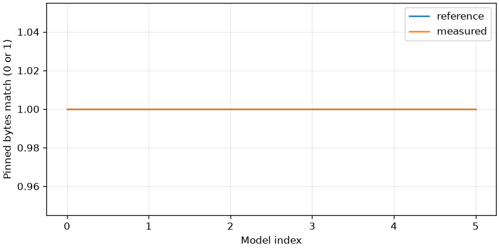

<!-- pal:language:start -->
<p align="right">
  <a href="../../ko/lessons/core-02.md" lang="ko">한국어</a> | <a href="core-02.md" lang="en">ENGLISH</a>
</p>
<!-- pal:language:end -->

# core-02 — Pinned public robot sources

<!-- pal:metadata:start -->
| Field | Value |
|---|---|
| Stage / track | `core / common` |
| Legacy alias | `T02` |
| Platforms | `macos-arm64, linux-x86_64` |
| Capabilities | `python-3.12, numpy, mujoco` |
| Prerequisites | `core-01` |
| Safety | `simulation` |
| Verification | `maintainer-checked` |
| Implementation | `implemented` |
<!-- pal:metadata:end -->

## Reader route

[Terminal setup, resuming, opening results and camera controls](../READER_GUIDE.md)

Read the [simulation concept chapter](../concepts/simulation.md), then locate this lesson in the [equipment progression](../equipment-stages.md).

## Learning goals

Check pinned source commits and model files. Change one byte in a memory copy and compare the SHA-256 values to detect changes even when the model keeps the same name.

## Preflight

### Predict before running

Predict whether the two SHA-256 values will match if you change only the first byte and keep the file length and remaining bytes fixed.

The agent prepares and verifies Core using the [reader guide](../READER_GUIDE.md#manual-setup). For direct execution, read the plan with `sh bootstrap.sh --plan` at the repository root and use `--apply` if setup is needed. Activate the environment with `source .venv/bin/activate`, then run the checks below. If a run directory already exists, choose a fresh suffix such as `02`. The first group of commands prepares the required public models.

```bash
pal assets fetch mujoco-menagerie
pal assets fetch wuji-description-beta2
pal assets fetch flexiv-description
```

```bash
pal host detect --json
pal lesson check core-02 --json
```

## How it works

An annotated Git tag may point to a tag object. Pin the actual commit and hash the bytes of the selected model and license files. Let $b$ be the file bytes and $h$ their SHA-256 hash. Dividing 256 bits by 8 gives 32 bytes, represented by 64 hexadecimal digits. Identical file contents give the same hash. Use the check to detect changes in the file bytes. Changing a mesh file can affect contact or collision results even in the same pose.

$$
h=\operatorname{SHA256}(b)
$$

## Code connection

[`examples/core-02/run.py`](../../../examples/core-02/run.py) calls [`runner.py`](../../../src/pai_lab/lessons/runner.py), which dispatches to [`physics.py`](../../../src/pai_lab/lessons/physics.py). [`models.provenance`](../../../src/pai_lab/lessons/models.py) verifies the SHA-256 of model files against `assets/model-lock.json` and rejects missing or changed files. `physics.run` reads pinned commits, licenses and aggregate file hashes for FR3, Wuji, Enlight, G1, Sharpa and ALOHA.

## Action

The agent records the baseline with this command.

```bash
pal lesson run core-02 --headless --seed 7 --samples 64 --output-dir .local/runs/core-02/baseline-01 --json
```

## Expected

All six public model caches must match `assets/model-lock.json`. Download receipts live outside the checkout. In the measured example below, a 1 means the commit ID passes the 40-character length check. The complete source pin check runs separately.



```bash
pal lesson check core-02 --run-dir .local/runs/core-02/baseline-01 --json
```

## Observe

Find `model`, `revision`, `license` and `files_digest` under `models` in `source-pins.json`. The commit ID identifies the loaded version, and the license states the terms for reuse. Verify the run with `lesson inspect`. The commands below also open the plot and raw values.

```bash
pal lesson inspect core-02 --run-dir .local/runs/core-02/baseline-01 --json
```

```bash
open .local/runs/core-02/baseline-01/plot.png
```

```bash
python -m json.tool .local/runs/core-02/baseline-01/experiment.json
```

## Try it

The code reads the tracked `assets/sources.json` as bytes and applies XOR 1 to the first byte of a memory copy. The original file and vendor cache stay intact. One run stores both hash values under `hash_comparison` in `source-pins.json`. Read `byte_offset`, `original_byte` and `changed_byte`, then compare `original_sha256` and `changed_sha256`. This comparison uses the same seed and a single run.

The agent uses the command below to validate the run evidence and generate a result page. It opens the page in a separate window from the lesson and verifies the display. If a separate window is unavailable, it uses a result tab. With no screen control, it shares the actual measurements and any images supported in chat.

```bash
pal lesson present core-02 --run-dir .local/runs/core-02/baseline-01 --language en --json
```

## Recovery

On `capability-unavailable`, the agent reads `missing_capabilities` or `error` and explains how to prepare the required Python, model, platform or external stack. Rerun in a fresh directory once it is ready. Keep the failed `run.json` and measurements. System packages, drivers, CUDA, ROS, Isaac and large models require separate setup. Restore the pinned cache if a checksum fails. Keep vendor sources read-only.

## Checkpoint

What does a matching hash establish? Point to the field that reports the byte you changed in memory. In the next lesson, you will compile the models and check their actual structure.

`lesson present` saves the result and the awaiting-comprehension phase. A new chat can resume from the same question and result. Once the learner has discussed the answer or asked to finish, the agent records actual observations and an interpretation in `--notes`, then records review and completion. Resolve and reverify any outstanding feedback first. Changed execution code or corrupt artifacts block completion.

```bash
pal lesson review core-02 --run-dir .local/runs/core-02/baseline-01 --notes "Replace with inspected names, units, structure, limits and concrete evidence." --json
pal lesson finish core-02 --run-dir .local/runs/core-02/baseline-01 --json
```

<!-- pal:navigation:start -->
## Next lesson

[core-03](./core-03.md)

This is catalog order. Use `pal course next --json` to select an eligible lesson.
<!-- pal:navigation:end -->
