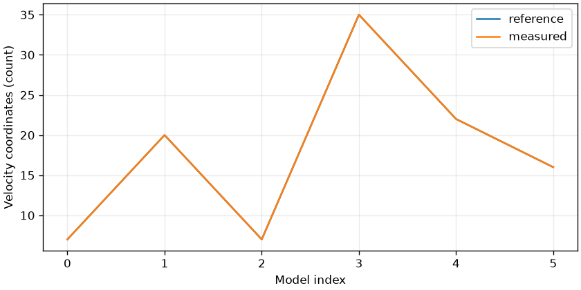

<!-- pal:language:start -->
<p align="right">
  <a href="../../ko/lessons/core-03.md" lang="ko">한국어</a> | <a href="core-03.md" lang="en">ENGLISH</a>
</p>
<!-- pal:language:end -->

# core-03 — Multi-model inspection and asset validation

<!-- pal:metadata:start -->
| Field | Value |
|---|---|
| Stage / track | `core / common` |
| Legacy alias | `T03` |
| Platforms | `macos-arm64, linux-x86_64` |
| Capabilities | `python-3.12, numpy, mujoco` |
| Prerequisites | `core-01, core-02` |
| Safety | `simulation` |
| Verification | `maintainer-checked` |
| Implementation | `implemented` |
<!-- pal:metadata:end -->

## Reader route

[Terminal setup, resuming, opening results and camera controls](../READER_GUIDE.md)

Read the [simulation concept chapter](../concepts/simulation.md), then locate this lesson in the [equipment progression](../equipment-stages.md).

## Learning goals

Load six robot models in MuJoCo and compare the counts of position coordinates, velocity coordinates and actuators. Use these counts to choose the right array sizes and indices for joint state and control.

## Preflight

### Predict before running

Compare a robot arm fixed to the floor with a robot body free to move. Predict which one has different counts for position and velocity coordinates.

The agent prepares and verifies Core using the [reader guide](../READER_GUIDE.md#manual-setup). For direct execution, read the plan with `sh bootstrap.sh --plan` at the repository root and use `--apply` if setup is needed. Activate the environment with `source .venv/bin/activate`, then run the checks below. If a run directory already exists, choose a fresh suffix such as `02`. The first group of commands prepares the required public models.

```bash
pal assets fetch mujoco-menagerie
pal assets fetch wuji-description-beta2
pal assets fetch flexiv-description
```

```bash
pal host detect --json
pal lesson check core-03 --json
```

## How it works

In MuJoCo, `nq` counts position coordinates, `nv` counts velocity coordinates, and `nu` counts actuators. The one-dimensional arrays `qpos`, `qvel` and `ctrl` have lengths `nq`, `nv` and `nu` respectively. One free joint has 7 position coordinates: 3 translations and 4 entries of a unit quaternion. It has 6 velocity coordinates: 3 linear and 3 angular. Each quantity is a count.

$$
n_q=7,\quad n_v=6\quad\text{(one free joint)}
$$

## Code connection

[`examples/core-03/run.py`](../../../examples/core-03/run.py) calls [`runner.py`](../../../src/pai_lab/lessons/runner.py), which dispatches to [`physics.py`](../../../src/pai_lab/lessons/physics.py). [`models.load` and `inventory`](../../../src/pai_lab/lessons/models.py) load each MuJoCo model and record `nq`, `nv`, `nu`, `joint_names`, `joint_ranges`, `site_names` and `mass_kg` by model name. The Enlight draft generated from pinned vendor parameters is saved in `enlight-draft.xml`.

## Action

The agent records the baseline with this command.

```bash
pal lesson run core-03 --headless --seed 7 --samples 64 --output-dir .local/runs/core-03/baseline-01 --json
```

## Expected

When all six models load, `model-inventory.json` stores the measured dimensions for FR3, Enlight, Wuji, Sharpa, G1 and ALOHA. The measured development plot below compares `nv` by model. The check reports a separate scalar, the fraction of models with positive mass.



```bash
pal lesson check core-03 --run-dir .local/runs/core-03/baseline-01 --json
```

## Observe

Find the model, joint names, joint limits and total mass in the corresponding entry in `model-inventory.json`. Verify the run with `lesson inspect`. The commands below also open the plot and raw values.

```bash
pal lesson inspect core-03 --run-dir .local/runs/core-03/baseline-01 --json
```

```bash
open .local/runs/core-03/baseline-01/plot.png
```

```bash
python -m json.tool .local/runs/core-03/baseline-01/experiment.json
```

## Try it

Select the fixed-base FR3 and the free-joint G1 from the same run, then compare `nq`, `nv` and `nu`. The only change is the model you read through the same inspection procedure. Use the 7-to-6 calculation for a free joint to explain why G1 has more position coordinates than velocity coordinates. The robots have other different joints, so the free joint alone cannot explain the difference between the robots’ totals. Keep the pinned models and seed fixed.

The agent uses the command below to validate the run evidence and generate a result page. It opens the page in a separate window from the lesson and verifies the display. If a separate window is unavailable, it uses a result tab. With no screen control, it shares the actual measurements and any images supported in chat.

```bash
pal lesson present core-03 --run-dir .local/runs/core-03/baseline-01 --language en --json
```

## Recovery

On `capability-unavailable`, the agent reads `missing_capabilities` or `error` and explains how to prepare the required Python, model, platform or external stack. Rerun in a fresh directory once it is ready. Keep the failed `run.json` and measurements. System packages, drivers, CUDA, ROS, Isaac and large models require separate setup. Restore the pinned cache if a checksum fails. Keep vendor sources read-only.

## Checkpoint

Why does G1 have different `nq` and `nv` values? Read `nu` for both models and give the length of each `ctrl` array. Compilation and positive mass verify structure. Collision behavior and real-world calibration require separate checks.

`lesson present` saves the result and the awaiting-comprehension phase. A new chat can resume from the same question and result. Once the learner has discussed the answer or asked to finish, the agent records actual observations and an interpretation in `--notes`, then records review and completion. Resolve and reverify any outstanding feedback first. Changed execution code or corrupt artifacts block completion.

```bash
pal lesson review core-03 --run-dir .local/runs/core-03/baseline-01 --notes "Replace with inspected names, units, structure, limits and concrete evidence." --json
pal lesson finish core-03 --run-dir .local/runs/core-03/baseline-01 --json
```

<!-- pal:navigation:start -->
## Next lesson

[core-04](./core-04.md)

This is catalog order. Use `pal course next --json` to select an eligible lesson.
<!-- pal:navigation:end -->
