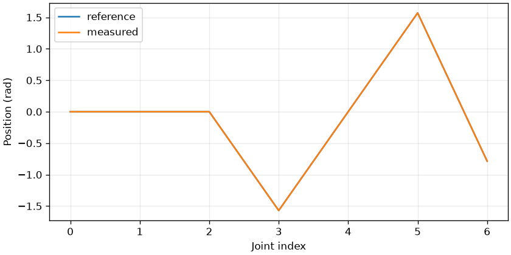

<!-- pal:language:start -->
<p align="right">
  <a href="../../ko/lessons/core-04.md" lang="ko">한국어</a> | <a href="core-04.md" lang="en">ENGLISH</a>
</p>
<!-- pal:language:end -->

# core-04 — Unified viewer and deterministic rendering

<!-- pal:metadata:start -->
| Field | Value |
|---|---|
| Stage / track | `core / common` |
| Legacy alias | `T04` |
| Platforms | `macos-arm64, linux-x86_64` |
| Capabilities | `python-3.12, numpy, mujoco` |
| Prerequisites | `core-03` |
| Safety | `simulation` |
| Verification | `maintainer-checked` |
| Implementation | `implemented` |
<!-- pal:metadata:end -->

## Reader route

[Terminal setup, resuming, opening results and camera controls](../READER_GUIDE.md)

Read the [simulation concept chapter](../concepts/simulation.md), then locate this lesson in the [equipment progression](../equipment-stages.md).

## Learning goals

View the same FR3 home pose from two camera azimuths. Learn to distinguish image changes due to arm motion from image changes due to camera motion.

## Preflight

### Predict before running

Keep the joints fixed and imagine moving the camera around the robot. Predict which part of the base, elbow or tool tip will look different or be obscured.

The agent prepares and verifies Core using the [reader guide](../READER_GUIDE.md#manual-setup). For direct execution, read the plan with `sh bootstrap.sh --plan` at the repository root and use `--apply` if setup is needed. Activate the environment with `source .venv/bin/activate`, then run the checks below. If a run directory already exists, choose a fresh suffix such as `02`. The first group of commands prepares the required public models.

```bash
pal assets fetch mujoco-menagerie
```

```bash
pal host detect --json
pal lesson check core-04 --json
```

## How it works

The renderer computes pixels from the model, joint state and camera. A `headless` run still needs an offscreen graphics context. The axes of RGB image $I$ are 360 rows, 480 columns, and 3 RGB channels with values from 0 to 255. That gives $360\times480\times3=518400$ channel values (calculated).

$$
I\in\{0,\ldots,255\}^{360\times480\times3}
$$

## Code connection

[`examples/core-04/run.py`](../../../examples/core-04/run.py) calls [`runner.py`](../../../src/pai_lab/lessons/runner.py), which dispatches to [`physics.py`](../../../src/pai_lab/lessons/physics.py). `physics.run` reads the FR3 home pose and [`experiment.render`](../../../src/pai_lab/lessons/experiment.py) renders that pose from the specified camera azimuth. Match `frame_positions_m`, `joint_names` and saved `qpos` to the base and tool tip you see. `plot.png` shows joint angles in rad by joint index.

## Action

The agent records the baseline with this command.

```bash
pal lesson run core-04 --headless --seed 7 --samples 64 --output-dir .local/runs/core-04/baseline-01 --json
```

## Expected

`frame.png` is the 480×360 RGB rendering, and `frame.pgm` is its grayscale representation. The pixel standard deviation check detects a blank image. Inspect the framing to see whether the base, elbow and tool tip are visible. The figure below is the joint position plot from an earlier measured development run.



```bash
pal lesson check core-04 --run-dir .local/runs/core-04/baseline-01 --json
```

## Observe

Locate the base, elbow and tool tip in the render. Repeating the same conditions on the same host should show the same pose. Verify the run with `lesson inspect`. The commands below also open the plot and raw values.

```bash
pal lesson inspect core-04 --run-dir .local/runs/core-04/baseline-01 --json
```

```bash
open .local/runs/core-04/baseline-01/plot.png
```

```bash
python -m json.tool .local/runs/core-04/baseline-01/experiment.json
```

## Try it

Change only camera azimuth `camera_azimuth` from 135° to 165°. The angular change is 30°, or about 0.5236 rad (calculated). Keep the seed, sample count, model and pose fixed. Compare the two images side by side and locate the elbow and tool tip. Check that `qpos`, joint names, mass and joint count agree across the two runs to verify that the joint state was held fixed.

```bash
pal lesson run core-04 --headless --samples 64 --output-dir .local/runs/core-04/comparison-01 --seed 7 --param camera_azimuth=165 --json
```

The agent uses the command below to validate the run evidence and generate a result page. It opens the page in a separate window from the lesson and verifies the display. If a separate window is unavailable, it uses a result tab. With no screen control, it shares the actual measurements and any images supported in chat.

```bash
pal lesson present core-04 --run-dir .local/runs/core-04/baseline-01 --comparison-run-dir .local/runs/core-04/comparison-01 --language en --json
```

The following command saves a joint-angle comparison plot and measurements to a separate directory.

```bash
pal lesson compare core-04 --run-dir .local/runs/core-04/baseline-01 --comparison-run-dir .local/runs/core-04/comparison-01 --output-dir .local/comparisons/core-04/comparison-01 --json
```

## Recovery

On `capability-unavailable`, the agent reads `missing_capabilities` or `error` and explains how to prepare the required Python, model, platform or external stack. Rerun in a fresh directory once it is ready. Keep the failed `run.json` and measurements. System packages, drivers, CUDA, ROS, Isaac and large models require separate setup. Restore the pinned cache if a checksum fails. Keep vendor sources read-only.

## Checkpoint

Choose the same joint in both images. What changed, and which run evidence confirms that the joint held still? Explain how a `headless` run still produces an image. Teleoperation is an elective, and the robot paths can continue without VR.

`lesson present` saves the result and the awaiting-comprehension phase. A new chat can resume from the same question and result. Once the learner has discussed the answer or asked to finish, the agent records actual observations and an interpretation in `--notes`, then records review and completion. Resolve and reverify any outstanding feedback first. Changed execution code or corrupt artifacts block completion.

```bash
pal lesson review core-04 --run-dir .local/runs/core-04/baseline-01 --comparison-run-dir .local/runs/core-04/comparison-01 --notes "Explained measured results and one-variable comparison; inspected plots and renderings." --json
pal lesson finish core-04 --run-dir .local/runs/core-04/baseline-01 --json
```

<!-- pal:navigation:start -->
## Next lesson

[core-teleop-01](./core-teleop-01.md)

This is catalog order. Use `pal course next --json` to select an eligible lesson.
<!-- pal:navigation:end -->
