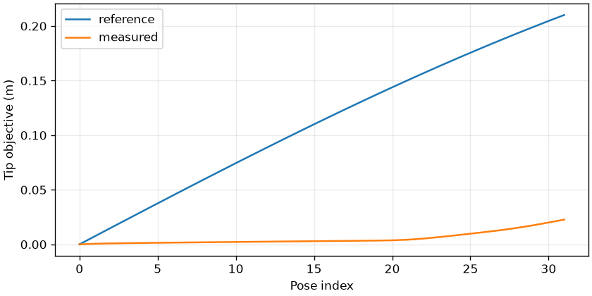
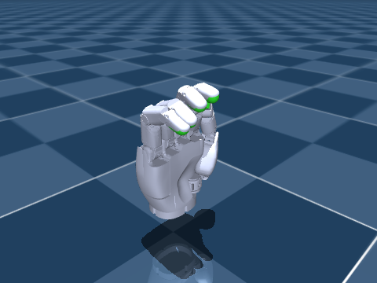

<!-- pal:language:start -->
<p align="right">
  <a href="../../ko/lessons/core-dexterity-02.md" lang="ko">한국어</a> | <a href="core-dexterity-02.md" lang="en">ENGLISH</a>
</p>
<!-- pal:language:end -->

# core-dexterity-02 — Hand retargeting and demonstration recording

<!-- pal:metadata:start -->
| Field | Value |
|---|---|
| Stage / track | `core / dexterity` |
| Legacy alias | `T16A` |
| Platforms | `macos-arm64, linux-x86_64` |
| Capabilities | `python-3.12, numpy, mujoco` |
| Prerequisites | `core-dexterity-01, core-data-01` |
| Safety | `simulation` |
| Verification | `maintainer-checked` |
| Implementation | `implemented` |
<!-- pal:metadata:end -->

## Reader route

Read the Expected result first. Your task is to connect the measured values to the learning goal, then explain the calculation and the code that produced them.

[Terminal setup, resuming, opening results and camera controls](../READER_GUIDE.md)

Read the [robot-hands concept chapter](../concepts/robot-hands.md), then locate this lesson in the [equipment progression](../equipment-stages.md).

## Learning goals

Retarget observed fingertip displacement and record the result.

## Preflight

Device setup and manual references: [Wuji Hand 2 Beta 2](../setup/wuji.md), [Sharpa Wave](../setup/sharpa.md).

On a fresh checkout, run `sh bootstrap.sh --plan`, read the plan, then use `--apply`. Activate `source .venv/bin/activate` before these commands. If the run directory already exists, use a new suffix such as 02.

Prepare the required public models once:

```bash
pal assets fetch wuji-description-beta2
pal assets fetch mujoco-menagerie
```

```bash
pal host detect --json
pal lesson check core-dexterity-02 --json
```

## Action

```bash
pal lesson run core-dexterity-02 --headless --seed 7 --samples 64 --output-dir .local/runs/core-dexterity-02/baseline-01 --json
```

## Expected

Measured development example. Read both axis units and the reference/measured difference first. Validate your own run separately.



Reviewed maintainer example from the pinned public model; your local run must be checked separately.



Compare baseline and optimized errors for each source pose. Inspect retargeted-motion.npz joint order and the rendered Sharpa hand; average optimized error must not exceed baseline.

Common artifacts are summary.json, trace.csv, experiment.json, plot.png, run.json and lesson-report.md. Model lessons also produce frame.png or the external stack's evaluation/Isaac image. Inspect axes, units and camera framing, not only file size.

```bash
pal lesson check core-dexterity-02 --run-dir .local/runs/core-dexterity-02/baseline-01 --json
```

## Observe

Read the metric units, observed_first/observed_last and checks first. Inspection validates saved files, exits, and leaves completion unchanged.

```bash
pal lesson inspect core-dexterity-02 --run-dir .local/runs/core-dexterity-02/baseline-01 --json
```

Open the plot on macOS (closing the image preserves the run):

```bash
open .local/runs/core-dexterity-02/baseline-01/plot.png
```

On other systems, open the same PNG in your file manager. Read the raw values from this JSON:

```bash
python -m json.tool .local/runs/core-dexterity-02/baseline-01/experiment.json
```

## How it works

Rest-pose fingertip clouds align the two hand coordinate conventions. Bounded least squares matches relative fingertip displacement with a small posture penalty. Residuals include geometric mismatch; perfect matching is not assumed.

$$
\min_q\|p(q)-p^*\|^2+\lambda\|q-q_0\|^2
$$

Symbols, units and assumptions: p: m in aligned frame; q: rad; λ: m²/rad²; bounded joint search.

Worked calculation (not a measured run result): position residual 0.01 m → squared term 0.0001 m².

Practical connection: Morphology differences leave residuals even with correct retargeting.

### From input to observation

Matching fingertip displacement is more meaningful than copying joint angles between hands. Align 5×3 fingertip point clouds at rest, then approximate the target within its joint bounds. Different morphology can leave residual error.

## Code connection

`examples/core-dexterity-02/run.py` → `src/pai_lab/lessons/runner.py` → `src/pai_lab/lessons/hands.py`. The runner records the execution; the experiment module computes measurements from actual state. Match `experiment.json` payload fields to the corresponding calculations.

### Read the actual producer and artifacts

Compare [`hands.py`](../../../src/pai_lab/lessons/hands.py) with dispatch in [`runner.py`](../../../src/pai_lab/lessons/runner.py).

`hands.run` uses SVD to align row-vector point clouds and a determinant correction to avoid reflection. `least_squares` concatenates 15 fingertip position residuals with 0.002(q-q0) posture terms. In the squared objective above, λ=(0.002)²=4e-6 m²/rad². Despite the name, `demonstrations.tip_error_m` stores this combined residual norm, not pure fingertip distance alone. qpos in `retargeted-motion.npz` follows the target hand joint order.

## Try it

Source pose amplitude: maximum 0.5 → 0.75 rad before joint-limit clipping. The target solver and geometry remain fixed.

```bash
pal lesson run core-dexterity-02 --headless --seed 7 --samples 64 --output-dir .local/runs/core-dexterity-02/comparison-01 --variant 1.5 --json
```

Change only the indicated seed, sample count or variant. Explain differences in measurements, shape and limits. If results are invariant, explain why; do not invent a performance improvement.

```bash
pal lesson compare core-dexterity-02 --run-dir .local/runs/core-dexterity-02/baseline-01 --comparison-run-dir .local/runs/core-dexterity-02/comparison-01 --output-dir .local/comparisons/core-dexterity-02/comparison-01 --json
```

<details>
<summary>Optional: what changes when the assumptions fail?</summary>

Choose one input in the equation and write its units. Inspect whether doubling it doubles the output or whether clipping, normalization or coordinate transforms change that relationship. Changing another assumption or model at the same time needs a separate experiment.

</details>

### Predict before changing a value

Changing only maximum source amplitude 0.5→0.75 rad can enlarge requested displacement, but joint bounds and a 25-evaluation budget prevent proportional residual changes. The trace reference is the initial combined residual, not zero.

## Recovery

For capability-unavailable, prepare exactly the reported Python, model, platform or external stack, then rerun this lesson in a new directory. Preserve the failed run.json and numerical evidence. Do not automatically install system packages, drivers, CUDA, ROS, Isaac or large models. Resolve checksum errors by restoring a pinned cache, never by editing vendor sources.

## Checkpoint

Replace `--notes` with the concrete measurements and interpretation you observed before running this command. Save, fix and reverify received feedback first. Unresolved feedback, changed execution code or corrupt artifacts block completion. Execution alone does not complete the lesson. Stop after finishing this lesson.

```bash
pal lesson review core-dexterity-02 --run-dir .local/runs/core-dexterity-02/baseline-01 --comparison-run-dir .local/runs/core-dexterity-02/comparison-01 --notes "Explained measured results and one-variable comparison; inspected plots and renderings." --json
pal lesson finish core-dexterity-02 --run-dir .local/runs/core-dexterity-02/baseline-01 --json
```

### Check understanding and answer guide

Question: Is the metric fingertip RMS? Answer: It averages combined residual norms over poses. Question: May target qpos use Wuji order? Answer: Follow Sharpa names and bounds. Report initial/final residuals and constrained joints.

<!-- pal:navigation:start -->
## Next lesson

[core-g1-01](./core-g1-01.md)

This is catalog order. Use `pal course next --json` to select an eligible lesson.
<!-- pal:navigation:end -->
