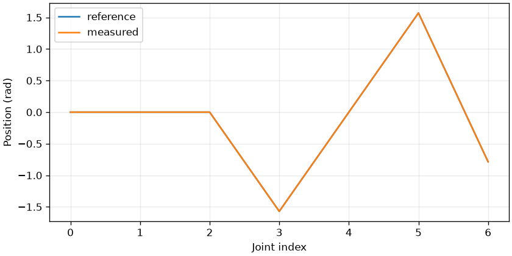

<!-- pal:language:start -->
<p align="right">
  <a href="../../ko/lessons/core-fr3-01.md" lang="ko">한국어</a> | <a href="core-fr3-01.md" lang="en">ENGLISH</a>
</p>
<!-- pal:language:end -->

# core-fr3-01 — FR3 model anatomy

<!-- pal:metadata:start -->
| Field | Value |
|---|---|
| Stage / track | `core / fr3` |
| Legacy alias | `T05` |
| Platforms | `macos-arm64, linux-x86_64` |
| Capabilities | `python-3.12, numpy, mujoco` |
| Prerequisites | `core-04` |
| Safety | `simulation` |
| Verification | `maintainer-checked` |
| Implementation | `implemented` |
<!-- pal:metadata:end -->

## Reader route

Read the Expected result first. Your task is to connect the measured values to the learning goal, then explain the calculation and the code that produced them.

[Terminal setup, resuming, opening results and camera controls](../READER_GUIDE.md)

Read the [kinematics concept chapter](../concepts/kinematics.md), then locate this lesson in the [equipment progression](../equipment-stages.md).

## Learning goals

Map FR3 joints, bodies, actuators and the tool site.

## Preflight

Device setup and manual references: [Franka Research 3](../setup/fr3.md).

On a fresh checkout, run `sh bootstrap.sh --plan`, read the plan, then use `--apply`. Activate `source .venv/bin/activate` before these commands. If the run directory already exists, use a new suffix such as 02.

Prepare the required public models once:

```bash
pal assets fetch mujoco-menagerie
```

```bash
pal host detect --json
pal lesson check core-fr3-01 --json
```

## Action

```bash
pal lesson run core-fr3-01 --headless --seed 7 --samples 64 --output-dir .local/runs/core-fr3-01/baseline-01 --json
```

## Expected

Measured development example. Read both axis units and the reference/measured difference first. Validate your own run separately.



Check seven joint names and ranges, actuator count, total mass and attachment_site. Match the rendered pose to the recorded home configuration.

Common artifacts are summary.json, trace.csv, experiment.json, plot.png, run.json and lesson-report.md. Model lessons also produce frame.png or the external stack's evaluation/Isaac image. Inspect axes, units and camera framing, not only file size.

```bash
pal lesson check core-fr3-01 --run-dir .local/runs/core-fr3-01/baseline-01 --json
```

## Observe

Read the metric units, observed_first/observed_last and checks first. Inspection validates saved files, exits, and leaves completion unchanged.

```bash
pal lesson inspect core-fr3-01 --run-dir .local/runs/core-fr3-01/baseline-01 --json
```

Open the plot on macOS (closing the image preserves the run):

```bash
open .local/runs/core-fr3-01/baseline-01/plot.png
```

On other systems, open the same PNG in your file manager. Read the raw values from this JSON:

```bash
python -m json.tool .local/runs/core-fr3-01/baseline-01/experiment.json
```

## How it works

Joint indices are model-specific. The attachment_site is a location on the final link; its world position changes with the joint angles. Read model limits rather than inventing a generic seven-joint range.

$$
{}^Wp={}^WT_T(q)\,{}^Tp
$$

Symbols, units and assumptions: p: homogeneous point; translation: m; q: rad; W: world, T: tool.

Worked calculation (not a measured run result): [0,0,0,1] maps to the transform translation column.

Practical connection: Sensor state must use the same joint names and frames as the display.

### Joint configuration determines the shape of the whole robot

Read `payload.joint_names` and `payload.joint_ranges` in `experiment.json` in the same order, then match the plotted home values to their joints. Both the seven revolute joints in home `qpos` and the corresponding model ranges use radians. With the model fixed, specifying all seven angles determines the positions and orientations of every link. That joint configuration is one point in **configuration space**.

Find `attachment_site` in `payload.site_names`. It is a reference point on the last link whose world position varies with the joint angles. The set of world positions it can reach as the joints move within their ranges is the **position workspace**. Mapping a physical tool tip to this reference point requires separate tool calibration. See how configuration space and workspace are related in the [planar arm example with one tip position and different link configurations](../concepts/kinematics.md#configuration-and-clearance).

## Code connection

`examples/core-fr3-01/run.py` → `src/pai_lab/lessons/runner.py` → `src/pai_lab/lessons/physics.py`. The runner records the execution; the experiment module computes measurements from actual state. Match `experiment.json` payload fields to the corresponding calculations.

### Read the actual producer and artifacts

Compare [`physics.py`](../../../src/pai_lab/lessons/physics.py) with dispatch in [`runner.py`](../../../src/pai_lab/lessons/runner.py).

Read `joint_names`, `joint_ranges`, `site_names`, `body_names` and `mass_kg` from `fr3-joints.json`, written by `models.inventory`. `physics.run` adds world-frame `frame_positions_m` in m. A 4×4 homogeneous transform acts on length-4 column [x,y,z,1]; its first three output components are world position. Separate rotation from translation. Overlapping plot curves show the same home values, not an independent sensor measurement.

## Try it

This is an environment or structure audit. A seed change is not required. Compare names, units, prerequisites and the actual artifact; record specific findings in the review notes.

<details>
<summary>Optional: what changes when the assumptions fail?</summary>

Choose one input in the equation and write its units. Inspect whether doubling it doubles the output or whether clipping, normalization or coordinate transforms change that relationship. Changing another assumption or model at the same time needs a separate experiment.

</details>

### Predict before changing a value

In a paper calculation, increasing only transform translation x by 0.1 m increases the mapped point x by 0.1 m. Audit seed does not change the home pose. A real model/tool-offset change is separate from this fixed structural inspection.

## Recovery

For capability-unavailable, prepare exactly the reported Python, model, platform or external stack, then rerun this lesson in a new directory. Preserve the failed run.json and numerical evidence. Do not automatically install system packages, drivers, CUDA, ROS, Isaac or large models. Resolve checksum errors by restoring a pinned cache, never by editing vendor sources.

## Checkpoint

Replace `--notes` with the concrete measurements and interpretation you observed before running this command. Save, fix and reverify received feedback first. Unresolved feedback, changed execution code or corrupt artifacts block completion. Execution alone does not complete the lesson. Stop after finishing this lesson.

```bash
pal lesson review core-fr3-01 --run-dir .local/runs/core-fr3-01/baseline-01 --notes "Replace with inspected names, units, structure, limits and concrete evidence." --json
pal lesson finish core-fr3-01 --run-dir .local/runs/core-fr3-01/baseline-01 --json
```

### Check understanding and answer guide

Does the same index identify the same joint on another arm? Check the names, axes and order for each model.

Pick one joint name and range in rad from the record. If this joint alone moves within its range, what changes in configuration space, and how do you interpret the position of `attachment_site`? The corresponding component of the joint vector changes and the arm moves to a different point in configuration space. Forward kinematics gives the world position of `attachment_site` for that vector. A pair of joint limits alone does not give the range of world positions of this point. Record the name and range you observed before moving on to PD control.

This structural audit is explicitly exempted by `evidence.comparison_errors` from a separate comparison run. The review command above passes only the baseline. Record actual audit evidence in notes; do not represent a paper calculation as an executed comparison artifact.

<!-- pal:navigation:start -->
## Next lesson

[core-fr3-02](./core-fr3-02.md)

This is catalog order. Use `pal course next --json` to select an eligible lesson.
<!-- pal:navigation:end -->
