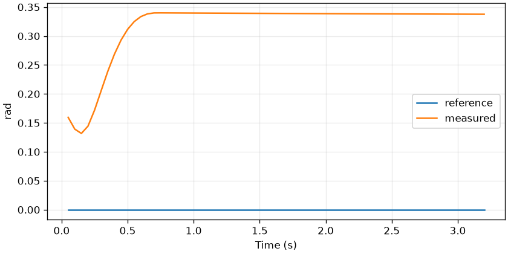

<!-- pal:language:start -->
<p align="right">
  <a href="../../ko/lessons/core-fr3-02.md" lang="ko">한국어</a> | <a href="core-fr3-02.md" lang="en">ENGLISH</a>
</p>
<!-- pal:language:end -->

# core-fr3-02 — FR3 joint-space PD control

<!-- pal:metadata:start -->
| Field | Value |
|---|---|
| Stage / track | `core / fr3` |
| Legacy alias | `T06` |
| Platforms | `macos-arm64, linux-x86_64` |
| Capabilities | `python-3.12, numpy, mujoco` |
| Prerequisites | `core-fr3-01` |
| Safety | `simulation` |
| Verification | `maintainer-checked` |
| Implementation | `implemented` |
<!-- pal:metadata:end -->

## Reader route

Read the Expected result first. Your task is to connect the measured values to the learning goal, then explain the calculation and the code that produced them.

[Terminal setup, resuming, opening results and camera controls](../READER_GUIDE.md)

Read the [control and contact chapter](../concepts/control-contact.md). Ask: “Why does a stronger pull toward the target not always produce a better response?” Separate position correction, velocity damping and torque limits.

## Learning goals

Apply bounded joint PD torque on the FR3 dynamics.

## Preflight

Device setup and manual references: [Franka Research 3](../setup/fr3.md).

On a fresh checkout, run `sh bootstrap.sh --plan`, read the plan, then use `--apply`. Activate `source .venv/bin/activate` before these commands. If the run directory already exists, use a new suffix such as 02.

Prepare the required public models once:

```bash
pal assets fetch mujoco-menagerie
```

```bash
pal host detect --json
pal lesson check core-fr3-02 --json
```

## Action

```bash
pal lesson run core-fr3-02 --headless --seed 7 --samples 64 --output-dir .local/runs/core-fr3-02/baseline-01 --json
```

## Expected

Reviewed maintainer example from the pinned public model; your local run must be checked separately.



The first joint target shifts by 0.18 rad. Its final error must be below 0.02 rad; the arm norm must stay below 0.5 rad. Inspect torque saturation and residual gravity error.

Common artifacts are summary.json, trace.csv, experiment.json, plot.png, run.json and lesson-report.md. Model lessons also produce frame.png or the external stack's evaluation/Isaac image. Inspect axes, units and camera framing, not only file size.

```bash
pal lesson check core-fr3-02 --run-dir .local/runs/core-fr3-02/baseline-01 --json
```

## Observe

Read the metric units, observed_first/observed_last and checks first. Inspection validates saved files, exits, and leaves completion unchanged.

```bash
pal lesson inspect core-fr3-02 --run-dir .local/runs/core-fr3-02/baseline-01 --json
```

Open the plot on macOS (closing the image preserves the run):

```bash
open .local/runs/core-fr3-02/baseline-01/plot.png
```

On other systems, open the same PNG in your file manager. Read the raw values from this JSON:

```bash
python -m json.tool .local/runs/core-fr3-02/baseline-01/experiment.json
```

### Match each file to the equation

| File or field | Values to read | Meaning |
|---|---|---|
| `control.csv` | `time_s`, `joint`, `target_rad`, `q_rad`, `velocity_rad_s`, `requested_nm`, `applied_nm` | Operands at one control instant, before and after clipping |
| `experiment.json` → `payload` | `gain`, `kd`, `target_qpos`, `qpos`, `qvel`, `commanded_joint_error` | Gains, states and final first-joint error |
| `trace.csv` | Third column | Whole-arm error norm(rad), saved after each 25 integration steps |

Check the actual CSV headers. Calculate position correction and damping from one `control.csv` row, compare their sum with `requested_nm`, then compare it with `applied_nm`. One final `torque_nm` sample cannot establish that saturation never occurred earlier.

The [historical public verification](../../verification/reader-experience.md) records a whole-arm error of 0.3376263 rad. It belongs to that source revision and variant conditions, and is neither this execution's measurement nor the first-joint error. Judge the current execution using its own artifacts.

## How it works

Proportional torque corrects position error and derivative torque damps velocity. Here kp=120 Nm/rad and kd=2√kp Nms/rad. Without gravity feedforward, static error is expected; inspect the commanded first joint separately from the whole-arm norm.

$$
\tau_{raw}=K_p(q^*-q)-K_d\dot q,\qquad\tau=\operatorname{clip}(\tau_{raw},\tau_{min},\tau_{max})
$$

Symbols, units and assumptions: q,q*: rad; qdot: rad/s; Kp: Nm/rad; Kd: Nm s/rad; torque: Nm.

Worked calculation (not a measured run result): 120 × 0.18 − 21.9089 × 0 = 21.6 Nm.

Practical connection: Payload gravity creates residual error; saturation limits how much higher gain can help.

### From an error vector to joint torque

Joint position $q$, target $q^*$ and velocity $\dot q$ are each length-7 arrays in this model. Apply the equation element by element to corresponding joints. With positive error at rest, the proportional term produces positive torque. As the joint starts moving toward its target, $-K_d\dot q$ damps that motion. The damping term does not itself measure distance to the target.

The 0.18 rad target shift is approximately 10.3° in simulation. Moving only the first joint target can still move other joints because of gravity and inertial coupling. The commanded joint's absolute error and the whole-arm norm $\|q^*-q\|_2$ therefore answer different questions. This lesson observes PD without gravity feedforward; the next adds compensation.

### Reading saturation

When $\tau_{raw}$ exceeds a joint's model limit, only the clipped $\tau$ enters the dynamics. Increasing raw torque while applied torque remains fixed does not produce a proportional increase in force. These limits come from the simulation model; they are not approved physical-device limits.

## Code connection

`examples/core-fr3-02/run.py` → `src/pai_lab/lessons/runner.py` → `src/pai_lab/lessons/physics.py`. The runner records the execution; the experiment module computes measurements from actual state. Match `experiment.json` payload fields to the corresponding calculations.

`arm_control` constructs the target, evaluates `gain * (target_q - data.qpos) - kd * data.qvel`, clips to model torque limits, and writes `qfrc_applied`. Model actuation is disabled on this path to avoid applying two controllers. `control.csv` records time, joint, target, position, velocity and both torques **before** mj_step. After 25 integration steps, mj_forward refreshes observed geometry and trace.csv receives the whole-arm error. Reproduce the first-row 21.6 Nm calculation and find saturated rows.

The numeric rule `2√kp` uses a teaching reference inertia of 1 kg m². The dimensional single-joint critical damping expression is $K_d=2\sqrt{I K_p}$. A coupled arm with payload does not share one critical damping value.

## Try it

Change only kp from 120 to 180 Nm/rad. kd stays at 21.9089 Nm s/rad. Legacy --variant 1.5 is a different experiment that changes kp and the coupled kd=2√kp rule together.

```bash
pal lesson run core-fr3-02 --headless --seed 7 --samples 64 --output-dir .local/runs/core-fr3-02/comparison-01 --param kp=180 --json
```

Change only the named parameter indicated above. Explain differences in measurements, shape and limits. If results are invariant, explain why; do not invent a performance improvement.

```bash
pal lesson compare core-fr3-02 --run-dir .local/runs/core-fr3-02/baseline-01 --comparison-run-dir .local/runs/core-fr3-02/comparison-01 --output-dir .local/comparisons/core-fr3-02/comparison-01 --json
```

<details>
<summary>Optional: what changes when the assumptions fail?</summary>

Choose one input in the equation and write its units. Inspect whether doubling it doubles the output or whether clipping, normalization or coordinate transforms change that relationship. Changing another assumption or model at the same time needs a separate experiment.

</details>

## Recovery

For capability-unavailable, prepare exactly the reported Python, model, platform or external stack, then rerun this lesson in a new directory. Preserve the failed run.json and numerical evidence. Do not automatically install system packages, drivers, CUDA, ROS, Isaac or large models. Resolve checksum errors by restoring a pinned cache, never by editing vendor sources.

## Checkpoint

Replace `--notes` with the concrete measurements and interpretation you observed before running this command. Save, fix and reverify received feedback first. Unresolved feedback, changed execution code or corrupt artifacts block completion. Execution alone does not complete the lesson. Stop after finishing this lesson.

```bash
pal lesson review core-fr3-02 --run-dir .local/runs/core-fr3-02/baseline-01 --comparison-run-dir .local/runs/core-fr3-02/comparison-01 --notes "Explained measured results and one-variable comparison; inspected plots and renderings." --json
pal lesson finish core-fr3-02 --run-dir .local/runs/core-fr3-02/baseline-01 --json
```

### Check your understanding

1. What signs can the two torque terms have when a joint is far from its target but already moving quickly?
2. Why inspect whole-arm error even when the first-joint error passes?
3. With `kp=180` and fixed `kd`, which of raw torque, applied torque and error response must change, and which may remain nearly unchanged because of saturation?

Include a calculation from one `control.csv` row and both kinds of final error. Higher gain alone does not establish suitability for physical control.

Answer guide: Positive position error produces positive proportional torque, while positive velocity produces negative damping torque. The arm norm also includes gravitational deflection of other joints. At zero initial velocity, kp=180 gives calculated first-joint raw torque 32.4 Nm; applied torque and final response still depend on limits and dynamics.

<!-- pal:navigation:start -->
## Next lesson

[core-fr3-03](./core-fr3-03.md)

This is catalog order. Use `pal course next --json` to select an eligible lesson.
<!-- pal:navigation:end -->
