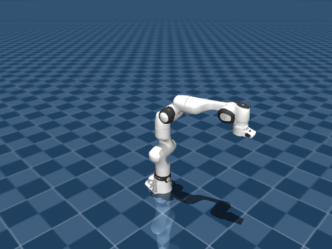
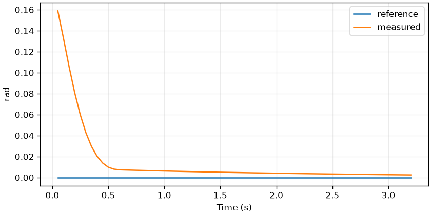

<!-- pal:language:start -->
<p align="right">
  <a href="../../ko/lessons/core-fr3-03.md" lang="ko">한국어</a> | <a href="core-fr3-03.md" lang="en">ENGLISH</a>
</p>
<!-- pal:language:end -->

# core-fr3-03 — FR3 gravity compensation and feedforward

<!-- pal:metadata:start -->
| Field | Value |
|---|---|
| Stage / track | `core / fr3` |
| Legacy alias | `T07` |
| Platforms | `macos-arm64, linux-x86_64` |
| Capabilities | `python-3.12, numpy, mujoco` |
| Prerequisites | `core-fr3-02` |
| Safety | `simulation` |
| Verification | `maintainer-checked` |
| Implementation | `implemented` |
<!-- pal:metadata:end -->

## Reader route

Read the Expected result first. Your task is to connect the measured values to the learning goal, then explain the calculation and the code that produced them.

[Terminal setup, resuming, opening results and camera controls](../READER_GUIDE.md)

Read the [control-contact concept chapter](../concepts/control-contact.md), then locate this lesson in the [equipment progression](../equipment-stages.md).

## Learning goals

Measure how gravity feedforward changes tracking error.

## Preflight

Device setup and manual references: [Franka Research 3](../setup/fr3.md).

On a fresh checkout, run `sh bootstrap.sh --plan`, read the plan, then use `--apply`. Activate `source .venv/bin/activate` before these commands. If the run directory already exists, use a new suffix such as 02.

Prepare the required public models once:

```bash
pal assets fetch mujoco-menagerie
```

```bash
pal host detect --json
pal lesson check core-fr3-03 --json
```

## Action

```bash
pal lesson run core-fr3-03 --headless --seed 7 --samples 64 --output-dir .local/runs/core-fr3-03/baseline-01 --json
```

## Expected

Reviewed maintainer example from the pinned public model; your local run must be checked separately.





Read without_compensation_error and final_error. Compensation must reduce the measured norm. Torque arrays are in Nm; the reported tracking metric is in rad.

Common artifacts are summary.json, trace.csv, experiment.json, plot.png, run.json and lesson-report.md. Model lessons also produce frame.png or the external stack's evaluation/Isaac image. Inspect axes, units and camera framing, not only file size.

```bash
pal lesson check core-fr3-03 --run-dir .local/runs/core-fr3-03/baseline-01 --json
```

## Observe

Read the metric units, observed_first/observed_last and checks first. Inspection validates saved files, exits, and leaves completion unchanged.

```bash
pal lesson inspect core-fr3-03 --run-dir .local/runs/core-fr3-03/baseline-01 --json
```

Open the plot on macOS (closing the image preserves the run):

```bash
open .local/runs/core-fr3-03/baseline-01/plot.png
```

On other systems, open the same PNG in your file manager. Read the raw values from this JSON:

```bash
python -m json.tool .local/runs/core-fr3-03/baseline-01/experiment.json
```

## How it works

qfrc_bias contains gravity and velocity-dependent bias forces. The lesson compares identical PD gains with and without this term. Compensation uses the simulated model, so it is not evidence that a physical robot's payload is correct.

$$
M(q)\ddot q+c(q,\dot q)+g(q)=\tau+J^Tf_{ext}
$$

Symbols, units and assumptions: M: kg m²; qddot: rad/s²; c,g,torque: Nm; J: m/rad; f: N.

Worked calculation (not a measured run result): 21.6 Nm PD + 4 Nm bias = 25.6 Nm before clipping.

Practical connection: qfrc_bias includes velocity terms as well as gravity; incorrect payload breaks compensation.

### Why a stationary arm still needs torque

When the arm holds still in the air, its joint velocities and accelerations are zero. Ignoring external loads and passive torque, the motors must supply the torque $g(q)$ required to support the arm against gravity at that configuration. With PD alone, a small position error can provide that torque through the proportional term. Once the arm moves, $M(q)\ddot q$ in the equation above gives the torque needed for acceleration, and $c(q,\dot q)$ accounts for the velocity-dependent Coriolis and centrifugal effects. See [holding torque and bias](../concepts/control-contact.md#gravity-and-bias) for each term.

Within one run, compare the two final joint error norms in radians at the same PD gains. Open `experiment.json` and read `without_compensation_error` and `final_error` from its `payload`. The second branch adds `qfrc_bias`, which combines gravity and velocity terms, to the PD request, then clips each joint to its torque limits. Compare `requested_nm` and `applied_nm` for the same time and joint in `control.csv` to find where the compensated branch reached saturation.

## Code connection

`examples/core-fr3-03/run.py` → `src/pai_lab/lessons/runner.py` → `src/pai_lab/lessons/physics.py`. The runner records the execution; the experiment module computes measurements from actual state. Match `experiment.json` payload fields to the corresponding calculations.

### Read the actual producer and artifacts

Compare [`physics.py`](../../../src/pai_lab/lessons/physics.py) with dispatch in [`runner.py`](../../../src/pai_lab/lessons/runner.py).

`physics.run` reloads the same model for PD and gravity `arm_control` runs. q, qdot, bias and torque are length-7 arrays with units rad, rad/s, Nm and Nm. The saved trace is the compensated branch; `without_compensation_error` stores the uncompensated final result. Compare it with payload `final_error` and read `gravity_reduces_error`. Bias is added before final clipping, so calculated 21.6+4=25.6 Nm need not be the applied value.

## Try it

PD gain: kp 120 → 180 Nm/rad, with kd determined by the same rule. Both compensation branches use identical gains.

```bash
pal lesson run core-fr3-03 --headless --seed 7 --samples 64 --output-dir .local/runs/core-fr3-03/comparison-01 --variant 1.5 --json
```

Change only the indicated seed, sample count or variant. Explain differences in measurements, shape and limits. If results are invariant, explain why; do not invent a performance improvement.

```bash
pal lesson compare core-fr3-03 --run-dir .local/runs/core-fr3-03/baseline-01 --comparison-run-dir .local/runs/core-fr3-03/comparison-01 --output-dir .local/comparisons/core-fr3-03/comparison-01 --json
```

<details>
<summary>Optional: what changes when the assumptions fail?</summary>

Choose one input in the equation and write its units. Inspect whether doubling it doubles the output or whether clipping, normalization or coordinate transforms change that relationship. Changing another assumption or model at the same time needs a separate experiment.

</details>

### Predict before changing a value

variant=1.5 changes both kp and kd=2√kp. It varies one CLI input but does not isolate kp alone. Distinguish equal gains between compensation branches from coupled gain changes between baseline and comparison.

## Recovery

For capability-unavailable, prepare exactly the reported Python, model, platform or external stack, then rerun this lesson in a new directory. Preserve the failed run.json and numerical evidence. Do not automatically install system packages, drivers, CUDA, ROS, Isaac or large models. Resolve checksum errors by restoring a pinned cache, never by editing vendor sources.

## Checkpoint

Replace `--notes` with the concrete measurements and interpretation you observed before running this command. Save, fix and reverify received feedback first. Unresolved feedback, changed execution code or corrupt artifacts block completion. Execution alone does not complete the lesson. Stop after finishing this lesson.

```bash
pal lesson review core-fr3-03 --run-dir .local/runs/core-fr3-03/baseline-01 --comparison-run-dir .local/runs/core-fr3-03/comparison-01 --notes "Explained measured results and one-variable comparison; inspected plots and renderings." --json
pal lesson finish core-fr3-03 --run-dir .local/runs/core-fr3-03/baseline-01 --json
```

### Check understanding and answer guide

Question: Does low compensated error establish a correct real payload? Answer: Only simulation model consistency is checked.

**Where are the two final errors in radians at the same PD gains, and how can you tell if a joint torque was limited in the compensated branch?**

If `payload.final_error` is smaller than `payload.without_compensation_error`, compensation reduced the error at those gains. Different values of `requested_nm` and `applied_nm` in the same row of `control.csv` indicate that joint's torque was clipped.

<!-- pal:navigation:start -->
## Next lesson

[core-fr3-04](./core-fr3-04.md)

This is catalog order. Use `pal course next --json` to select an eligible lesson.
<!-- pal:navigation:end -->
