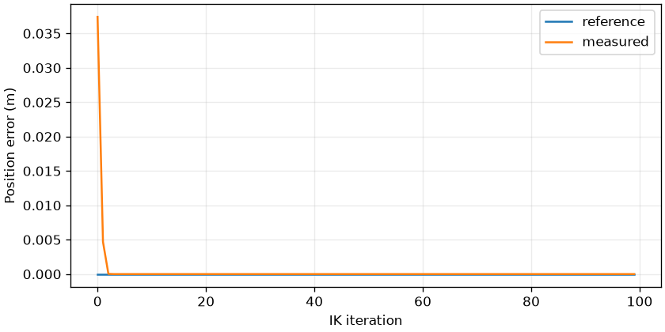

<!-- pal:language:start -->
<p align="right">
  <a href="../../ko/lessons/core-fr3-04.md" lang="ko">한국어</a> | <a href="core-fr3-04.md" lang="en">ENGLISH</a>
</p>
<!-- pal:language:end -->

# core-fr3-04 — FR3 kinematics, Jacobian, and inverse kinematics

<!-- pal:metadata:start -->
| Field | Value |
|---|---|
| Stage / track | `core / fr3` |
| Legacy alias | `T08` |
| Platforms | `macos-arm64, linux-x86_64` |
| Capabilities | `python-3.12, numpy, mujoco` |
| Prerequisites | `core-fr3-03` |
| Safety | `simulation` |
| Verification | `maintainer-checked` |
| Implementation | `implemented` |
<!-- pal:metadata:end -->

## Reader route

Read the Expected result first. Your task is to connect the measured values to the learning goal, then explain the calculation and the code that produced them.

[Terminal setup, resuming, opening results and camera controls](../READER_GUIDE.md)

Read the [kinematics chapter](../concepts/kinematics.md) for frames and Jacobians. First predict which world-frame direction the end effector moves when one joint moves a little; then compare two ways of calculating that motion.

## Learning goals

Check a geometric Jacobian and solve a small IK displacement.

## Preflight

Device setup and manual references: [Franka Research 3](../setup/fr3.md).

On a fresh checkout, run `sh bootstrap.sh --plan`, read the plan, then use `--apply`. Activate `source .venv/bin/activate` before these commands. If the run directory already exists, use a new suffix such as 02.

Prepare the required public models once:

```bash
pal assets fetch mujoco-menagerie
```

```bash
pal host detect --json
pal lesson check core-fr3-04 --json
```

## Action

```bash
pal lesson run core-fr3-04 --headless --seed 7 --samples 64 --output-dir .local/runs/core-fr3-04/baseline-01 --json
```

## Expected

Measured development example. Read both axis units and the reference/measured difference first. Validate your own run separately.



Compare analytic and finite_difference arrays. Maximum disagreement must be below 1e-6; IK residual must be below 1 mm for the fixed 3D target offset.

Common artifacts are summary.json, trace.csv, experiment.json, plot.png, run.json and lesson-report.md. Model lessons also produce frame.png or the external stack's evaluation/Isaac image. Inspect axes, units and camera framing, not only file size.

```bash
pal lesson check core-fr3-04 --run-dir .local/runs/core-fr3-04/baseline-01 --json
```

## Observe

Read the metric units, observed_first/observed_last and checks first. Inspection validates saved files, exits, and leaves completion unchanged.

```bash
pal lesson inspect core-fr3-04 --run-dir .local/runs/core-fr3-04/baseline-01 --json
```

Open the plot on macOS (closing the image preserves the run):

```bash
open .local/runs/core-fr3-04/baseline-01/plot.png
```

On other systems, open the same PNG in your file manager. Read the raw values from this JSON:

```bash
python -m json.tool .local/runs/core-fr3-04/baseline-01/experiment.json
```

## How it works

Each column of J maps one joint's angular velocity into tool linear velocity. Central finite differences independently approximate those columns. Damped least squares limits the effect of near-singular directions and clips joint increments.

$$
\Delta q=J^T(JJ^T+\lambda I)^{-1}\Delta x
$$

Symbols, units and assumptions: J: 3×nv translational Jacobian; x: world m; q: rad; λ regularizes JJᵀ.

Worked calculation (not a measured run result): J=0.5 m/rad, Δx=0.01 m, λ=0.0001 (m/rad)² → Δq≈0.019992 rad.

Practical connection: Near singularities a small Cartesian request can require large joint motion.

### The position function and its derivative

Forward kinematics $x=f(q)$ maps a length-7 joint array(rad) into a length-3 end-effector position array(m). Here $x$ is `site_xpos[0]`, expressed in the world frame. This lesson does not solve full end-effector orientation or tool-frame velocity. Column $j$ of the translational Jacobian $J\in\mathbb{R}^{3\times7}$ is $\partial x/\partial q_j$, with units m/rad.

Central differences hold other joints fixed while perturbing $q_j$ in both directions.

$$
J_{:,j}^{FD}=\frac{f(q+\epsilon e_j)-f(q-\epsilon e_j)}{2\epsilon},\qquad \epsilon=10^{-6}\ \mathrm{rad}.
$$

Here $e_j$ is a length-7 vector with only component $j$ equal to 1. An overly large interval includes curvature effects; an overly small interval amplifies floating-point subtraction error. Smaller is not always more accurate.

### IK takes repeated local solves

Recompute the current position error $\Delta x$ after each update. The implementation uses regularization coefficient $\lambda=10^{-4}$, rather than $\lambda^2$ in this notation. $JJ^T+\lambda I$ is 3×3, its solved vector has length 3, and the resulting $\Delta q$ has length 7. Each component of the increment is clipped to ±0.08 rad, then joint positions are limited to their ranges. This numerical IK reduces position residual; it does not perform collision avoidance, force control or physical path validation.

## Code connection

Read [`run.py`](../../../examples/core-fr3-04/run.py) → [`runner.py`](../../../src/pai_lab/lessons/runner.py) → `jacobian`, `inverse_kinematics` and the selected `run` branch in [`physics.py`](../../../src/pai_lab/lessons/physics.py).

The code independently computes an analytic array with `mj_jacSite` and an array from actual ±ε joint perturbations. Both describe the original configuration, restored after the difference calculation. IK starts there and makes 100 updates toward a fixed offset of `[0.03, 0.02, 0.01]` m. Finite-difference ε is not passed into IK, so changing ε can leave the IK residual curve unchanged.

### Arrays and axes to inspect

In `jacobian.json` or `experiment.json`'s payload, `analytic` and `finite_difference` are 3×7 arrays. `jacobian_max_error` is the largest absolute component difference(m/rad), while `ik_errors_m` contains 100 position residuals(m). The first `trace.csv` column is the IK iteration index, not elapsed seconds. The observed curve in `plot.png` shows those residuals. Its zero reference line is the desired residual, not another controller execution.

## Try it

Central-difference step: ε 10⁻⁶ → 2×10⁻⁶ rad. The IK target remains fixed. J has units m/rad, Δq rad and Δx m.

```bash
pal lesson run core-fr3-04 --headless --seed 7 --samples 64 --output-dir .local/runs/core-fr3-04/comparison-01 --variant 2 --json
```

Change only the indicated seed, sample count or variant. Explain differences in measurements, shape and limits. If results are invariant, explain why; do not invent a performance improvement.

```bash
pal lesson compare core-fr3-04 --run-dir .local/runs/core-fr3-04/baseline-01 --comparison-run-dir .local/runs/core-fr3-04/comparison-01 --output-dir .local/comparisons/core-fr3-04/comparison-01 --json
```

<details>
<summary>Optional: what changes when the assumptions fail?</summary>

Choose one input in the equation and write its units. Inspect whether doubling it doubles the output or whether clipping, normalization or coordinate transforms change that relationship. Changing another assumption or model at the same time needs a separate experiment.

</details>

### Predict before comparing

In this branch, `--variant 2` changes only ε to 2×10⁻⁶ rad. `jacobian_max_error` can change while the IK target, regularization and iteration count stay fixed. Identical plots may show the separation between the calculations rather than a failed experiment. The [historical verification](../../verification/reader-experience.md) records an IK residual near 1.387779×10⁻¹⁶ m for both conditions. That historical value is not a required exact result for today's run.

## Recovery

For capability-unavailable, prepare exactly the reported Python, model, platform or external stack, then rerun this lesson in a new directory. Preserve the failed run.json and numerical evidence. Do not automatically install system packages, drivers, CUDA, ROS, Isaac or large models. Resolve checksum errors by restoring a pinned cache, never by editing vendor sources.

## Checkpoint

Replace `--notes` with the concrete measurements and interpretation you observed before running this command. Save, fix and reverify received feedback first. Unresolved feedback, changed execution code or corrupt artifacts block completion. Execution alone does not complete the lesson. Stop after finishing this lesson.

```bash
pal lesson review core-fr3-04 --run-dir .local/runs/core-fr3-04/baseline-01 --comparison-run-dir .local/runs/core-fr3-04/comparison-01 --notes "Explained measured results and one-variable comparison; inspected plots and renderings." --json
pal lesson finish core-fr3-04 --run-dir .local/runs/core-fr3-04/baseline-01 --json
```

### Check your understanding

1. What do the second row and third column of the 3×7 array mean?
2. Why is multiplying by $J^T$ alone different from solving the regularized system?
3. If the Jacobian difference changes with ε but the IK curve does not, which code connection explains that result?

State the frame, m/rad units, `analytic` array shape and final position residual.

Answer guide: Row two is world-y displacement and column three describes the third joint's infinitesimal rotation. The regularized solve accounts for axis scaling and coupling. Epsilon is used only in the verification difference, so IK can produce the same residual from the same target and Jacobian function.

<!-- pal:navigation:start -->
## Next lesson

[core-fr3-05](./core-fr3-05.md)

This is catalog order. Use `pal course next --json` to select an eligible lesson.
<!-- pal:navigation:end -->
