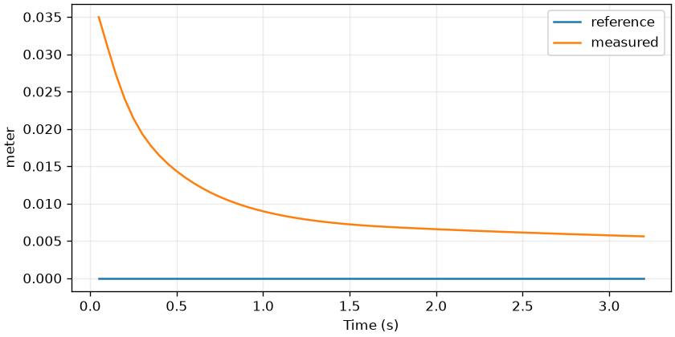

<!-- pal:language:start -->
<p align="right">
  <a href="../../ko/lessons/core-fr3-05.md" lang="ko">한국어</a> | <a href="core-fr3-05.md" lang="en">ENGLISH</a>
</p>
<!-- pal:language:end -->

# core-fr3-05 — FR3 operational-space control

<!-- pal:metadata:start -->
| Field | Value |
|---|---|
| Stage / track | `core / fr3` |
| Legacy alias | `T09` |
| Platforms | `macos-arm64, linux-x86_64` |
| Capabilities | `python-3.12, numpy, mujoco` |
| Prerequisites | `core-fr3-04` |
| Safety | `simulation` |
| Verification | `maintainer-checked` |
| Implementation | `implemented` |
<!-- pal:metadata:end -->

## Reader route

Read the Expected result first. Your task is to connect the measured values to the learning goal, then explain the calculation and the code that produced them.

[Terminal setup, resuming, opening results and camera controls](../READER_GUIDE.md)

Read the [control-contact concept chapter](../concepts/control-contact.md), then locate this lesson in the [equipment progression](../equipment-stages.md).

## Learning goals

Control a world-frame tool position using operational inertia.

## Preflight

Device setup and manual references: [Franka Research 3](../setup/fr3.md).

On a fresh checkout, run `sh bootstrap.sh --plan`, read the plan, then use `--apply`. Activate `source .venv/bin/activate` before these commands. If the run directory already exists, use a new suffix such as 02.

Prepare the required public models once:

```bash
pal assets fetch mujoco-menagerie
```

```bash
pal host detect --json
pal lesson check core-fr3-05 --json
```

## Action

```bash
pal lesson run core-fr3-05 --headless --seed 7 --samples 64 --output-dir .local/runs/core-fr3-05/baseline-01 --json
```

## Expected

Measured development example. Read both axis units and the reference/measured difference first. Validate your own run separately.



The target offset is (0.03, 0.02, 0.01) m. Read the error trace and joint torques. Final position error must be under 0.04 m and all states finite.

Common artifacts are summary.json, trace.csv, experiment.json, plot.png, run.json and lesson-report.md. Model lessons also produce frame.png or the external stack's evaluation/Isaac image. Inspect axes, units and camera framing, not only file size.

```bash
pal lesson check core-fr3-05 --run-dir .local/runs/core-fr3-05/baseline-01 --json
```

## Observe

Read the metric units, observed_first/observed_last and checks first. Inspection validates saved files, exits, and leaves completion unchanged.

```bash
pal lesson inspect core-fr3-05 --run-dir .local/runs/core-fr3-05/baseline-01 --json
```

Open the plot on macOS (closing the image preserves the run):

```bash
open .local/runs/core-fr3-05/baseline-01/plot.png
```

On other systems, open the same PNG in your file manager. Read the raw values from this JSON:

```bash
python -m json.tool .local/runs/core-fr3-05/baseline-01/experiment.json
```

## How it works

The mass matrix M couples joint accelerations. Operational inertia Λ converts Cartesian acceleration into force; Jᵀ maps that force back to joint torque. This experiment controls translation only, not the complete six-dimensional pose.

$$
\Lambda=(JM^{-1}J^T+\lambda I)^{-1},\qquad\tau=J^T\Lambda a+c+g
$$

Symbols, units and assumptions: Λ: effective kg; a: m/s²; J: m/rad; damping regularization λ has inverse-mass units.

Worked calculation (not a measured run result): 2 kg × 0.1 m/s² = 0.2 N; 0.5 m/rad × 0.2 N = 0.1 Nm.

Practical connection: This translation-only controller omits full orientation and exact Jdot compensation.

### From input to observation

Moving the tool in a Cartesian direction requires coordinated joint motion. J is 3×7 and M is 7×7, so JM⁻¹Jᵀ is 3×3. Its regularized inverse describes effective mass for the requested acceleration. The lesson controls three translation axes, not three orientation axes.

## Code connection

`examples/core-fr3-05/run.py` → `src/pai_lab/lessons/runner.py` → `src/pai_lab/lessons/physics.py`. The runner records the execution; the experiment module computes measurements from actual state. Match `experiment.json` payload fields to the corresponding calculations.

### Read the actual producer and artifacts

Compare [`physics.py`](../../../src/pai_lab/lessons/physics.py) with dispatch in [`runner.py`](../../../src/pai_lab/lessons/runner.py).

The task branch of `physics.arm_control` computes force toward world offset [0.03,0.02,0.01] m, then uses `jac.T @ force + data.qfrc_bias - 2 * data.qvel`. The compact equation above omits this last joint-velocity damping term; its coefficient 2 has units Nm s/rad. Final torque is clipped to joint-model limits. `task-space-response.csv` and `payload.final_error` report position error(m), while `torque_nm` holds joint torques.

## Try it

Cartesian acceleration gain: 120 → 180 s⁻²; damping follows 2√gain. M is kg·m², Λ kg, force N and torque Nm.

```bash
pal lesson run core-fr3-05 --headless --seed 7 --samples 64 --output-dir .local/runs/core-fr3-05/comparison-01 --variant 1.5 --json
```

Change only the indicated seed, sample count or variant. Explain differences in measurements, shape and limits. If results are invariant, explain why; do not invent a performance improvement.

```bash
pal lesson compare core-fr3-05 --run-dir .local/runs/core-fr3-05/baseline-01 --comparison-run-dir .local/runs/core-fr3-05/comparison-01 --output-dir .local/comparisons/core-fr3-05/comparison-01 --json
```

<details>
<summary>Optional: what changes when the assumptions fail?</summary>

Choose one input in the equation and write its units. Inspect whether doubling it doubles the output or whether clipping, normalization or coordinate transforms change that relationship. Changing another assumption or model at the same time needs a separate experiment.

</details>

### Predict before changing a value

variant 1.5 changes acceleration gain 120→180 s⁻² and its 2√gain damping together. Saturation and dynamics prevent predicting error as simply divided by 1.5. Compare a first-step calculation with the actual trace to explain that limit.

## Recovery

For capability-unavailable, prepare exactly the reported Python, model, platform or external stack, then rerun this lesson in a new directory. Preserve the failed run.json and numerical evidence. Do not automatically install system packages, drivers, CUDA, ROS, Isaac or large models. Resolve checksum errors by restoring a pinned cache, never by editing vendor sources.

## Checkpoint

Replace `--notes` with the concrete measurements and interpretation you observed before running this command. Save, fix and reverify received feedback first. Unresolved feedback, changed execution code or corrupt artifacts block completion. Execution alone does not complete the lesson. Stop after finishing this lesson.

```bash
pal lesson review core-fr3-05 --run-dir .local/runs/core-fr3-05/baseline-01 --comparison-run-dir .local/runs/core-fr3-05/comparison-01 --notes "Explained measured results and one-variable comparison; inspected plots and renderings." --json
pal lesson finish core-fr3-05 --run-dir .local/runs/core-fr3-05/baseline-01 --json
```

### Check understanding and answer guide

Question: What does Jᵀ map? Answer: World translational force(N) into joint torque(Nm). Question: Does metric name pose_error mean full-pose control? Answer: Here it measures position only. Separate position error, joint torque and damping in your report.

<!-- pal:navigation:start -->
## Next lesson

[core-fr3-06](./core-fr3-06.md)

This is catalog order. Use `pal course next --json` to select an eligible lesson.
<!-- pal:navigation:end -->
