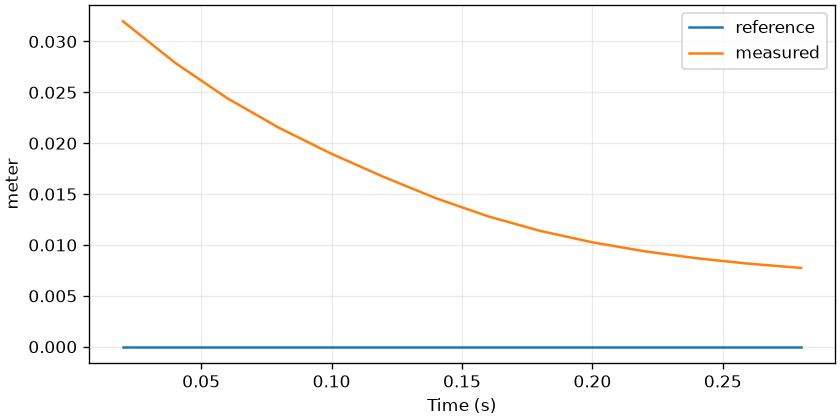

<!-- pal:language:start -->
<p align="right">
  <a href="../../ko/lessons/core-fr3-07.md" lang="ko">한국어</a> | <a href="core-fr3-07.md" lang="en">ENGLISH</a>
</p>
<!-- pal:language:end -->

# core-fr3-07 — FR3 reach environment without ROS

<!-- pal:metadata:start -->
| Field | Value |
|---|---|
| Stage / track | `core / fr3` |
| Legacy alias | `T22` |
| Platforms | `macos-arm64, linux-x86_64` |
| Capabilities | `python-3.12, numpy, mujoco` |
| Prerequisites | `core-fr3-04` |
| Safety | `simulation` |
| Verification | `maintainer-checked` |
| Implementation | `implemented` |
<!-- pal:metadata:end -->

## Reader route

Read the Expected result first. Your task is to connect the measured values to the learning goal, then explain the calculation and the code that produced them.

[Terminal setup, resuming, opening results and camera controls](../READER_GUIDE.md)

Read the [reinforcement-learning concept chapter](../concepts/reinforcement-learning.md), then locate this lesson in the [equipment progression](../equipment-stages.md).

## Learning goals

Use reset, observation, action, reward and episode boundaries for FR3 reach.

## Preflight

Device setup and manual references: [Franka Research 3](../setup/fr3.md).

On a fresh checkout, run `sh bootstrap.sh --plan`, read the plan, then use `--apply`. Activate `source .venv/bin/activate` before these commands. If the run directory already exists, use a new suffix such as 02.

Prepare the required public models once:

```bash
pal assets fetch mujoco-menagerie
```

```bash
pal host detect --json
pal lesson check core-fr3-07 --json
```

## Action

```bash
pal lesson run core-fr3-07 --headless --seed 7 --samples 64 --output-dir .local/runs/core-fr3-07/baseline-01 --json
```

## Expected

Measured development example. Read both axis units and the reference/measured difference first. Validate your own run separately.



Inspect every transition in transitions.json. The baseline Jacobian controller should reduce distance; count steps and distinguish success from timeout.

Common artifacts are summary.json, trace.csv, experiment.json, plot.png, run.json and lesson-report.md. Model lessons also produce frame.png or the external stack's evaluation/Isaac image. Inspect axes, units and camera framing, not only file size.

```bash
pal lesson check core-fr3-07 --run-dir .local/runs/core-fr3-07/baseline-01 --json
```

## Observe

Read the metric units, observed_first/observed_last and checks first. Inspection validates saved files, exits, and leaves completion unchanged.

```bash
pal lesson inspect core-fr3-07 --run-dir .local/runs/core-fr3-07/baseline-01 --json
```

Open the plot on macOS (closing the image preserves the run):

```bash
open .local/runs/core-fr3-07/baseline-01/plot.png
```

On other systems, open the same PNG in your file manager. Read the raw values from this JSON:

```bash
python -m json.tool .local/runs/core-fr3-07/baseline-01/experiment.json
```

## How it works

The observation concatenates seven position offsets, seven scaled velocities and three world-target errors. Seven bounded actions adjust joint position targets. A successful reach terminates; the 64-step time limit truncates. These meanings matter to later PPO bootstrapping.

$$
o=[q-q_0,\;0.1\dot q,\;10(x^*-x)]\in\mathbb R^{17}
$$

Symbols, units and assumptions: q: rad; qdot: rad/s; x: world m; 0.1 and 10: component-specific numerical scales.

Worked calculation (not a measured run result): 7 + 7 + 3 = 17.

Practical connection: Termination and time-limit truncation need different value bootstrapping.

### From input to observation

An RL environment defines state, action, reward and episode endings together. Here the observation is [q-qhome,0.1qdot,10(x*-x)] of length 17; latent action has length 7. q uses rad, qdot rad/s and position error world-frame m, with numerical scales embedded in the input.

## Code connection

`examples/core-fr3-07/run.py` → `src/pai_lab/lessons/runner.py` → `src/pai_lab/lessons/learning.py`. The runner records the execution; the experiment module computes measurements from actual state. Match `experiment.json` payload fields to the corresponding calculations.

### Read the actual producer and artifacts

Compare [`learning.py`](../../../src/pai_lab/lessons/learning.py) with dispatch in [`runner.py`](../../../src/pai_lab/lessons/runner.py).

The actual runner dispatches this ID to `learning.run`. `Reach` clips target q+0.03 tanh(action) and integrates 10 times; a scripted Jacobian controller converts its command into latent action using arctanh. In `transitions.json`, observation/action precede integration and next_observation follows it. Holding within 10 mm for 10 steps terminates; reaching 64 steps truncates. The distance-reduced check alone does not prove the success-hold condition.

## Try it

Scripted action scale: 1 → 1.5 before bounded latent-action conversion. Check the 17-observation/7-action contract and termination.

```bash
pal lesson run core-fr3-07 --headless --seed 7 --samples 64 --output-dir .local/runs/core-fr3-07/comparison-01 --variant 1.5 --json
```

Change only the indicated seed, sample count or variant. Explain differences in measurements, shape and limits. If results are invariant, explain why; do not invent a performance improvement.

```bash
pal lesson compare core-fr3-07 --run-dir .local/runs/core-fr3-07/baseline-01 --comparison-run-dir .local/runs/core-fr3-07/comparison-01 --output-dir .local/comparisons/core-fr3-07/comparison-01 --json
```

<details>
<summary>Optional: what changes when the assumptions fail?</summary>

Choose one input in the equation and write its units. Inspect whether doubling it doubles the output or whether clipping, normalization or coordinate transforms change that relationship. Changing another assumption or model at the same time needs a separate experiment.

</details>

### Predict before changing a value

variant 1.5 scales the command before clipping to [-0.9,0.9] and arctanh. For example, pre-limit 0.8 becomes 1.2 and is clipped to 0.9(calculation). Target increments may therefore not scale by 1.5; compare end flags alongside terminal distance.

## Recovery

For capability-unavailable, prepare exactly the reported Python, model, platform or external stack, then rerun this lesson in a new directory. Preserve the failed run.json and numerical evidence. Do not automatically install system packages, drivers, CUDA, ROS, Isaac or large models. Resolve checksum errors by restoring a pinned cache, never by editing vendor sources.

## Checkpoint

Replace `--notes` with the concrete measurements and interpretation you observed before running this command. Save, fix and reverify received feedback first. Unresolved feedback, changed execution code or corrupt artifacts block completion. Execution alone does not complete the lesson. Stop after finishing this lesson.

```bash
pal lesson review core-fr3-07 --run-dir .local/runs/core-fr3-07/baseline-01 --comparison-run-dir .local/runs/core-fr3-07/comparison-01 --notes "Explained measured results and one-variable comparison; inspected plots and renderings." --json
pal lesson finish core-fr3-07 --run-dir .local/runs/core-fr3-07/baseline-01 --json
```

### Check understanding and answer guide

Question: Are the last 3 observation values raw m? Answer: They are errors scaled by 10. Question: Is timeout success? Answer: Distinguish truncated from terminated. Explain why PPO value bootstrapping needs that distinction.

<!-- pal:navigation:start -->
## Next lesson

[core-fr3-08](./core-fr3-08.md)

This is catalog order. Use `pal course next --json` to select an eligible lesson.
<!-- pal:navigation:end -->
