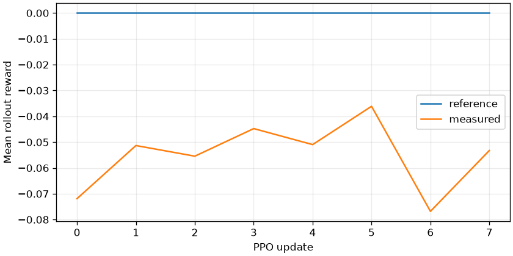

<!-- pal:language:start -->
<p align="right">
  <a href="../../ko/lessons/core-fr3-08.md" lang="ko">한국어</a> | <a href="core-fr3-08.md" lang="en">ENGLISH</a>
</p>
<!-- pal:language:end -->

# core-fr3-08 — PPO on FR3 reach

<!-- pal:metadata:start -->
| Field | Value |
|---|---|
| Stage / track | `core / fr3` |
| Legacy alias | `T24` |
| Platforms | `macos-arm64, linux-x86_64` |
| Capabilities | `python-3.12, numpy, mujoco` |
| Prerequisites | `core-fr3-07, core-rl-01` |
| Safety | `simulation` |
| Verification | `maintainer-checked` |
| Implementation | `implemented` |
<!-- pal:metadata:end -->

## Reader route

Read the Expected result first. Your task is to connect the measured values to the learning goal, then explain the calculation and the code that produced them.

[Terminal setup, resuming, opening results and camera controls](../READER_GUIDE.md)

Read the [reinforcement learning chapter](../concepts/reinforcement-learning.md). Separate “the weights changed” from “the policy reliably reaches new targets.” This lesson connects a short training and serialization path with independent evaluation.

## Learning goals

Train, save and reload PPO on the actual FR3 reach environment.

## Preflight

Device setup and manual references: [Franka Research 3](../setup/fr3.md).

On a fresh checkout, run `sh bootstrap.sh --plan`, read the plan, then use `--apply`. Activate `source .venv/bin/activate` before these commands. If the run directory already exists, use a new suffix such as 02.

Prepare the required public models once:

```bash
pal assets fetch mujoco-menagerie
```

```bash
pal host detect --json
pal lesson check core-fr3-08 --json
```

## Action

```bash
pal lesson run core-fr3-08 --headless --seed 7 --samples 64 --output-dir .local/runs/core-fr3-08/baseline-01 --json
```

## Expected

Reviewed maintainer example from the pinned public model; your local run must be checked separately.



Inspect policy-contract.json, parameter change and rollout rewards. Compare learning rate only. Rewards may fluctuate; keep performance_verified false until a separate evaluation establishes a threshold.

Common artifacts are summary.json, trace.csv, experiment.json, plot.png, run.json and lesson-report.md. Model lessons also produce frame.png or the external stack's evaluation/Isaac image. Inspect axes, units and camera framing, not only file size.

```bash
pal lesson check core-fr3-08 --run-dir .local/runs/core-fr3-08/baseline-01 --json
```

## Observe

`evaluation.json` records independent twenty-target performance: ten consecutive control steps within 10 mm, with a 16/20 gate. Fewer successes mean performance failure even if optimizer checks pass. This is not a hardware tolerance.

Read the metric units, observed_first/observed_last and checks first. Inspection validates saved files, exits, and leaves completion unchanged.

```bash
pal lesson inspect core-fr3-08 --run-dir .local/runs/core-fr3-08/baseline-01 --json
```

Open the plot on macOS (closing the image preserves the run):

```bash
open .local/runs/core-fr3-08/baseline-01/plot.png
```

On other systems, open the same PNG in your file manager. Read the raw values from this JSON:

```bash
python -m json.tool .local/runs/core-fr3-08/baseline-01/experiment.json
```

## How it works

### Observation, latent action and joint target

The policy receives $o=[q-q_{home},\;0.1\dot q,\;10(x^*-x)]$, a length-17 array in this order. The first 7 values are joint displacements(rad), the next 7 are velocities(rad/s) multiplied by numerical scale 0.1, and the last 3 are world-frame position errors(m) multiplied by 10. These scales define the numerical input convention; distinguish them from the original sensor units.

Clip each component to [-5, 5] and append bias 1 to form length-18 input $z$. The weights $W$ are 18×7. Training samples Gaussian latent action $u$, and the environment applies tanh.

$$
\mu=zW,\qquad u\sim\mathcal N(\mu,0.3^2I_7),\qquad
q^*=\operatorname{clip}(q+0.03\tanh u,\;q_{min},q_{max}).
$$

$u$ and $\tanh u$ are normalized actions; 0.03 has units rad. Worked calculation, not a measured result: if one component of $\tanh u$ is 0.5, its target increment is 0.015 rad. Evaluation uses $u=\mu$ without added noise, with the same transform and joint limits.

### Separate learning checks from performance checks

PPO uses GAE advantages and a surrogate objective clipping the probability ratio to [0.8, 1.2]. With `--samples 64`, there are 8 updates, each collecting 128 transitions and applying 4 actor updates. Here samples is not the total number of collected transitions. Neither the objective nor the reward curve must improve monotonically.

The environment reward is $r=-\|x^*-x\|_2-0.001\sum_j u_j^2$. This numerical teaching reward combines distance and action cost; it is not a measurement of force or energy. Better reward can still accompany failure to hold a new target long enough.

## Code connection

Connect `Reach.observation`, `Reach.step` and `ppo` in [`learning.py`](../../../src/pai_lab/lessons/learning.py) with the actual [`runner.py`](../../../src/pai_lab/lessons/runner.py) dispatch. `Reach.step` sets joint targets and performs 10 MuJoCo integration steps. `ppo` saves `policy.npz`, reloads it and checks array equality.

[`arm.evaluate`](../../../src/pai_lab/lessons/arm.py) generates 20 new targets with evaluation seed 10007. This `Reach` environment truncates an episode at 64 control steps; the evaluation loop's maximum of 160 iterations does not mean this lesson runs 160-step episodes. Holding within 10 mm for 10 consecutive steps succeeds on one target; at least 16/20 targets must succeed for `performance_verified=true`. This is a simulation performance gate, not a hardware tolerance.

### Each artifact answers a different question

| Artifact | What to inspect |
|---|---|
| `experiment.json` | Positive `parameter_delta`, zero `reload_max_error`, and reward/clip fraction in `updates` |
| `policy.npz` | 18×7 `weights`, length-18 `value_weights`, latent-action standard deviation `sigma` |
| `policy-contract.json` | Observation 17, action 7, tanh, `training_scope=optimizer-smoke`, performance result |
| `evaluation.json` | Per-target errors and `success`, aggregate `successes`, `hold_steps`, `hardware_tolerance=false` |

Observation order and scales 0.1/10 are implementation conventions read here. The current `policy-contract.json` does not encode every component's scale, so that file alone does not establish a complete independent deployment contract.

## Try it

Actor gradient step size: 0.01 → 0.015 with the same reach environment. A reward difference in this short run does not establish policy quality.

```bash
pal lesson run core-fr3-08 --headless --seed 7 --samples 64 --output-dir .local/runs/core-fr3-08/comparison-01 --variant 1.5 --json
```

Change only the indicated seed, sample count or variant. Explain differences in measurements, shape and limits. If results are invariant, explain why; do not invent a performance improvement.

```bash
pal lesson compare core-fr3-08 --run-dir .local/runs/core-fr3-08/baseline-01 --comparison-run-dir .local/runs/core-fr3-08/comparison-01 --output-dir .local/comparisons/core-fr3-08/comparison-01 --json
```

<details>
<summary>Optional: what changes when the assumptions fail?</summary>

Choose one input in the equation and write its units. Inspect whether doubling it doubles the output or whether clipping, normalization or coordinate transforms change that relationship. Changing another assumption or model at the same time needs a separate experiment.

</details>

### Report results in order

`--variant 1.5` changes the actor learning rate in `weights += 0.01 * variant * gradient` to 0.015. Target range, σ and evaluation seed stay fixed. Inspect parameter change and reload equality first, training rewards second, and independent evaluation successes last. One pair with a shared seed cannot establish a general performance improvement.

## Recovery

For capability-unavailable, prepare exactly the reported Python, model, platform or external stack, then rerun this lesson in a new directory. Preserve the failed run.json and numerical evidence. Do not automatically install system packages, drivers, CUDA, ROS, Isaac or large models. Resolve checksum errors by restoring a pinned cache, never by editing vendor sources.

## Checkpoint

Replace `--notes` with the concrete measurements and interpretation you observed before running this command. Save, fix and reverify received feedback first. Unresolved feedback, changed execution code or corrupt artifacts block completion. Execution alone does not complete the lesson. Stop after finishing this lesson.

```bash
pal lesson review core-fr3-08 --run-dir .local/runs/core-fr3-08/baseline-01 --comparison-run-dir .local/runs/core-fr3-08/comparison-01 --notes "Explained measured results and one-variable comparison; inspected plots and renderings." --json
pal lesson finish core-fr3-08 --run-dir .local/runs/core-fr3-08/baseline-01 --json
```

### Check your understanding

1. How do latent action u and joint target q* differ in shape, units and transformation?
2. Why can `parameters_updated=true`, `reload_exact=true` and `performance_verified=false` all be correct?
3. Why do 15/20 successes or only 9 consecutive steps within 10 mm fail this gate?

Report update count, weight change, reload error and independent successes separately. A short training execution is not a solved policy or readiness for physical operation.

Answer guide: The latent action is a normalized length-7 array transformed by tanh, the 0.03 rad scale and joint limits into a target. Weight updates and exact reload verify execution; 16/20 successes and 10 consecutive steps define a separate performance gate. Missing either criterion leaves performance false.

<!-- pal:navigation:start -->
## Next lesson

[core-enlight-01](./core-enlight-01.md)

This is catalog order. Use `pal course next --json` to select an eligible lesson.
<!-- pal:navigation:end -->
