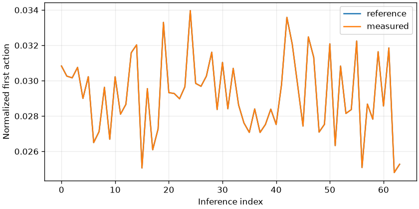

<!-- pal:language:start -->
<p align="right">
  <a href="../../ko/lessons/hw-common-01.md" lang="ko">한국어</a> | <a href="hw-common-01.md" lang="en">ENGLISH</a>
</p>
<!-- pal:language:end -->

# hw-common-01 — Runtime bootstrap, offline replay, and command sink

<!-- pal:metadata:start -->
| Field | Value |
|---|---|
| Stage / track | `hardware / common` |
| Legacy alias | `T35B` |
| Platforms | `macos-arm64, linux-x86_64` |
| Capabilities | `python-3.12` |
| Prerequisites | `sim-deploy-01` |
| Safety | `offline` |
| Verification | `maintainer-checked` |
| Implementation | `implemented` |
<!-- pal:metadata:end -->

## Reader route

Read the Expected result first. Your task is to connect the measured values to the learning goal, then explain the calculation and the code that produced them.

[Terminal setup, resuming, opening results and camera controls](../READER_GUIDE.md)

Read the prerequisite [concept chapter](../concepts/deployment-hardware.md) and [equipment progression](../equipment-stages.md). This lesson addresses: How does a command sink prove receipt without physical output?

## Learning goals

An inference sink exercises a policy while making the output boundary visible.

How does a command sink prove receipt without physical output?

## Preflight

On a fresh checkout, run `sh bootstrap.sh --plan`, read the plan, then use `--apply`. Activate `source .venv/bin/activate` before these commands. If the run directory already exists, use a new suffix such as 02.

```bash
pal host detect --json
pal lesson check hw-common-01 --json
```

## Action

Activate the prepared environment and use a fresh output directory. Preserve the returned run path; execution does not mark completion.

```bash
pal lesson run hw-common-01 --headless --seed 7 --samples 64 --output-dir .local/runs/hw-common-01/baseline-01 --json
```

## Expected

Measured development example. Read both axis units and the reference/measured difference first. Validate your own run separately.



Inspect inference.json action arrays, replay equality, inference_count and emitted_command_count=0. This portable offline lesson grants no live-hardware approval.

Common artifacts are summary.json, trace.csv, experiment.json, plot.png, run.json and lesson-report.md. Model lessons also produce frame.png or the external stack's evaluation/Isaac image. Inspect axes, units and camera framing, not only file size.

```bash
pal lesson check hw-common-01 --run-dir .local/runs/hw-common-01/baseline-01 --json
```

## Observe

Read the metric units, observed_first/observed_last and checks first. Inspection validates saved files, exits, and leaves completion unchanged.

```bash
pal lesson inspect hw-common-01 --run-dir .local/runs/hw-common-01/baseline-01 --json
```

Open the plot on macOS (closing the image preserves the run):

```bash
open .local/runs/hw-common-01/baseline-01/plot.png
```

On other systems, open the same PNG in your file manager. Read the raw values from this JSON:

```bash
python -m json.tool .local/runs/hw-common-01/baseline-01/experiment.json
```

### Reading the artifacts

Inspect `inference.json` arrays `actions` and `replay`, and `experiment.json` → `payload`: `command_sink=enabled`, `emitted_command_count=0`, `inference_count`, `manifest_sha256`, `replay_exact`. The metric is deliberately zero physical commands; inspect nonempty inference separately so an empty loop cannot masquerade as evidence.

## How it works

### Intuition

An inference sink exercises a policy while making the output boundary visible. This path loads the validated candidate and evaluates each saved observation twice. It appends action arrays to memory and saves them; there is intentionally no publisher, socket, SDK or hardware callback. It is the implemented offline exception within the hardware stage.

### Calculation and units

$$
e_{replay}=\max_{i,j}|a^{first}_{ij}-a^{replay}_{ij}|
$$

The two arrays have shape (test vectors, 7) and normalized action units. Equal deterministic inference gives zero discrepancy; that does not mean actions themselves are all zero. Worked calculation, not runtime output: [0.2,-0.1] compared with itself gives discrepancy zero.

```python
import numpy as np
a = np.array([0.2, -0.1])
assert np.max(np.abs(a - a.copy())) == 0.0
```

## Code connection

### Source trace

[`src/pai_lab/lessons/deployment.py`](https://github.com/terryum/tutorial-robotics/blob/main/src/pai_lab/lessons/deployment.py)

`examples/hw-common-01/run.py` delegates to the common runner, which checks catalog implementation and capabilities before dispatch. The source above computes the quantities described here; metadata filenames do not establish the calculation by themselves.

## Try it

### Controlled comparison

Keep the saved bundle fixed and change only the documented CLI input. This producer replays its manifest test vectors and ignores `variant`, seed and `samples`; exact invariance is expected. A different vector set must be created upstream as a new candidate, not silently edited in a hashed bundle.

```bash
pal lesson run hw-common-01 --headless --seed 8 --samples 64 --output-dir .local/runs/hw-common-01/comparison-01 --json
pal lesson check hw-common-01 --run-dir .local/runs/hw-common-01/baseline-01 --json
pal lesson check hw-common-01 --run-dir .local/runs/hw-common-01/comparison-01 --json
pal lesson compare hw-common-01 --run-dir .local/runs/hw-common-01/baseline-01 --comparison-run-dir .local/runs/hw-common-01/comparison-01 --output-dir .local/comparisons/hw-common-01/comparison-01 --json
```

## Recovery

For capability-unavailable, prepare exactly the reported Python, model, platform or external stack, then rerun this lesson in a new directory. Preserve the failed run.json and numerical evidence. Do not automatically install system packages, drivers, CUDA, ROS, Isaac or large models. Resolve checksum errors by restoring a pinned cache, never by editing vendor sources.

## Checkpoint

### Check understanding

How can inference be nonzero while emitted commands remain zero? The sink calculates numbers but has no physical output path. Does this test verify a robot's stop circuit? No.

Inspect actual values, axes and images from both runs. Replace the notes below with measured values and your interpretation, resolve feedback, then review/finish one lesson. Missing capability remains unavailable; a publication badge is not your local completion.

```bash
pal lesson review hw-common-01 --run-dir .local/runs/hw-common-01/baseline-01 --comparison-run-dir .local/runs/hw-common-01/comparison-01 --notes "REPLACE with actual measured values and interpretation" --json
pal lesson finish hw-common-01 --run-dir .local/runs/hw-common-01/baseline-01 --json
```

<!-- pal:navigation:start -->
## Next lesson

[hw-common-02](./hw-common-02.md)

This is catalog order. Use `pal course next --json` to select an eligible lesson.
<!-- pal:navigation:end -->
