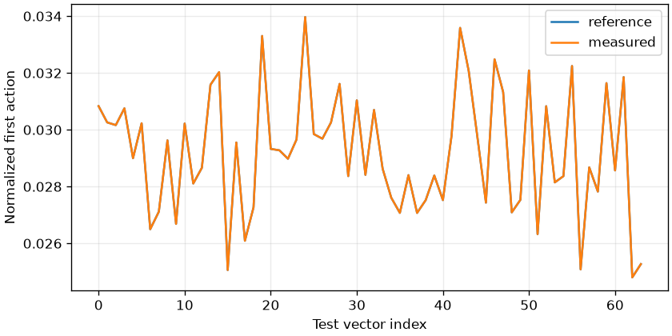

<!-- pal:language:start -->
<p align="right">
  <a href="../../ko/lessons/sim-deploy-01.md" lang="ko">한국어</a> | <a href="sim-deploy-01.md" lang="en">ENGLISH</a>
</p>
<!-- pal:language:end -->

# sim-deploy-01 — Candidate deployment bundle and promotion gate

<!-- pal:metadata:start -->
| Field | Value |
|---|---|
| Stage / track | `sim / deployment` |
| Legacy alias | `T35A` |
| Platforms | `macos-arm64, linux-x86_64` |
| Capabilities | `python-3.12` |
| Prerequisites | `core-fr3-08` |
| Safety | `offline` |
| Verification | `maintainer-checked` |
| Implementation | `implemented` |
<!-- pal:metadata:end -->

## Reader route

Read the Expected result first. Your task is to connect the measured values to the learning goal, then explain the calculation and the code that produced them.

[Terminal setup, resuming, opening results and camera controls](../READER_GUIDE.md)

Read the prerequisite [concept chapter](../concepts/deployment-hardware.md) and [equipment progression](../equipment-stages.md). This lesson addresses: What evidence and hashes make a deployment candidate reproducible? Follow the [NVIDIA ecosystem workbook](../nvidia-ecosystem.md) where relevant; the actual producer below identifies which engine/framework this lesson uses.

## Learning goals

Packaging preserves the meaning of learned numbers across a process boundary.

What evidence and hashes make a deployment candidate reproducible?

## Preflight

On a fresh checkout, run `sh bootstrap.sh --plan`, read the plan, then use `--apply`. Activate `source .venv/bin/activate` before these commands. If the run directory already exists, use a new suffix such as 02.

```bash
pal host detect --json
pal lesson check sim-deploy-01 --json
```

## Action

Activate the prepared environment and use a fresh output directory. Preserve the returned run path; execution does not mark completion.

```bash
pal lesson run sim-deploy-01 --headless --seed 7 --samples 64 --output-dir .local/runs/sim-deploy-01/baseline-01 --json
```

## Expected

Measured development example. Read both axis units and the reference/measured difference first. Validate your own run separately.



Open sample_candidate/manifest.json and compare its policy hash with the completed core-fr3-08 run. Execute every deterministic test vector. No promotion or hardware authority follows.

Common artifacts are summary.json, trace.csv, experiment.json, plot.png, run.json and lesson-report.md. Model lessons also produce frame.png or the external stack's evaluation/Isaac image. Inspect axes, units and camera framing, not only file size.

```bash
pal lesson check sim-deploy-01 --run-dir .local/runs/sim-deploy-01/baseline-01 --json
```

## Observe

Read the metric units, observed_first/observed_last and checks first. Inspection validates saved files, exits, and leaves completion unchanged.

```bash
pal lesson inspect sim-deploy-01 --run-dir .local/runs/sim-deploy-01/baseline-01 --json
```

Open the plot on macOS (closing the image preserves the run):

```bash
open .local/runs/sim-deploy-01/baseline-01/plot.png
```

On other systems, open the same PNG in your file manager. Read the raw values from this JSON:

```bash
python -m json.tool .local/runs/sim-deploy-01/baseline-01/experiment.json
```

### Reading the artifacts

Read `sample_candidate/manifest.json`: policy path/hash, `files`, `test_vectors`, `observation_order`, `action_order`, `frame`, `rate_hz=50`, `rollback=command-sink`, `promotion=candidate-only` and `performance_verified=False`. `validate_candidate` also rejects paths outside the bundle and mismatched test-vector inference. The 50 Hz declaration is not an offline timing benchmark.

## How it works

### Intuition

Packaging preserves the meaning of learned numbers across a process boundary. `deployment.run` consumes validated completed FR3 PPO evidence, copies the exact policy and source contract, constructs deterministic observation/action test vectors, then checks a candidate manifest. A bundle may be structurally valid while its policy lacks independent task performance.

### Calculation and units

$$
a=\tanh([\operatorname{clip}(o,-5,5),1]W)
$$

Observation o has 17 values, biased input has 18 and weights W have shape 18×7. Actions are normalized deltas; the simulator applies 0.03 rad per normalized unit. Worked calculation, not a policy measurement: pre-activation 0.5 gives tanh(0.5)≈0.462117. Hashes identify exact bytes, not physical safety.

```python
import numpy as np
raw = 0.5
assert np.isclose(np.tanh(raw), 0.46211715726000974)
```

## Code connection

### Source trace

[`src/pai_lab/lessons/deployment.py`](https://github.com/terryum/tutorial-robotics/blob/main/src/pai_lab/lessons/deployment.py)

`examples/sim-deploy-01/run.py` delegates to the common runner, which checks catalog implementation and capabilities before dispatch. The source above computes the quantities described here; metadata filenames do not establish the calculation by themselves.

## Try it

### Controlled comparison

A supported comparison changes the documented random test-vector seed, keeping policy bytes and manifest contract fixed; test inputs can change while reload agreement remains exact. The producer ignores `variant`. Explain invariance rather than claiming better control from packaging.

```bash
pal lesson run sim-deploy-01 --headless --seed 8 --samples 64 --output-dir .local/runs/sim-deploy-01/comparison-01 --json
pal lesson check sim-deploy-01 --run-dir .local/runs/sim-deploy-01/baseline-01 --json
pal lesson check sim-deploy-01 --run-dir .local/runs/sim-deploy-01/comparison-01 --json
pal lesson compare sim-deploy-01 --run-dir .local/runs/sim-deploy-01/baseline-01 --comparison-run-dir .local/runs/sim-deploy-01/comparison-01 --output-dir .local/comparisons/sim-deploy-01/comparison-01 --json
```

## Recovery

For capability-unavailable, prepare exactly the reported Python, model, platform or external stack, then rerun this lesson in a new directory. Preserve the failed run.json and numerical evidence. Do not automatically install system packages, drivers, CUDA, ROS, Isaac or large models. Resolve checksum errors by restoring a pinned cache, never by editing vendor sources.

## Checkpoint

### Check understanding

What survives a correct hash check? Byte identity. What does it not establish? Independent task performance, correct physical calibration or permission to command a device.

Inspect actual values, axes and images from both runs. Replace the notes below with measured values and your interpretation, resolve feedback, then review/finish one lesson. Missing capability remains unavailable; a publication badge is not your local completion.

```bash
pal lesson review sim-deploy-01 --run-dir .local/runs/sim-deploy-01/baseline-01 --comparison-run-dir .local/runs/sim-deploy-01/comparison-01 --notes "REPLACE with actual measured values and interpretation" --json
pal lesson finish sim-deploy-01 --run-dir .local/runs/sim-deploy-01/baseline-01 --json
```

<!-- pal:navigation:start -->
## Next lesson

[sim-enlight-01](./sim-enlight-01.md)

This is catalog order. Use `pal course next --json` to select an eligible lesson.
<!-- pal:navigation:end -->
