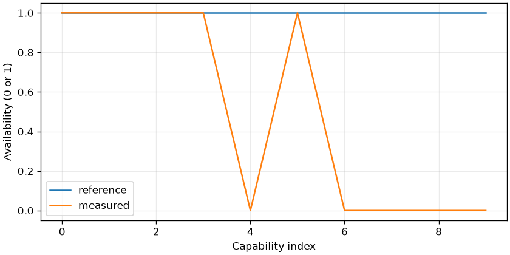

<!-- pal:language:start -->
<p align="right">
  <a href="core-00.md" lang="ko">한국어</a> | <a href="../../en/lessons/core-00.md" lang="en">ENGLISH</a>
</p>
<!-- pal:language:end -->

# core-00 — 저장소 시작과 호스트 점검

<!-- pal:metadata:start -->
| Field | Value |
|---|---|
| Stage / track | `core / common` |
| Legacy alias | `T00` |
| Platforms | `macos-arm64, linux-x86_64` |
| Capabilities | `python-3.12` |
| Prerequisites | `None` |
| Safety | `simulation` |
| Verification | `maintainer-checked` |
| Implementation | `implemented` |
| Role | `on-demand diagnostic` |
<!-- pal:metadata:end -->

## Reader route

`core-00`(`T00`)은 필요할 때 명시적으로 실행하는 환경 진단입니다. 일반 설치 흐름에서는 에이전트가 Core 환경을 점검하고 사용자 응답을 받은 뒤 [첫 진자 수업](core-01.md)을 엽니다. 학습 경로와 진도 집계에서 이 진단을 제외하며, 기존 완료 기록과 실행 파일은 보존합니다.

[터미널 준비·재개·결과 열기·카메라 조작](../READER_GUIDE.md)

실험 환경과 재현성은 [시뮬레이션 개념 교재](../concepts/simulation.md)를 읽고, 이 진단이 필요한 장비와 준비 단계는 [장비를 늘리는 학습 순서](../equipment-stages.md)에서 확인하세요.

## Learning goals

호스트 준비 상태, 로컬 실행 기록, 학습 완료를 구분합니다.

## Preflight

처음이면 저장소 루트에서 `sh bootstrap.sh --plan`을 실행하고 계획을 읽은 뒤 `--apply`로 환경을 준비합니다. `source .venv/bin/activate` 후 아래 명령을 사용합니다. 이미 같은 이름의 실행 폴더가 있으면 02처럼 새 이름을 정합니다.

```bash
pal host detect --json
pal lesson check core-00 --json
```

## Action

```bash
pal lesson run core-00 --headless --seed 7 --samples 64 --output-dir .local/runs/core-00/baseline-01 --json
```

## Expected

아래 그래프는 개발 환경을 점검한 예시입니다. 각 축에서 기능 번호와 사용 가능 여부를 확인하세요. 현재 호스트의 준비 상태는 직접 실행해 확인합니다.



`host-audit.json`에서 `platform_id`, `python`, `capability_status`를 읽습니다. seed를 8로 바꿔도 OS나 설치 패키지는 같아야 합니다.

공통 산출물은 summary.json, trace.csv, experiment.json, plot.png, run.json과 lesson-report.md입니다. 모델 수업에는 실제 frame.png 또는 외부 스택의 evaluation/isaac 이미지도 있습니다. 파일 크기만 보지 말고 그래프 축·단위·영상 구도를 직접 확인합니다.

```bash
pal lesson check core-00 --run-dir .local/runs/core-00/baseline-01 --json
```

## Observe

에이전트는 `lesson inspect`로 검증한 기록을 열고 `metric`의 단위, `observed_first`와 `observed_last`, `checks`를 읽습니다.

```bash
pal lesson inspect core-00 --run-dir .local/runs/core-00/baseline-01 --json
```

Mac에서 아래 명령으로 결과 그래프를 열 수 있습니다. 창을 닫아도 실행 기록은 남습니다.

```bash
open .local/runs/core-00/baseline-01/plot.png
```

다른 OS의 파일 관리자에서는 같은 PNG를 엽니다. 원시 수치는 아래 JSON에 있습니다.

```bash
python -m json.tool .local/runs/core-00/baseline-01/experiment.json
```

## How it works

에이전트는 기능별 검사 결과로 사용 가능 여부를 판단합니다. Python은 주 버전과 부 버전을 확인합니다. 패키지 import, 렌더링, 장치 연산은 각각 확인해야 합니다.

$$
r=N_{available}/N_{checked}
$$

$N_{available}$은 사용 가능한 기능 수, $N_{checked}$는 확인한 기능 수입니다. 단위가 없는 비율 $r$을 손으로 계산하면 5개 중 3개가 사용 가능할 때 $3/5=0.6$이 됩니다. 실제 렌더링이 가능한지는 패키지를 불러온 뒤 렌더링 검사로 확인합니다.

### 입력에서 관측까지

진단 코드는 실험을 실행할 호스트의 정보를 읽습니다. 설치된 패키지와 실제로 통과한 검사 항목을 비교하면 렌더링·CUDA·ROS가 없을 때 실험 코드와 실행 환경을 구분해 원인을 찾을 수 있습니다. 그래프에서 1은 `available`을 나타냅니다. `unavailable`과 `unverified`는 모두 0으로 표시합니다.

## Code connection

`examples/core-00/run.py` → `src/pai_lab/lessons/runner.py` → `src/pai_lab/lessons/physics.py`. runner는 실행을 기록하고 실험 모듈이 실제 상태에서 수치를 계산합니다. `experiment.json`의 payload를 계산 코드와 대조합니다.

### 실제 코드와 산출물 읽기

[`physics.py`](../../../src/pai_lab/lessons/physics.py)와 [`runner.py`](../../../src/pai_lab/lessons/runner.py)의 dispatch를 대조합니다.

`physics.run`의 core-00 분기는 `detect_host().to_dict()`의 `capability_status`를 한 행씩 읽고 available을 1로 바꿉니다. `host-audit.json`의 `platform_id`, `python`, 상태별 설명을 그래프 인덱스와 대조합니다. summary의 metric은 available 역량의 개수이지 위 비율 r 자체가 아닙니다. 예를 들어 5개 중 3개이면 비율은 0.6이고 개수는 3입니다(계산 예시). 이 진단은 Python 3.12를 확인합니다. 외부 스택마다 별도 검사가 필요합니다.

## Try it

호스트에서 확인한 기능 이름, 상태, 선행 조건을 실제 기록과 대조하세요. 진단 내용을 검토할 때는 이 근거를 `--notes`에 적습니다.

<details>
<summary>선택 심화: 가정이 깨지면 무엇이 달라질까요?</summary>

본문 식의 입력 하나를 고르고 단위를 적습니다. 그 값이 두 배일 때 출력이 두 배인지, 포화·정규화·좌표 변환 때문에 다른지 코드에서 확인합니다. 다른 가정이나 모델까지 동시에 바꾸면 한 변수 비교가 아니므로 별도 실행으로 기록합니다.

</details>

### 바꾸기 전에 예측하기

확인한 항목을 5개로 두고 사용 가능한 항목이 3개에서 4개로 늘었다고 가정하면 비율 $r$은 0.6에서 0.8로 바뀝니다. 실제로 seed만 바꾸면 설치 상태는 같아야 합니다. 필요한 스택이 빠져 있다면 해당 수업의 준비 절차를 확인하세요.

## Recovery

`capability-unavailable`이 반환되면 `missing_capabilities` 또는 `error`에 나온 Python·모델·플랫폼·외부 스택을 준비한 뒤 같은 수업을 새 폴더에서 재실행합니다. 실패한 run.json과 수치를 보존합니다. 시스템 패키지·드라이버·CUDA·ROS·Isaac·대형 모델은 자동 설치하지 않습니다. 체크섬 오류는 vendor 소스를 수정하지 말고 고정 캐시를 복구합니다.

## Checkpoint

명령을 그대로 복사하기 전에 `--notes`를 자신이 관찰한 구체적인 수치와 해석으로 바꿉니다. 접수된 [개선점]을 먼저 저장·수정·재검증합니다. 미해결 개선점, 변경된 실행 코드, 손상된 산출물은 완료를 막습니다. 이 명령은 진단 검토와 완료 기록을 남길 때 사용합니다. 학습 진도에는 반영하지 않습니다.

```bash
pal lesson review core-00 --run-dir .local/runs/core-00/baseline-01 --notes "검사한 이름·단위·구조·제한과 실제 근거를 자신의 값으로 적으세요." --json
pal lesson finish core-00 --run-dir .local/runs/core-00/baseline-01 --json
```

### 이해 확인과 답의 기준

개수 3과 비율 0.6은 각각 무엇을 뜻하나요? NumPy를 불러온 뒤 Isaac을 쓰려면 런타임과 GPU에서 어떤 검사를 해야 할까요? 현재 플랫폼, Python 버전, 처음으로 준비가 부족한 기능과 다음 확인 항목을 적어 보세요.

`evidence.comparison_errors`는 이 진단에 별도 비교 실행을 요구하지 않습니다. 위 검토 명령에서 기준 실행만 전달하고, 직접 확인한 진단 결과를 `--notes`에 적습니다.

<!-- pal:navigation:start -->
## Next lesson

[core-01](./core-01.md)

다음 항목은 목차 순서입니다. 실제 선택은 `pal course next --json`이 준비 상태로 결정합니다.
<!-- pal:navigation:end -->
