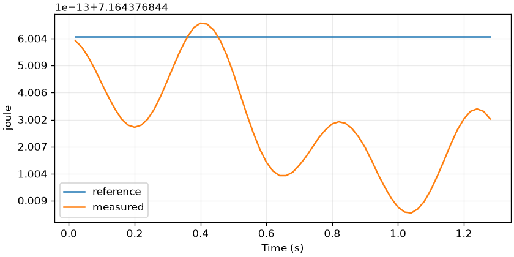

<!-- pal:language:start -->
<p align="right">
  <a href="core-01.md" lang="ko">한국어</a> | <a href="../../en/lessons/core-01.md" lang="en">ENGLISH</a>
</p>
<!-- pal:language:end -->

# core-01 — 결정론적 진자 상태와 시간 간격

<!-- pal:metadata:start -->
| Field | Value |
|---|---|
| Stage / track | `core / common` |
| Legacy alias | `T01` |
| Platforms | `macos-arm64, linux-x86_64` |
| Capabilities | `python-3.12, numpy, mujoco` |
| Prerequisites | `core-00` |
| Safety | `simulation` |
| Verification | `maintainer-checked` |
| Implementation | `implemented` |
<!-- pal:metadata:end -->

## Reader route

이 수업의 질문은 아래 목표를 실행 결과의 값과 연결해 설명할 수 있는가입니다. 먼저 Expected의 결과 기준을 읽고 실행한 뒤, 관찰·계산·코드를 순서대로 확인합니다.

[터미널 준비·재개·결과 열기·카메라 조작](../READER_GUIDE.md)

먼저 [개념 교재: simulation](../concepts/simulation.md)를 읽고, [장비를 늘리는 학습 순서](../equipment-stages.md)에서 이 수업의 실행 단계를 확인합니다.

## Learning goals

진자 상태와 수치 적분의 에너지 오차를 측정합니다.

## Preflight

처음이면 저장소 루트에서 `sh bootstrap.sh --plan`을 실행하고 계획을 읽은 뒤 `--apply`로 환경을 준비합니다. `source .venv/bin/activate` 후 아래 명령을 사용합니다. 이미 같은 이름의 실행 폴더가 있으면 02처럼 새 이름을 정합니다.

```bash
pal host detect --json
pal lesson check core-01 --json
```

## Action

```bash
pal lesson run core-01 --headless --seed 7 --samples 64 --output-dir .local/runs/core-01/baseline-01 --json
```

## Expected

실제 개발 실행의 예시입니다. 가로축·세로축의 단위와 기준/측정 곡선의 차이를 먼저 읽습니다. 개인 실행 결과는 별도 검사합니다.



측정 에너지와 초기값을 비교합니다. 최대 절대 오차는 1e-5 J 미만이어야 합니다. experiment.json에서 q와 qdot도 따로 읽습니다.

공통 산출물은 summary.json, trace.csv, experiment.json, plot.png, run.json과 lesson-report.md입니다. 모델 수업에는 실제 frame.png 또는 외부 스택의 evaluation/isaac 이미지도 있습니다. 파일 크기만 보지 말고 그래프 축·단위·영상 구도를 직접 확인합니다.

```bash
pal lesson check core-01 --run-dir .local/runs/core-01/baseline-01 --json
```

## Observe

먼저 metric의 단위, observed_first/observed_last, checks를 읽습니다. inspection은 검증된 파일만 읽고 종료하며 진도를 완료하지 않습니다.

```bash
pal lesson inspect core-01 --run-dir .local/runs/core-01/baseline-01 --json
```

Mac 결과 그래프 열기(창을 닫아도 실행 기록은 유지됩니다):

```bash
open .local/runs/core-01/baseline-01/plot.png
```

다른 OS의 파일 관리자에서는 같은 PNG를 엽니다. 원시 수치는 아래 JSON에 있습니다.

```bash
python -m json.tool .local/runs/core-01/baseline-01/experiment.json
```

## How it works

MuJoCo는 q(rad)와 qdot(rad/s)를 적분합니다. 외력이 없는 강체 진자의 운동·위치 에너지 합은 일정하지만 수치 적분에는 오차가 생깁니다. 캡슐은 질량이 분포하므로 점질량 관성으로 계산하면 안 됩니다.

$$
E=K+U,\qquad d=\max_t |E(t)-E(0)|
$$

기호·단위·조건: K,U,E,d: J; t: s; 외력이 없고 마찰이 없는 모델.

손으로 계산하는 예시(실행 측정값이 아님): |1.000003-1.000000|=0.000003 J.

실전 연결: 제어기 조정 전에 적분 오차를 찾아냅니다.

### 입력에서 관측까지

에너지 보존은 시뮬레이터가 운동을 얼마나 일관되게 적분하는지 보는 출발점입니다. 모델은 1 kg 분포 질량 capsule의 단일 회전 관절이고 초기 각도는 0.35 rad입니다. q와 qdot은 길이 1 배열이며, E는 MuJoCo가 계산한 운동·위치 에너지의 합(J)입니다. 점질량 진자의 관성 공식을 그대로 대입하면 다른 모델을 분석하게 됩니다.

## Code connection

`examples/core-01/run.py` → `src/pai_lab/lessons/runner.py` → `src/pai_lab/lessons/physics.py`. runner는 실행을 기록하고 실험 모듈이 실제 상태에서 수치를 계산합니다. `experiment.json`의 payload를 계산 코드와 대조합니다.

### 실제 코드와 산출물 읽기

[`physics.py`](../../../src/pai_lab/lessons/physics.py)와 [`runner.py`](../../../src/pai_lab/lessons/runner.py)의 dispatch를 대조합니다.

`physics.pendulum`은 RK4·마찰 없는 관절을 정의하고, `physics.run`은 표본마다 10회 적분한 뒤 `mj_forward`로 에너지를 갱신합니다. `experiment.json`의 `state` 행은 [time_s,q,qdot], `dt_s`는 적분 간격입니다. `trace.csv`의 기준은 E(0), 관찰값은 E(t)입니다. drift는 마지막 값만의 차이가 아니라 모든 저장 표본의 최대 절댓값 차이입니다. 64표본·0.002 s이면 마지막 시각은 1.28 s입니다(계산).

## Try it

적분 간격을 0.002 → 0.004 s로 바꿉니다. 표본 수가 같으므로 관찰 시간도 두 배가 됩니다. 같은 시각의 상태가 아니라 에너지 표류를 비교합니다.

```bash
pal lesson run core-01 --headless --seed 7 --samples 64 --output-dir .local/runs/core-01/comparison-01 --variant 2 --json
```

seed·표본 수·variant 중 위 명령의 한 값만 바꿉니다. 기본 결과와 비교 결과의 수치·형상·한계를 설명합니다. 차이가 없으면 해당 변수가 이 실험에서 불변인 이유를 설명하고 성능 개선으로 꾸미지 않습니다.

```bash
pal lesson compare core-01 --run-dir .local/runs/core-01/baseline-01 --comparison-run-dir .local/runs/core-01/comparison-01 --output-dir .local/comparisons/core-01/comparison-01 --json
```

<details>
<summary>선택 심화: 가정이 깨지면 무엇이 달라질까요?</summary>

본문 식의 입력 하나를 고르고 단위를 적습니다. 그 값이 두 배일 때 출력이 두 배인지, 포화·정규화·좌표 변환 때문에 다른지 코드에서 확인합니다. 다른 가정이나 모델까지 동시에 바꾸면 한 변수 비교가 아니므로 별도 실행으로 기록합니다.

</details>

### 바꾸기 전에 예측하기

간격만 0.004 s로 바꾸면 표본당 0.04 s, 마지막 시각 2.56 s입니다. 기존 비교 명령은 간격이라는 한 CLI 입력을 바꾸지만 관찰 시간도 함께 바뀝니다. 두 최종 자세를 같은 시각의 상태로 해석하지 말고 에너지 오차와 각 축을 읽습니다.

## Recovery

capability-unavailable이면 missing 목록에 나온 Python·모델·플랫폼·외부 스택을 준비한 뒤 같은 수업을 새 폴더에서 재실행합니다. 실패한 run.json과 수치를 보존합니다. 시스템 패키지·드라이버·CUDA·ROS·Isaac·대형 모델은 자동 설치하지 않습니다. 체크섬 오류는 vendor 소스를 수정하지 말고 고정 캐시를 복구합니다.

## Checkpoint

명령을 그대로 복사하기 전에 `--notes`를 자신이 관찰한 구체적인 수치와 해석으로 바꿉니다. 접수된 [개선점]을 먼저 저장·수정·재검증합니다. 미해결 개선점, 변경된 실행 코드, 손상된 산출물은 완료를 막습니다. 실행만으로 진도가 완료되지 않습니다. 완료 후 여기서 멈춥니다.

```bash
pal lesson review core-01 --run-dir .local/runs/core-01/baseline-01 --comparison-run-dir .local/runs/core-01/comparison-01 --notes "측정 결과와 한 변수 비교를 설명하고 그래프와 렌더링을 확인했습니다." --json
pal lesson finish core-01 --run-dir .local/runs/core-01/baseline-01 --json
```

### 이해 확인과 답의 기준

질문: 한 표본 사이에 몇 번 적분하나요? 답: 10회입니다. 질문: drift가 작으면 제어기·접촉도 검증되었나요? 답: 무구동 진자의 수치 일관성만 확인했습니다. 비교 기록에는 dt·마지막 시각·최대 drift(J)를 함께 적습니다.

<!-- pal:navigation:start -->
## Next lesson

[core-02](./core-02.md)

다음 항목은 목차 순서입니다. 실제 선택은 `pal course next --json`이 준비 상태로 결정합니다.
<!-- pal:navigation:end -->
