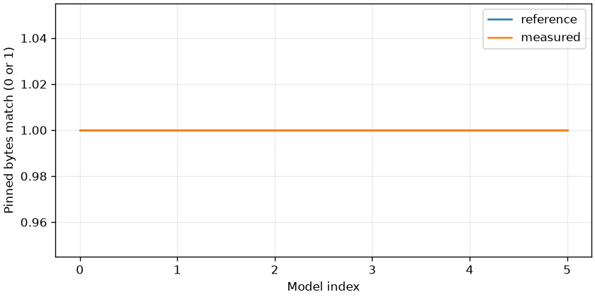

<!-- pal:language:start -->
<p align="right">
  <a href="core-02.md" lang="ko">한국어</a> | <a href="../../en/lessons/core-02.md" lang="en">ENGLISH</a>
</p>
<!-- pal:language:end -->

# core-02 — 공개 로봇 소스 고정과 자산 매니페스트

<!-- pal:metadata:start -->
| Field | Value |
|---|---|
| Stage / track | `core / common` |
| Legacy alias | `T02` |
| Platforms | `macos-arm64, linux-x86_64` |
| Capabilities | `python-3.12, numpy, mujoco` |
| Prerequisites | `core-00` |
| Safety | `simulation` |
| Verification | `maintainer-checked` |
| Implementation | `implemented` |
<!-- pal:metadata:end -->

## Reader route

이 수업의 질문은 아래 목표를 실행 결과의 값과 연결해 설명할 수 있는가입니다. 먼저 Expected의 결과 기준을 읽고 실행한 뒤, 관찰·계산·코드를 순서대로 확인합니다.

[터미널 준비·재개·결과 열기·카메라 조작](../READER_GUIDE.md)

먼저 [개념 교재: simulation](../concepts/simulation.md)를 읽고, [장비를 늘리는 학습 순서](../equipment-stages.md)에서 이 수업의 실행 단계를 확인합니다.

## Learning goals

불변 소스 커밋과 실제 모델 파일의 바이트를 검증합니다.

## Preflight

처음이면 저장소 루트에서 `sh bootstrap.sh --plan`을 실행하고 계획을 읽은 뒤 `--apply`로 환경을 준비합니다. `source .venv/bin/activate` 후 아래 명령을 사용합니다. 이미 같은 이름의 실행 폴더가 있으면 02처럼 새 이름을 정합니다.

필요한 공개 모델을 한 번 준비합니다:

```bash
pal assets fetch mujoco-menagerie
pal assets fetch wuji-description-beta2
pal assets fetch flexiv-description
```

```bash
pal host detect --json
pal lesson check core-02 --json
```

## Action

```bash
pal lesson run core-02 --headless --seed 7 --samples 64 --output-dir .local/runs/core-02/baseline-01 --json
```

## Expected

실제 개발 실행의 예시입니다. 가로축·세로축의 단위와 기준/측정 곡선의 차이를 먼저 읽습니다. 개인 실행 결과는 별도 검사합니다.



여섯 공개 모델 캐시가 assets/model-lock.json과 일치해야 합니다. 다운로드 영수증은 checkout 바깥에 저장합니다. vendor 파일을 직접 고쳐 통과시키지 않습니다.

공통 산출물은 summary.json, trace.csv, experiment.json, plot.png, run.json과 lesson-report.md입니다. 모델 수업에는 실제 frame.png 또는 외부 스택의 evaluation/isaac 이미지도 있습니다. 파일 크기만 보지 말고 그래프 축·단위·영상 구도를 직접 확인합니다.

```bash
pal lesson check core-02 --run-dir .local/runs/core-02/baseline-01 --json
```

## Observe

먼저 metric의 단위, observed_first/observed_last, checks를 읽습니다. inspection은 검증된 파일만 읽고 종료하며 진도를 완료하지 않습니다.

```bash
pal lesson inspect core-02 --run-dir .local/runs/core-02/baseline-01 --json
```

Mac 결과 그래프 열기(창을 닫아도 실행 기록은 유지됩니다):

```bash
open .local/runs/core-02/baseline-01/plot.png
```

다른 OS의 파일 관리자에서는 같은 PNG를 엽니다. 원시 수치는 아래 JSON에 있습니다.

```bash
python -m json.tool .local/runs/core-02/baseline-01/experiment.json
```

## How it works

Git 태그는 커밋 대신 annotated tag 객체를 가리킬 수 있습니다. 실제 커밋을 고정하고 모델 파일과 라이선스의 SHA-256을 계산합니다. 해시는 바이트 변경을 감지하지만 물리 정확성을 입증하지는 않습니다.

$$
h=\operatorname{SHA256}(b)
$$

기호·단위·조건: b: 파일 바이트; h: 32바이트 해시; 물리량이 아닙니다.

손으로 계산하는 예시(실행 측정값이 아님): 256 bits / 8 = 32 bytes.

실전 연결: 로봇 이름이 같아도 메시가 바뀌면 충돌 결과가 달라집니다.

### 입력에서 관측까지

로봇 이름이 같아도 mesh·관성·관절 파일이 바뀌면 같은 실험이 아닙니다. source revision은 Git 이력의 식별자이고 파일 해시는 선택한 바이트의 식별자입니다. 둘을 함께 남겨야 다른 호스트에서 같은 공개 모델을 불러왔다고 검토할 수 있습니다. 이 식별값에는 좌표계·kg·m 같은 물리 단위가 없습니다.

## Code connection

`examples/core-02/run.py` → `src/pai_lab/lessons/runner.py` → `src/pai_lab/lessons/physics.py`. runner는 실행을 기록하고 실험 모듈이 실제 상태에서 수치를 계산합니다. `experiment.json`의 payload를 계산 코드와 대조합니다.

### 실제 코드와 산출물 읽기

[`physics.py`](../../../src/pai_lab/lessons/physics.py)와 [`runner.py`](../../../src/pai_lab/lessons/runner.py)의 dispatch를 대조합니다.

`models.provenance`는 `assets/model-lock.json`의 파일 목록을 읽어 실제 SHA-256과 비교하고 누락·변경을 거부합니다. `physics.run`은 FR3·Wuji·Enlight·G1·Sharpa·ALOHA의 receipt를 수집합니다. `source-pins.json`의 `models`에서 model·revision·license·files_digest를 읽습니다. 그래프의 1은 해당 revision 문자열 길이 40 검사의 표시이며, 모든 기하·동역학의 정확도 100%라는 뜻이 아닙니다. 전체 source pin 검사도 따로 수행됩니다.

## Try it

이 수업은 구조·환경 조사입니다. seed를 바꾼 수치 실험을 요구하지 않습니다. 이름·단위·선수 조건과 실제 artifact를 대조하고, 발견한 항목을 review notes에 적습니다.

<details>
<summary>선택 심화: 가정이 깨지면 무엇이 달라질까요?</summary>

본문 식의 입력 하나를 고르고 단위를 적습니다. 그 값이 두 배일 때 출력이 두 배인지, 포화·정규화·좌표 변환 때문에 다른지 코드에서 확인합니다. 다른 가정이나 모델까지 동시에 바꾸면 한 변수 비교가 아니므로 별도 실행으로 기록합니다.

</details>

### 바꾸기 전에 예측하기

오프라인 사고 실험에서 다른 조건을 고정하고 mesh 바이트 하나만 바뀌었다고 가정하면 해시 일치가 깨져야 합니다. 실제 vendor 파일을 수정해 시험하지 않습니다. seed 변경은 이 감사의 모델·license·해시를 바꾸지 않아야 합니다.

## Recovery

capability-unavailable이면 missing 목록에 나온 Python·모델·플랫폼·외부 스택을 준비한 뒤 같은 수업을 새 폴더에서 재실행합니다. 실패한 run.json과 수치를 보존합니다. 시스템 패키지·드라이버·CUDA·ROS·Isaac·대형 모델은 자동 설치하지 않습니다. 체크섬 오류는 vendor 소스를 수정하지 말고 고정 캐시를 복구합니다.

## Checkpoint

명령을 그대로 복사하기 전에 `--notes`를 자신이 관찰한 구체적인 수치와 해석으로 바꿉니다. 접수된 [개선점]을 먼저 저장·수정·재검증합니다. 미해결 개선점, 변경된 실행 코드, 손상된 산출물은 완료를 막습니다. 실행만으로 진도가 완료되지 않습니다. 완료 후 여기서 멈춥니다.

```bash
pal lesson review core-02 --run-dir .local/runs/core-02/baseline-01 --notes "검사한 이름·단위·구조·제한과 실제 근거를 자신의 값으로 적으세요." --json
pal lesson finish core-02 --run-dir .local/runs/core-02/baseline-01 --json
```

### 이해 확인과 답의 기준

질문: 해시 일치는 실물 정확성을 보장하나요? 답: 같은 바이트만 보장합니다. 질문: revision과 license를 함께 읽는 이유는 무엇인가요? 답: 재현할 버전과 재사용 조건이 별개이기 때문입니다. 다음 수업에서는 실제 모델을 컴파일해 구조를 검사합니다.

이 구조 감사는 `evidence.comparison_errors`의 명시적 예외여서 별도 comparison run이 필수가 아닙니다. 위 review 명령은 baseline만 전달합니다. 종이 계산을 실행된 비교 산출물로 꾸미지 않고 실제로 확인한 감사 근거를 notes에 적습니다.

<!-- pal:navigation:start -->
## Next lesson

[core-03](./core-03.md)

다음 항목은 목차 순서입니다. 실제 선택은 `pal course next --json`이 준비 상태로 결정합니다.
<!-- pal:navigation:end -->
