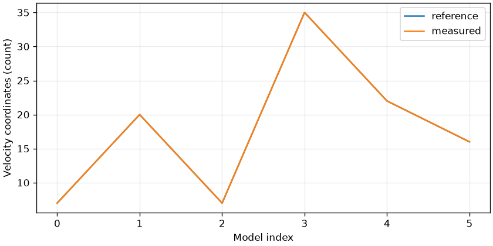

<!-- pal:language:start -->
<p align="right">
  <a href="core-03.md" lang="ko">한국어</a> | <a href="../../en/lessons/core-03.md" lang="en">ENGLISH</a>
</p>
<!-- pal:language:end -->

# core-03 — 다중 모델 검사와 자산 검증

<!-- pal:metadata:start -->
| Field | Value |
|---|---|
| Stage / track | `core / common` |
| Legacy alias | `T03` |
| Platforms | `macos-arm64, linux-x86_64` |
| Capabilities | `python-3.12, numpy, mujoco` |
| Prerequisites | `core-01, core-02` |
| Safety | `simulation` |
| Verification | `maintainer-checked` |
| Implementation | `implemented` |
<!-- pal:metadata:end -->

## Reader route

[터미널 준비·재개·결과 열기·카메라 조작](../READER_GUIDE.md)

먼저 [개념 교재: simulation](../concepts/simulation.md)를 읽고, [장비를 늘리는 학습 순서](../equipment-stages.md)에서 이 수업의 실행 단계를 확인합니다.

## Learning goals

여섯 로봇의 MuJoCo 모델을 불러와 위치 좌표, 속도 좌표, 구동기 수를 비교합니다. 관절이나 제어 입력을 배열에 넣을 때마다 알맞은 길이와 인덱스를 확인해야 합니다.

## Preflight

### 실행 전에 예측하기

바닥에 고정한 로봇 팔과 몸체가 자유롭게 움직이는 로봇을 비교하면 어느 쪽에서 위치 좌표 수와 속도 좌표 수가 다를까요?

에이전트는 [실행 안내](../READER_GUIDE.md#manual-setup)에 따라 Core 환경을 준비하고 확인합니다. 직접 실행할 때는 저장소 루트에서 `sh bootstrap.sh --plan`으로 계획을 읽고, 준비가 필요하면 `--apply`를 실행합니다. `source .venv/bin/activate`로 환경을 활성화한 뒤 아래 명령으로 준비 상태를 확인하세요. 이미 사용한 실행 폴더가 있으면 이름 끝에 `02`처럼 새 번호를 붙이세요. 아래 첫 명령 묶음으로 필요한 공개 모델을 준비합니다.

```bash
pal assets fetch mujoco-menagerie
pal assets fetch wuji-description-beta2
pal assets fetch flexiv-description
```

```bash
pal host detect --json
pal lesson check core-03 --json
```

## How it works

MuJoCo에서 `nq`는 위치 좌표 수, `nv`는 속도 좌표 수, `nu`는 구동기 수입니다. `qpos`, `qvel`, `ctrl`은 각각 길이가 `nq`, `nv`, `nu`인 1차원 배열입니다. 자유 관절 하나에는 이동을 나타내는 좌표 3개와 회전을 나타내는 단위 쿼터니언의 성분 4개를 써서 위치 좌표가 7개입니다. 선속도 성분 3개와 각속도 성분 3개를 써서 속도 좌표는 6개입니다. 모두 좌표나 구동기의 개수를 센 값입니다.

$$
n_q=7,\quad n_v=6\quad\text{(자유 관절 하나)}
$$

## Code connection

[`examples/core-03/run.py`](../../../examples/core-03/run.py)에서 [`runner.py`](../../../src/pai_lab/lessons/runner.py)를 거쳐 [`physics.py`](../../../src/pai_lab/lessons/physics.py)로 이어집니다. [`models.load`와 `inventory`](../../../src/pai_lab/lessons/models.py)가 MuJoCo 모델을 읽고 이름별로 `nq`, `nv`, `nu`, `joint_names`, `joint_ranges`, `site_names`, `mass_kg`를 저장합니다. 고정한 vendor 파라미터로 생성한 Enlight 초안은 `enlight-draft.xml`에 남습니다.

## Action

에이전트가 아래 명령으로 기준 실행을 기록합니다.

```bash
pal lesson run core-03 --headless --seed 7 --samples 64 --output-dir .local/runs/core-03/baseline-01 --json
```

## Expected

FR3·Enlight·Wuji·Sharpa·G1·ALOHA 여섯 모델이 모두 로드되면 `model-inventory.json`에 실제로 읽은 차원이 저장됩니다. 아래 개발 실행 예시 그래프는 모델별 `nv`를 나타냅니다. 검사에서 따로 기록하는 스칼라 값은 질량이 양수인 모델의 비율입니다.



```bash
pal lesson check core-03 --run-dir .local/runs/core-03/baseline-01 --json
```

## Observe

`model-inventory.json`에서 모델을 골라 관절 이름, 한계와 총질량을 찾아보세요. `lesson inspect`로 실행 기록을 확인하고, 아래 명령으로 그래프와 원시 수치를 직접 열 수 있습니다.

```bash
pal lesson inspect core-03 --run-dir .local/runs/core-03/baseline-01 --json
```

```bash
open .local/runs/core-03/baseline-01/plot.png
```

```bash
python -m json.tool .local/runs/core-03/baseline-01/experiment.json
```

## Try it

한 번 실행한 결과에서 고정 베이스 FR3와 자유 관절이 있는 G1을 골라 각각 `nq`, `nv`, `nu`를 비교합니다. 같은 검사 절차에서 읽을 모델만 바꿉니다. G1에서 위치 좌표 수가 속도 좌표 수보다 큰 이유를 자유 관절의 7 대 6 계산과 연결하세요. 로봇 두 대는 다른 관절도 갖고 있으므로 전체 개수의 차이를 자유 관절 하나의 영향으로 해석할 수는 없습니다. 비교를 위해 고정 모델이나 seed를 바꿀 필요는 없습니다.

에이전트가 아래 명령으로 실행 기록을 검증해 결과 페이지를 만듭니다. 에이전트는 교재와 별도 창에 페이지를 열고 표시를 확인합니다. 별도 창을 띄우기 어려우면 결과 탭을 사용합니다. 화면을 제어할 수 없는 환경에서는 실제 측정값과 채팅에서 표시할 수 있는 이미지를 보여 줍니다.

```bash
pal lesson present core-03 --run-dir .local/runs/core-03/baseline-01 --language ko --json
```

## Recovery

`capability-unavailable`이 반환되면 에이전트는 `missing_capabilities` 또는 `error`에서 어떤 Python·모델·플랫폼·외부 스택이 필요한지 확인해 조치 방법을 안내합니다. 준비가 끝나면 새 폴더에서 같은 실험을 실행하고, 실패한 `run.json`과 수치를 보존합니다. 시스템 패키지·드라이버·CUDA·ROS·Isaac·대형 모델은 별도 준비가 필요합니다. 체크섬 오류가 나면 vendor 파일을 직접 수정하지 말고 고정 캐시를 복구합니다.

## Checkpoint

G1에서 `nq`와 `nv`가 다른 이유를 설명할 수 있나요? 두 모델의 `nu`를 읽고 각각 `ctrl` 배열의 길이를 말해 보세요. 컴파일 결과와 양의 질량은 구조를 확인하는 근거이며 충돌 성능과 실물 보정에는 별도 검증이 필요합니다.

`lesson present`를 실행하면 에이전트가 이해 확인 대기 상태와 결과를 저장합니다. 새 대화에서도 같은 질문과 결과에서 이어갈 수 있습니다. 답을 함께 확인하거나 독자가 완료를 요청한 뒤에만 에이전트가 실제 관찰과 설명을 `--notes`에 적어 검토와 완료를 기록합니다. 피드백에 해결이 필요한 문제가 있으면 먼저 수정하고 재검증합니다. 변경된 실행 코드나 손상된 산출물은 완료를 막습니다.

```bash
pal lesson review core-03 --run-dir .local/runs/core-03/baseline-01 --notes "검사한 이름·단위·구조·제한과 실제 근거를 자신의 값으로 적으세요." --json
pal lesson finish core-03 --run-dir .local/runs/core-03/baseline-01 --json
```

<!-- pal:navigation:start -->
## Next lesson

[core-04](./core-04.md)

다음 항목은 목차 순서입니다. 실제 선택은 `pal course next --json`이 준비 상태로 결정합니다.
<!-- pal:navigation:end -->
