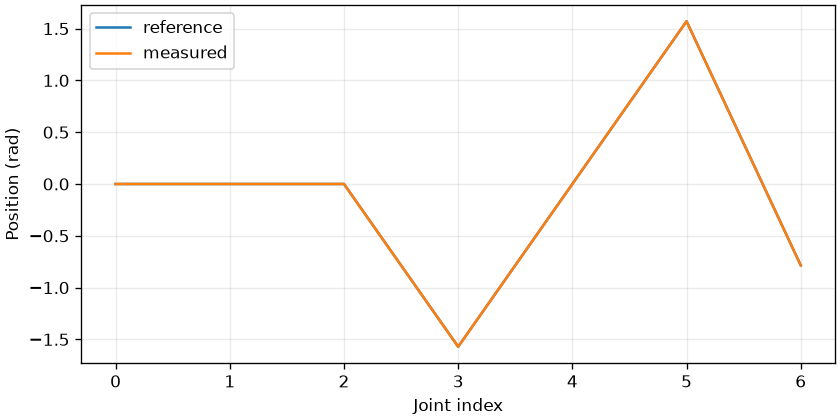

<!-- pal:language:start -->
<p align="right">
  <a href="core-04.md" lang="ko">한국어</a> | <a href="../../en/lessons/core-04.md" lang="en">ENGLISH</a>
</p>
<!-- pal:language:end -->

# core-04 — 통합 뷰어와 결정론적 렌더링

<!-- pal:metadata:start -->
| Field | Value |
|---|---|
| Stage / track | `core / common` |
| Legacy alias | `T04` |
| Platforms | `macos-arm64, linux-x86_64` |
| Capabilities | `python-3.12, numpy, mujoco` |
| Prerequisites | `core-03` |
| Safety | `simulation` |
| Verification | `maintainer-checked` |
| Implementation | `implemented` |
<!-- pal:metadata:end -->

## Reader route

[터미널 준비·재개·결과 열기·카메라 조작](../READER_GUIDE.md)

먼저 [개념 교재: simulation](../concepts/simulation.md)를 읽고, [장비를 늘리는 학습 순서](../equipment-stages.md)에서 이 수업의 실행 단계를 확인합니다.

## Learning goals

같은 FR3 홈 자세를 서로 다른 카메라 방위각에서 봅니다. 팔이 움직여 화면이 바뀐 경우와 카메라가 움직여 화면이 바뀐 경우를 구분합니다.

## Preflight

### 실행 전에 예측하기

관절 위치를 고정하고 카메라만 옆으로 돌리면, 화면 속 베이스·팔꿈치·말단 중 어떤 부분이 다르게 보이거나 가려질지 예측하세요.

에이전트는 [실행 안내](../READER_GUIDE.md#manual-setup)에 따라 Core 환경을 준비하고 확인합니다. 직접 실행할 때는 저장소 루트에서 `sh bootstrap.sh --plan`으로 계획을 읽고, 준비가 필요하면 `--apply`를 실행합니다. `source .venv/bin/activate`로 환경을 활성화한 뒤 아래 명령으로 준비 상태를 확인하세요. 이미 사용한 실행 폴더가 있으면 이름 끝에 `02`처럼 새 번호를 붙이세요. 아래 첫 명령 묶음으로 필요한 공개 모델을 준비합니다.

```bash
pal assets fetch mujoco-menagerie
```

```bash
pal host detect --json
pal lesson check core-04 --json
```

## How it works

렌더러는 모델, 관절 상태, 카메라를 바탕으로 픽셀을 계산합니다. `headless` 실행에도 오프스크린 그래픽 컨텍스트가 필요합니다. RGB 이미지 $I$의 배열 축은 행 360개, 열 480개, RGB 채널 3개 순서이며 값은 0에서 255까지입니다. 계산하면 $360\times480\times3=518400$개의 채널 값이 들어갑니다.

$$
I\in\{0,\ldots,255\}^{360\times480\times3}
$$

## Code connection

[`examples/core-04/run.py`](../../../examples/core-04/run.py)에서 [`runner.py`](../../../src/pai_lab/lessons/runner.py)를 거쳐 [`physics.py`](../../../src/pai_lab/lessons/physics.py)로 이어집니다. `physics.run`은 FR3 홈 자세를 읽고 [`experiment.render`](../../../src/pai_lab/lessons/experiment.py)는 그 자세를 주어진 카메라 방위각에서 렌더링합니다. `frame_positions_m`과 `joint_names`, 저장한 `qpos`를 베이스·도구 끝과 대조하세요. `plot.png`는 관절 인덱스에 해당하는 각도(rad)를 나타냅니다.

## Action

에이전트가 아래 명령으로 기준 실행을 기록합니다.

```bash
pal lesson run core-04 --headless --seed 7 --samples 64 --output-dir .local/runs/core-04/baseline-01 --json
```

## Expected

`frame.png`는 480×360 RGB 렌더링이고 `frame.pgm`은 회색조 표현입니다. 픽셀 표준편차가 0보다 큰지 검사한 뒤, 화면에서 로봇의 베이스, 팔꿈치, 말단이 보이는지도 살핍니다. 아래 그림은 기존 개발 실행의 관절 위치 그래프입니다.



```bash
pal lesson check core-04 --run-dir .local/runs/core-04/baseline-01 --json
```

## Observe

렌더링에서 베이스, 팔꿈치, 말단을 찾아보세요. 같은 호스트에서 같은 조건으로 반복하면 같은 자세가 보입니다. `lesson inspect`로 실행 기록을 확인하고, 아래 명령으로 그래프와 원시 수치를 직접 열 수 있습니다.

```bash
pal lesson inspect core-04 --run-dir .local/runs/core-04/baseline-01 --json
```

```bash
open .local/runs/core-04/baseline-01/plot.png
```

```bash
python -m json.tool .local/runs/core-04/baseline-01/experiment.json
```

## Try it

카메라 방위각 `camera_azimuth`만 135°에서 165°로 바꿉니다. 카메라가 이동한 각도는 30°, 약 0.5236 rad입니다(계산). 아래 명령에서 seed, 표본 수, 모델과 자세를 그대로 둡니다. 두 이미지를 나란히 열어 팔꿈치와 말단을 찾아보세요. `qpos`, 관절 이름, 질량, 관절 수가 두 실행에서 일치하는지 확인하면 관절 상태를 유지했음을 알 수 있습니다.

```bash
pal lesson run core-04 --headless --samples 64 --output-dir .local/runs/core-04/comparison-01 --seed 7 --param camera_azimuth=165 --json
```

에이전트가 아래 명령으로 실행 기록을 검증해 결과 페이지를 만듭니다. 에이전트는 교재와 별도 창에 페이지를 열고 표시를 확인합니다. 별도 창을 띄우기 어려우면 결과 탭을 사용합니다. 화면을 제어할 수 없는 환경에서는 실제 측정값과 채팅에서 표시할 수 있는 이미지를 보여 줍니다.

```bash
pal lesson present core-04 --run-dir .local/runs/core-04/baseline-01 --comparison-run-dir .local/runs/core-04/comparison-01 --language ko --json
```

아래 명령으로 관절 각도 비교 그래프와 측정값을 별도 폴더에 저장할 수 있습니다.

```bash
pal lesson compare core-04 --run-dir .local/runs/core-04/baseline-01 --comparison-run-dir .local/runs/core-04/comparison-01 --output-dir .local/comparisons/core-04/comparison-01 --json
```

## Recovery

`capability-unavailable`이 반환되면 에이전트는 `missing_capabilities` 또는 `error`에서 어떤 Python·모델·플랫폼·외부 스택이 필요한지 확인해 조치 방법을 안내합니다. 준비가 끝나면 새 폴더에서 같은 실험을 실행하고, 실패한 `run.json`과 수치를 보존합니다. 시스템 패키지·드라이버·CUDA·ROS·Isaac·대형 모델은 별도 준비가 필요합니다. 체크섬 오류가 나면 vendor 파일을 직접 수정하지 말고 고정 캐시를 복구합니다.

## Checkpoint

두 화면에서 같은 관절을 하나 고르세요. 어떤 값이 바뀌었고, 관절이 그대로였다는 사실을 어느 실행 기록에서 확인할 수 있나요? `headless` 실행에서 이미지가 생기는 이유를 함께 설명해 보세요. 다음 항목의 텔레오퍼레이션은 선택 수업이며 로봇 경로는 VR 없이 계속 진행할 수 있습니다.

`lesson present`를 실행하면 에이전트가 이해 확인 대기 상태와 결과를 저장합니다. 새 대화에서도 같은 질문과 결과에서 이어갈 수 있습니다. 답을 함께 확인하거나 독자가 완료를 요청한 뒤에만 에이전트가 실제 관찰과 설명을 `--notes`에 적어 검토와 완료를 기록합니다. 피드백에 해결이 필요한 문제가 있으면 먼저 수정하고 재검증합니다. 변경된 실행 코드나 손상된 산출물은 완료를 막습니다.

```bash
pal lesson review core-04 --run-dir .local/runs/core-04/baseline-01 --comparison-run-dir .local/runs/core-04/comparison-01 --notes "측정 결과와 한 변수 비교를 설명하고 그래프와 렌더링을 확인했습니다." --json
pal lesson finish core-04 --run-dir .local/runs/core-04/baseline-01 --json
```

<!-- pal:navigation:start -->
## Next lesson

[core-teleop-01](./core-teleop-01.md)

다음 항목은 목차 순서입니다. 실제 선택은 `pal course next --json`이 준비 상태로 결정합니다.
<!-- pal:navigation:end -->
