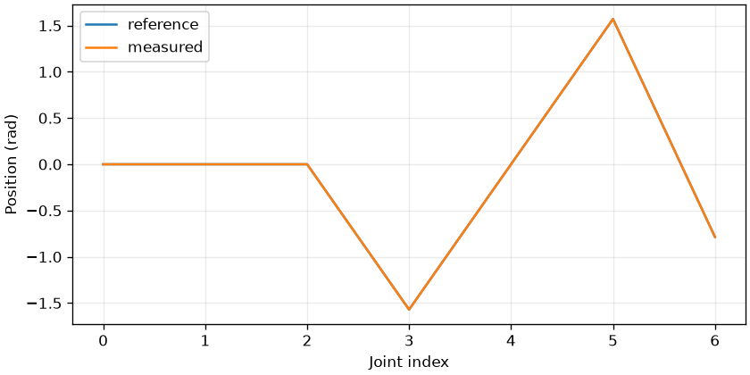

<!-- pal:language:start -->
<p align="right">
  <a href="core-fr3-01.md" lang="ko">한국어</a> | <a href="../../en/lessons/core-fr3-01.md" lang="en">ENGLISH</a>
</p>
<!-- pal:language:end -->

# core-fr3-01 — FR3 모델 구조

<!-- pal:metadata:start -->
| Field | Value |
|---|---|
| Stage / track | `core / fr3` |
| Legacy alias | `T05` |
| Platforms | `macos-arm64, linux-x86_64` |
| Capabilities | `python-3.12, numpy, mujoco` |
| Prerequisites | `core-04` |
| Safety | `simulation` |
| Verification | `maintainer-checked` |
| Implementation | `implemented` |
<!-- pal:metadata:end -->

## Reader route

이 수업의 질문은 아래 목표를 실행 결과의 값과 연결해 설명할 수 있는가입니다. 먼저 Expected의 결과 기준을 읽고 실행한 뒤, 관찰·계산·코드를 순서대로 확인합니다.

[터미널 준비·재개·결과 열기·카메라 조작](../READER_GUIDE.md)

먼저 [개념 교재: kinematics](../concepts/kinematics.md)를 읽고, [장비를 늘리는 학습 순서](../equipment-stages.md)에서 이 수업의 실행 단계를 확인합니다.

## Learning goals

FR3 관절·링크·구동기와 말단 사이트를 연결합니다.

## Preflight

장비 setup·매뉴얼 참조: [Franka Research 3](../setup/fr3.md).

처음이면 저장소 루트에서 `sh bootstrap.sh --plan`을 실행하고 계획을 읽은 뒤 `--apply`로 환경을 준비합니다. `source .venv/bin/activate` 후 아래 명령을 사용합니다. 이미 같은 이름의 실행 폴더가 있으면 02처럼 새 이름을 정합니다.

필요한 공개 모델을 한 번 준비합니다:

```bash
pal assets fetch mujoco-menagerie
```

```bash
pal host detect --json
pal lesson check core-fr3-01 --json
```

## Action

```bash
pal lesson run core-fr3-01 --headless --seed 7 --samples 64 --output-dir .local/runs/core-fr3-01/baseline-01 --json
```

## Expected

실제 개발 실행의 예시입니다. 가로축·세로축의 단위와 기준/측정 곡선의 차이를 먼저 읽습니다. 개인 실행 결과는 별도 검사합니다.



일곱 관절의 이름·범위, 구동기 수, 총질량과 attachment_site를 확인합니다. 렌더링 자세를 기록된 home 설정과 연결합니다.

공통 산출물은 summary.json, trace.csv, experiment.json, plot.png, run.json과 lesson-report.md입니다. 모델 수업에는 실제 frame.png 또는 외부 스택의 evaluation/isaac 이미지도 있습니다. 파일 크기만 보지 말고 그래프 축·단위·영상 구도를 직접 확인합니다.

```bash
pal lesson check core-fr3-01 --run-dir .local/runs/core-fr3-01/baseline-01 --json
```

## Observe

먼저 metric의 단위, observed_first/observed_last, checks를 읽습니다. inspection은 검증된 파일만 읽고 종료하며 진도를 완료하지 않습니다.

```bash
pal lesson inspect core-fr3-01 --run-dir .local/runs/core-fr3-01/baseline-01 --json
```

Mac 결과 그래프 열기(창을 닫아도 실행 기록은 유지됩니다):

```bash
open .local/runs/core-fr3-01/baseline-01/plot.png
```

다른 OS의 파일 관리자에서는 같은 PNG를 엽니다. 원시 수치는 아래 JSON에 있습니다.

```bash
python -m json.tool .local/runs/core-fr3-01/baseline-01/experiment.json
```

## How it works

관절 인덱스는 모델마다 다릅니다. attachment_site는 마지막 링크 위의 점이며 관절 각도에 따라 월드 위치가 변합니다. 임의의 7축 범위 대신 모델의 한계를 읽습니다.

$$
{}^Wp={}^WT_T(q)\,{}^Tp
$$

기호·단위·조건: p: 동차 점; 이동: m; q: rad; W: 세계, T: 도구.

손으로 계산하는 예시(실행 측정값이 아님): [0,0,0,1] maps to the transform translation column.

실전 연결: 센서 상태와 화면의 관절 이름·좌표계가 같아야 합니다.

### 입력에서 관측까지

제어 전에는 배열의 어느 성분이 어느 관절인지 알아야 합니다. 일곱 관절의 home qpos는 길이 7 배열이고 회전 관절 위치·범위는 rad입니다. attachment_site는 마지막 링크의 기준점이며 TCP를 특정 물리 툴의 끝으로 보정했다는 뜻은 아닙니다.

## Code connection

`examples/core-fr3-01/run.py` → `src/pai_lab/lessons/runner.py` → `src/pai_lab/lessons/physics.py`. runner는 실행을 기록하고 실험 모듈이 실제 상태에서 수치를 계산합니다. `experiment.json`의 payload를 계산 코드와 대조합니다.

### 실제 코드와 산출물 읽기

[`physics.py`](../../../src/pai_lab/lessons/physics.py)와 [`runner.py`](../../../src/pai_lab/lessons/runner.py)의 dispatch를 대조합니다.

`models.inventory`가 저장한 `joint_names`, `joint_ranges`, `site_names`, `body_names`와 `mass_kg`를 `fr3-joints.json`에서 읽습니다. `physics.run`의 `frame_positions_m`는 세계 좌표 위치(m)입니다. 4×4 동차 변환은 [x,y,z,1] 길이 4 열벡터에 작용하고 그 결과의 앞 세 값이 세계 위치입니다. 물체 방향의 회전 부분과 위치의 평행이동 부분을 구별합니다. 그래프에서 겹친 두 곡선은 같은 home 값의 표시이며 별도 센서 측정이 아닙니다.

## Try it

이 수업은 구조·환경 조사입니다. seed를 바꾼 수치 실험을 요구하지 않습니다. 이름·단위·선수 조건과 실제 artifact를 대조하고, 발견한 항목을 review notes에 적습니다.

<details>
<summary>선택 심화: 가정이 깨지면 무엇이 달라질까요?</summary>

본문 식의 입력 하나를 고르고 단위를 적습니다. 그 값이 두 배일 때 출력이 두 배인지, 포화·정규화·좌표 변환 때문에 다른지 코드에서 확인합니다. 다른 가정이나 모델까지 동시에 바꾸면 한 변수 비교가 아니므로 별도 실행으로 기록합니다.

</details>

### 바꾸기 전에 예측하기

오프라인 한 변수 계산으로 변환의 평행이동 x성분만 0.1 m 늘리면 같은 점의 세계 x도 0.1 m 늘어납니다. 이 감사의 seed는 home 자세를 바꾸지 않습니다. 실제 모델·툴 offset을 변경하는 실험은 이 고정 구조 검사와 분리합니다.

## Recovery

capability-unavailable이면 missing 목록에 나온 Python·모델·플랫폼·외부 스택을 준비한 뒤 같은 수업을 새 폴더에서 재실행합니다. 실패한 run.json과 수치를 보존합니다. 시스템 패키지·드라이버·CUDA·ROS·Isaac·대형 모델은 자동 설치하지 않습니다. 체크섬 오류는 vendor 소스를 수정하지 말고 고정 캐시를 복구합니다.

## Checkpoint

명령을 그대로 복사하기 전에 `--notes`를 자신이 관찰한 구체적인 수치와 해석으로 바꿉니다. 접수된 [개선점]을 먼저 저장·수정·재검증합니다. 미해결 개선점, 변경된 실행 코드, 손상된 산출물은 완료를 막습니다. 실행만으로 진도가 완료되지 않습니다. 완료 후 여기서 멈춥니다.

```bash
pal lesson review core-fr3-01 --run-dir .local/runs/core-fr3-01/baseline-01 --notes "검사한 이름·단위·구조·제한과 실제 근거를 자신의 값으로 적으세요." --json
pal lesson finish core-fr3-01 --run-dir .local/runs/core-fr3-01/baseline-01 --json
```

### 이해 확인과 답의 기준

질문: 인덱스가 같으면 다른 팔의 같은 관절인가요? 답: 이름·축·순서를 확인해야 합니다. 질문: attachment_site의 세계 위치와 툴 로컬 좌표는 같은가요? 답: 변환으로 연결됩니다. 이름 하나와 범위·단위를 기록한 뒤 PD 수업으로 연결합니다.

이 구조 감사는 `evidence.comparison_errors`의 명시적 예외여서 별도 comparison run이 필수가 아닙니다. 위 review 명령은 baseline만 전달합니다. 종이 계산을 실행된 비교 산출물로 꾸미지 않고 실제로 확인한 감사 근거를 notes에 적습니다.

<!-- pal:navigation:start -->
## Next lesson

[core-fr3-02](./core-fr3-02.md)

다음 항목은 목차 순서입니다. 실제 선택은 `pal course next --json`이 준비 상태로 결정합니다.
<!-- pal:navigation:end -->
