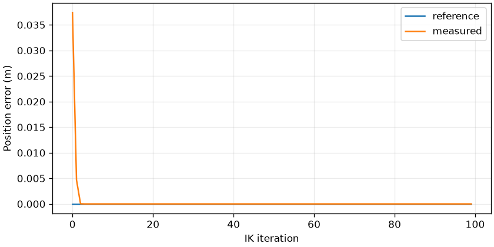

<!-- pal:language:start -->
<p align="right">
  <a href="core-fr3-04.md" lang="ko">한국어</a> | <a href="../../en/lessons/core-fr3-04.md" lang="en">ENGLISH</a>
</p>
<!-- pal:language:end -->

# core-fr3-04 — FR3 기구학, 자코비안과 역기구학

<!-- pal:metadata:start -->
| Field | Value |
|---|---|
| Stage / track | `core / fr3` |
| Legacy alias | `T08` |
| Platforms | `macos-arm64, linux-x86_64` |
| Capabilities | `python-3.12, numpy, mujoco` |
| Prerequisites | `core-fr3-03` |
| Safety | `simulation` |
| Verification | `maintainer-checked` |
| Implementation | `implemented` |
<!-- pal:metadata:end -->

## Reader route

이 수업의 질문은 아래 목표를 실행 결과의 값과 연결해 설명할 수 있는가입니다. 먼저 Expected의 결과 기준을 읽고 실행한 뒤, 관찰·계산·코드를 순서대로 확인합니다.

[터미널 준비·재개·결과 열기·카메라 조작](../READER_GUIDE.md)

[기구학 개념](../concepts/kinematics.md)에서 좌표계와 자코비안의 의미를 확인합니다. “관절 하나를 아주 조금 움직였을 때 말단은 세계 좌표계의 어느 방향으로 움직이는가?”를 먼저 예측하고 두 계산을 대조합니다.

## Learning goals

기하 자코비안을 검증하고 작은 변위의 IK를 풉니다.

## Preflight

장비 setup·매뉴얼 참조: [Franka Research 3](../setup/fr3.md).

처음이면 저장소 루트에서 `sh bootstrap.sh --plan`을 실행하고 계획을 읽은 뒤 `--apply`로 환경을 준비합니다. `source .venv/bin/activate` 후 아래 명령을 사용합니다. 이미 같은 이름의 실행 폴더가 있으면 02처럼 새 이름을 정합니다.

필요한 공개 모델을 한 번 준비합니다:

```bash
pal assets fetch mujoco-menagerie
```

```bash
pal host detect --json
pal lesson check core-fr3-04 --json
```

## Action

```bash
pal lesson run core-fr3-04 --headless --seed 7 --samples 64 --output-dir .local/runs/core-fr3-04/baseline-01 --json
```

## Expected

실제 개발 실행의 예시입니다. 가로축·세로축의 단위와 기준/측정 곡선의 차이를 먼저 읽습니다. 개인 실행 결과는 별도 검사합니다.



analytic과 finite_difference 배열을 비교합니다. 최대 차이는 1e-6 미만, 고정된 3차원 목표 변위의 IK 오차는 1 mm 미만이어야 합니다.

공통 산출물은 summary.json, trace.csv, experiment.json, plot.png, run.json과 lesson-report.md입니다. 모델 수업에는 실제 frame.png 또는 외부 스택의 evaluation/isaac 이미지도 있습니다. 파일 크기만 보지 말고 그래프 축·단위·영상 구도를 직접 확인합니다.

```bash
pal lesson check core-fr3-04 --run-dir .local/runs/core-fr3-04/baseline-01 --json
```

## Observe

먼저 metric의 단위, observed_first/observed_last, checks를 읽습니다. inspection은 검증된 파일만 읽고 종료하며 진도를 완료하지 않습니다.

```bash
pal lesson inspect core-fr3-04 --run-dir .local/runs/core-fr3-04/baseline-01 --json
```

Mac 결과 그래프 열기(창을 닫아도 실행 기록은 유지됩니다):

```bash
open .local/runs/core-fr3-04/baseline-01/plot.png
```

다른 OS의 파일 관리자에서는 같은 PNG를 엽니다. 원시 수치는 아래 JSON에 있습니다.

```bash
python -m json.tool .local/runs/core-fr3-04/baseline-01/experiment.json
```

## How it works

J의 각 열은 한 관절의 각속도를 말단 선속도로 변환합니다. 중앙 유한차분으로 열을 독립적으로 근사합니다. 감쇠 최소제곱은 특이점 부근의 영향을 줄이고 관절 증분을 제한합니다.

$$
\Delta q=J^T(JJ^T+\lambda I)^{-1}\Delta x
$$

기호·단위·조건: J: 3×nv 병진 Jacobian; x: 세계 좌표 m; q: rad; λ는 JJᵀ 정규화.

손으로 계산하는 예시(실행 측정값이 아님): J=0.5 m/rad, Δx=0.01 m, λ=0.0001 (m/rad)² → Δq≈0.019992 rad.

실전 연결: 특이점 근처에서는 작은 위치 변경에도 큰 관절 변화가 필요합니다.

### 위치 함수와 미분의 크기

순기구학 $x=f(q)$는 길이 7인 관절 배열(rad)을 길이 3인 말단 위치 배열(m)로 바꿉니다. 이 수업의 $x$는 `site_xpos[0]`이며 세계 좌표계 기준입니다. 말단 자세 전체나 툴 좌표계 속도를 풀지 않습니다. 병진 자코비안 $J\in\mathbb{R}^{3\times7}$의 열 $j$는 $\partial x/\partial q_j$이고 단위는 m/rad입니다.

중앙 차분은 다른 관절을 고정한 채 $q_j$만 양·음 방향으로 바꿉니다.

$$
J_{:,j}^{FD}=\frac{f(q+\epsilon e_j)-f(q-\epsilon e_j)}{2\epsilon},\qquad \epsilon=10^{-6}\ \mathrm{rad}.
$$

여기서 $e_j$는 $j$번째 성분만 1인 길이 7 벡터입니다. 차분 간격을 너무 크게 잡으면 곡률의 영향을 받고 너무 작게 잡으면 부동소수점 뺄셈 오차가 커집니다. 더 작은 간격이 항상 더 정확하지는 않습니다.

### IK는 역행렬 한 번으로 끝나지 않습니다

현재 위치와 목표의 차이 $\Delta x$를 반복해서 다시 계산합니다. 구현의 정규화 계수는 $\lambda=10^{-4}$이며, 표기상 $\lambda^2$가 아닙니다. $JJ^T+\lambda I$는 3×3, 선형계의 해는 길이 3, 최종 $\Delta q$는 길이 7입니다. 각 반복의 관절 증분은 ±0.08 rad로 잘리고 관절 범위 안으로 제한됩니다. 이 절차는 위치 잔차를 줄이는 수치 IK이며 충돌 회피·힘 제어·실물 경로 검증을 수행하지 않습니다.

## Code connection

[`run.py`](../../../examples/core-fr3-04/run.py) → [`runner.py`](../../../src/pai_lab/lessons/runner.py) → [`physics.py`](../../../src/pai_lab/lessons/physics.py)의 `jacobian`, `inverse_kinematics`, `run` 분기를 읽습니다.

`mj_jacSite`로 얻은 해석적 배열과 관절을 실제로 ±ε 변위한 배열을 독립적으로 계산합니다. 둘 다 원래 자세에서 구하고, 차분 뒤에는 `original`을 복구합니다. IK는 그 자세의 말단 위치에서 `[0.03, 0.02, 0.01]` m 이동한 고정 목표에 100회 반복합니다. 차분의 ε는 IK 계산에 전달되지 않으므로 ε를 바꾸어도 같은 IK 잔차 곡선을 얻을 수 있습니다.

### 관찰할 배열과 축

`jacobian.json` 또는 `experiment.json`의 `payload.analytic`과 `payload.finite_difference`는 3×7 배열입니다. `jacobian_max_error`는 모든 성분의 최대 절댓값 차이(m/rad), `ik_errors_m`는 100개 위치 잔차(m)입니다. `trace.csv`의 첫 열은 IK 반복 인덱스이고 시간(초)이 아닙니다. `plot.png`의 관찰 곡선은 이 잔차를 그립니다. 기준 0선은 목표 잔차이며 별도로 실행한 제어기의 응답이 아닙니다.

## Try it

중앙 유한차분 간격 ε를 10⁻⁶ → 2×10⁻⁶ rad로 바꿉니다. IK 목표는 같습니다. J의 단위는 m/rad, Δq는 rad, Δx는 m입니다.

```bash
pal lesson run core-fr3-04 --headless --seed 7 --samples 64 --output-dir .local/runs/core-fr3-04/comparison-01 --variant 2 --json
```

seed·표본 수·variant 중 위 명령의 한 값만 바꿉니다. 기본 결과와 비교 결과의 수치·형상·한계를 설명합니다. 차이가 없으면 해당 변수가 이 실험에서 불변인 이유를 설명하고 성능 개선으로 꾸미지 않습니다.

```bash
pal lesson compare core-fr3-04 --run-dir .local/runs/core-fr3-04/baseline-01 --comparison-run-dir .local/runs/core-fr3-04/comparison-01 --output-dir .local/comparisons/core-fr3-04/comparison-01 --json
```

<details>
<summary>선택 심화: 가정이 깨지면 무엇이 달라질까요?</summary>

본문 식의 입력 하나를 고르고 단위를 적습니다. 그 값이 두 배일 때 출력이 두 배인지, 포화·정규화·좌표 변환 때문에 다른지 코드에서 확인합니다. 다른 가정이나 모델까지 동시에 바꾸면 한 변수 비교가 아니므로 별도 실행으로 기록합니다.

</details>

### 비교 전에 적을 예측

`--variant 2`는 이 분기에서 ε만 2×10⁻⁶ rad로 바꿉니다. `jacobian_max_error`는 달라질 수 있지만 IK 목표·정규화·반복 횟수는 그대로입니다. 그래프가 같다면 비교 실패가 아니라 두 계산 경로의 분리를 보여주는 결과일 수 있습니다. [과거 검증](../../verification/reader-experience.md)의 IK 잔차는 두 조건 모두 약 1.387779×10⁻¹⁶ m였습니다. 그 값은 당시 실행 기록이며 지금도 동일해야 하는 승인 기준은 아닙니다.

## Recovery

capability-unavailable이면 missing 목록에 나온 Python·모델·플랫폼·외부 스택을 준비한 뒤 같은 수업을 새 폴더에서 재실행합니다. 실패한 run.json과 수치를 보존합니다. 시스템 패키지·드라이버·CUDA·ROS·Isaac·대형 모델은 자동 설치하지 않습니다. 체크섬 오류는 vendor 소스를 수정하지 말고 고정 캐시를 복구합니다.

## Checkpoint

명령을 그대로 복사하기 전에 `--notes`를 자신이 관찰한 구체적인 수치와 해석으로 바꿉니다. 접수된 [개선점]을 먼저 저장·수정·재검증합니다. 미해결 개선점, 변경된 실행 코드, 손상된 산출물은 완료를 막습니다. 실행만으로 진도가 완료되지 않습니다. 완료 후 여기서 멈춥니다.

```bash
pal lesson review core-fr3-04 --run-dir .local/runs/core-fr3-04/baseline-01 --comparison-run-dir .local/runs/core-fr3-04/comparison-01 --notes "측정 결과와 한 변수 비교를 설명하고 그래프와 렌더링을 확인했습니다." --json
pal lesson finish core-fr3-04 --run-dir .local/runs/core-fr3-04/baseline-01 --json
```

### 이해 확인

1. 3×7 배열의 두 번째 행과 세 번째 열은 각각 무엇을 뜻하나요?
2. $J^T\Delta x$만 사용하는 방법과 정규화된 선형계를 푸는 방법은 왜 다른가요?
3. ε를 바꾼 뒤 Jacobian 차이는 변했지만 IK 곡선이 같다면 코드의 어떤 연결이 그 결과를 설명하나요?

답에는 좌표계, m/rad 단위, `analytic`의 배열 크기와 최종 위치 잔차를 적습니다.

답의 기준: 두 번째 행은 세계 y 변위, 세 번째 열은 세 번째 관절의 미소 회전 효과입니다. 정규화 선형계는 축 사이의 스케일·결합을 반영합니다. ε는 검증용 차분에만 쓰이므로 IK는 같은 목표와 같은 Jacobian 함수로 같은 잔차를 만들 수 있습니다.

<!-- pal:navigation:start -->
## Next lesson

[core-fr3-05](./core-fr3-05.md)

다음 항목은 목차 순서입니다. 실제 선택은 `pal course next --json`이 준비 상태로 결정합니다.
<!-- pal:navigation:end -->
