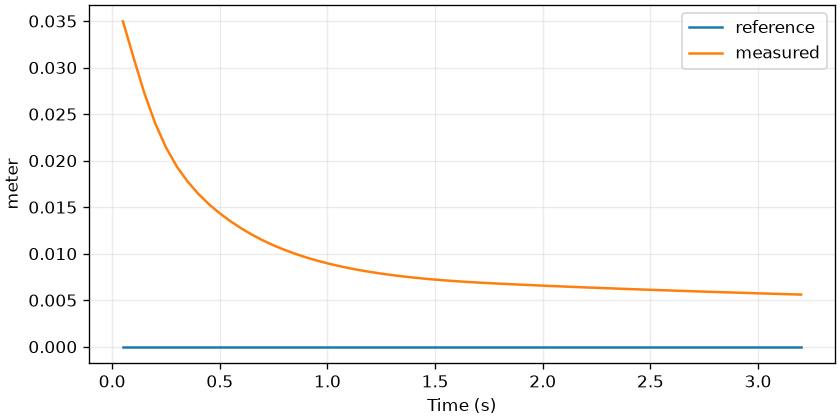

<!-- pal:language:start -->
<p align="right">
  <a href="core-fr3-05.md" lang="ko">한국어</a> | <a href="../../en/lessons/core-fr3-05.md" lang="en">ENGLISH</a>
</p>
<!-- pal:language:end -->

# core-fr3-05 — FR3 작업 공간 제어

<!-- pal:metadata:start -->
| Field | Value |
|---|---|
| Stage / track | `core / fr3` |
| Legacy alias | `T09` |
| Platforms | `macos-arm64, linux-x86_64` |
| Capabilities | `python-3.12, numpy, mujoco` |
| Prerequisites | `core-fr3-04` |
| Safety | `simulation` |
| Verification | `maintainer-checked` |
| Implementation | `implemented` |
<!-- pal:metadata:end -->

## Reader route

이 수업의 질문은 아래 목표를 실행 결과의 값과 연결해 설명할 수 있는가입니다. 먼저 Expected의 결과 기준을 읽고 실행한 뒤, 관찰·계산·코드를 순서대로 확인합니다.

[터미널 준비·재개·결과 열기·카메라 조작](../READER_GUIDE.md)

먼저 [개념 교재: control-contact](../concepts/control-contact.md)를 읽고, [장비를 늘리는 학습 순서](../equipment-stages.md)에서 이 수업의 실행 단계를 확인합니다.

## Learning goals

작업 공간 관성을 사용해 월드 좌표의 말단 위치를 제어합니다.

## Preflight

장비 setup·매뉴얼 참조: [Franka Research 3](../setup/fr3.md).

처음이면 저장소 루트에서 `sh bootstrap.sh --plan`을 실행하고 계획을 읽은 뒤 `--apply`로 환경을 준비합니다. `source .venv/bin/activate` 후 아래 명령을 사용합니다. 이미 같은 이름의 실행 폴더가 있으면 02처럼 새 이름을 정합니다.

필요한 공개 모델을 한 번 준비합니다:

```bash
pal assets fetch mujoco-menagerie
```

```bash
pal host detect --json
pal lesson check core-fr3-05 --json
```

## Action

```bash
pal lesson run core-fr3-05 --headless --seed 7 --samples 64 --output-dir .local/runs/core-fr3-05/baseline-01 --json
```

## Expected

실제 개발 실행의 예시입니다. 가로축·세로축의 단위와 기준/측정 곡선의 차이를 먼저 읽습니다. 개인 실행 결과는 별도 검사합니다.



목표 변위는 (0.03, 0.02, 0.01) m입니다. 위치 오차와 관절 토크를 읽습니다. 최종 위치 오차는 0.04 m 미만이며 상태가 모두 유한해야 합니다.

공통 산출물은 summary.json, trace.csv, experiment.json, plot.png, run.json과 lesson-report.md입니다. 모델 수업에는 실제 frame.png 또는 외부 스택의 evaluation/isaac 이미지도 있습니다. 파일 크기만 보지 말고 그래프 축·단위·영상 구도를 직접 확인합니다.

```bash
pal lesson check core-fr3-05 --run-dir .local/runs/core-fr3-05/baseline-01 --json
```

## Observe

먼저 metric의 단위, observed_first/observed_last, checks를 읽습니다. inspection은 검증된 파일만 읽고 종료하며 진도를 완료하지 않습니다.

```bash
pal lesson inspect core-fr3-05 --run-dir .local/runs/core-fr3-05/baseline-01 --json
```

Mac 결과 그래프 열기(창을 닫아도 실행 기록은 유지됩니다):

```bash
open .local/runs/core-fr3-05/baseline-01/plot.png
```

다른 OS의 파일 관리자에서는 같은 PNG를 엽니다. 원시 수치는 아래 JSON에 있습니다.

```bash
python -m json.tool .local/runs/core-fr3-05/baseline-01/experiment.json
```

## How it works

질량 행렬 M은 관절 가속도를 결합합니다. 작업 공간 관성 Λ는 직교 좌표 가속도를 힘으로 바꾸고 Jᵀ는 그 힘을 관절 토크로 변환합니다. 이 실험은 6차원 전체 자세가 아니라 위치만 제어합니다.

$$
\Lambda=(JM^{-1}J^T+\lambda I)^{-1},\qquad\tau_{\mathrm{req}}=J^T\Lambda a+c+g-k_q\dot q
$$

유효 질량 $\Lambda$의 단위는 kg, 병진 가속도 요청 $a$의 단위는 m/s², $J$의 단위는 m/rad입니다. 정규화 항 $\lambda$의 단위는 역질량입니다. 관절 감쇠 계수는 $k_q=2$ N·m·s/rad입니다. 제어기는 요청 토크 $\tau_{\mathrm{req}}$를 관절별 토크 한계 안으로 제한한 뒤 적용합니다.

손으로 계산하는 예시(실행 측정값이 아님): 2 kg × 0.1 m/s² = 0.2 N; 0.5 m/rad × 0.2 N = 0.1 Nm.

실전 연결: 병진만 제어하며 전체 자세 제어와 정확한 Jdot 보상은 포함하지 않습니다.

### 말단의 힘은 어떻게 관절 토크가 되는가

말단 사이트에서 월드 좌표계로 표현한 힘 $f$ (N)와 병진 속도 $v$ (m/s)를 짝지으면 일률 $f^\top v$ (W)를 구할 수 있습니다. 같은 일률을 관절 쪽에서 쓰면 $\tau_f^\top\dot q$입니다. 여기서 $\tau_f$는 이 힘에 해당하는 관절 토크 벡터입니다. 같은 사이트와 좌표계의 병진 자코비안 $J$에 대해 $v=J\dot q$를 대입하면 다음 관계를 얻습니다.

$$
f^\top v=f^\top J\dot q=(J^\top f)^\top\dot q=\tau_f^\top\dot q.
$$

이 식은 모든 관절 속도에 대해 성립하므로 $\tau_f=J^\top f$입니다. 코드에서 `jac.T @ force`는 7×3 행렬과 힘의 3원소 벡터를 곱해 관절 토크 7개를 구합니다. $M$은 7×7이므로 $JM^{-1}J^\top$은 3×3입니다. 그 행렬에 정규화 항을 더한 뒤 역행렬을 구하면 병진 가속도 요청을 힘으로 바꾸는 유효 질량 $\Lambda$를 얻습니다. 저장한 토크에는 이 힘의 기여분에 편향력과 관절 감쇠를 합하고 포화를 적용한 결과가 들어 있습니다. 회전 모멘트까지 포함한 표현은 [자코비안과 일률](../concepts/control-contact.md#jacobian-power)에서 확인할 수 있습니다.

## Code connection

`examples/core-fr3-05/run.py` → `src/pai_lab/lessons/runner.py` → `src/pai_lab/lessons/physics.py`. runner는 실행을 기록하고 실험 모듈이 실제 상태에서 수치를 계산합니다. `experiment.json`의 payload를 계산 코드와 대조합니다.

### 실제 코드와 산출물 읽기

[`physics.py`](../../../src/pai_lab/lessons/physics.py)와 [`runner.py`](../../../src/pai_lab/lessons/runner.py)의 dispatch를 대조합니다.

`physics.arm_control`의 task branch는 세계 위치 오차 [0.03,0.02,0.01] m에서 힘을 계산하고 `jac.T @ force + data.qfrc_bias - 2 * data.qvel`을 적용합니다. 최종 torque는 관절별 모델 한계로 잘립니다. `task-space-response.csv`와 `payload.final_error`는 위치 오차(m), `torque_nm`은 관절 토크입니다.

## Try it

작업 공간 가속도 이득을 120 → 180 s⁻²로 바꾸며 감쇠는 2√gain을 따릅니다. M은 kg·m², Λ는 kg, 힘은 N, 토크는 Nm입니다.

```bash
pal lesson run core-fr3-05 --headless --seed 7 --samples 64 --output-dir .local/runs/core-fr3-05/comparison-01 --variant 1.5 --json
```

seed·표본 수·variant 중 위 명령의 한 값만 바꿉니다. 기본 결과와 비교 결과의 수치·형상·한계를 설명합니다. 차이가 없으면 해당 변수가 이 실험에서 불변인 이유를 설명하고 성능 개선으로 꾸미지 않습니다.

```bash
pal lesson compare core-fr3-05 --run-dir .local/runs/core-fr3-05/baseline-01 --comparison-run-dir .local/runs/core-fr3-05/comparison-01 --output-dir .local/comparisons/core-fr3-05/comparison-01 --json
```

<details>
<summary>선택 심화: 가정이 깨지면 무엇이 달라질까요?</summary>

본문 식의 입력 하나를 고르고 단위를 적습니다. 그 값이 두 배일 때 출력이 두 배인지, 포화·정규화·좌표 변환 때문에 다른지 코드에서 확인합니다. 다른 가정이나 모델까지 동시에 바꾸면 한 변수 비교가 아니므로 별도 실행으로 기록합니다.

</details>

### 바꾸기 전에 예측하기

variant 1.5는 가속도 이득 120→180 s⁻²와 2√gain 감쇠를 함께 바꿉니다. 동일 목표라도 포화·동역학 때문에 오차가 1/1.5가 된다고 예측할 수 없습니다. 첫 원시 계산과 실제 trace를 비교해 이 한계를 설명합니다.

## Recovery

capability-unavailable이면 missing 목록에 나온 Python·모델·플랫폼·외부 스택을 준비한 뒤 같은 수업을 새 폴더에서 재실행합니다. 실패한 run.json과 수치를 보존합니다. 시스템 패키지·드라이버·CUDA·ROS·Isaac·대형 모델은 자동 설치하지 않습니다. 체크섬 오류는 vendor 소스를 수정하지 말고 고정 캐시를 복구합니다.

## Checkpoint

명령을 그대로 복사하기 전에 `--notes`를 자신이 관찰한 구체적인 수치와 해석으로 바꿉니다. 접수된 [개선점]을 먼저 저장·수정·재검증합니다. 미해결 개선점, 변경된 실행 코드, 손상된 산출물은 완료를 막습니다. 실행만으로 진도가 완료되지 않습니다. 완료 후 여기서 멈춥니다.

```bash
pal lesson review core-fr3-05 --run-dir .local/runs/core-fr3-05/baseline-01 --comparison-run-dir .local/runs/core-fr3-05/comparison-01 --notes "측정 결과와 한 변수 비교를 설명하고 그래프와 렌더링을 확인했습니다." --json
pal lesson finish core-fr3-05 --run-dir .local/runs/core-fr3-05/baseline-01 --json
```

### 이해 확인과 답의 기준

**`payload.torque_nm`에 저장한 값과 `jac.T @ force`는 어떤 관계인가요?**

$v=J\dot q$와 일률 관계에서 나온 $J^\top f$는 사이트에서 요청한 힘의 토크 기여분입니다. 저장값에는 편향력과 감쇠를 합한 뒤 토크 한계를 적용한 결과가 들어 있습니다.

질문: pose_error라는 metric 이름은 완전한 자세 제어인가요? 답: 여기서는 위치 오차만 뜻합니다. 위치 오차·관절 토크·감쇠 항을 구분해 적습니다.

<!-- pal:navigation:start -->
## Next lesson

[core-fr3-06](./core-fr3-06.md)

다음 항목은 목차 순서입니다. 실제 선택은 `pal course next --json`이 준비 상태로 결정합니다.
<!-- pal:navigation:end -->
