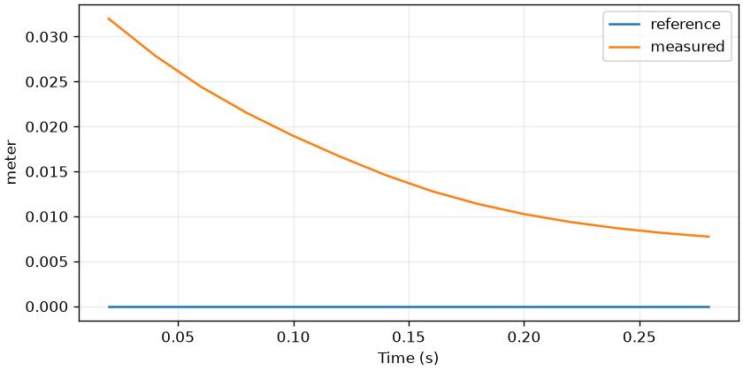

<!-- pal:language:start -->
<p align="right">
  <a href="core-fr3-07.md" lang="ko">한국어</a> | <a href="../../en/lessons/core-fr3-07.md" lang="en">ENGLISH</a>
</p>
<!-- pal:language:end -->

# core-fr3-07 — ROS 없는 FR3 도달 환경

<!-- pal:metadata:start -->
| Field | Value |
|---|---|
| Stage / track | `core / fr3` |
| Legacy alias | `T22` |
| Platforms | `macos-arm64, linux-x86_64` |
| Capabilities | `python-3.12, numpy, mujoco` |
| Prerequisites | `core-fr3-04` |
| Safety | `simulation` |
| Verification | `maintainer-checked` |
| Implementation | `implemented` |
<!-- pal:metadata:end -->

## Reader route

이 수업의 질문은 아래 목표를 실행 결과의 값과 연결해 설명할 수 있는가입니다. 먼저 Expected의 결과 기준을 읽고 실행한 뒤, 관찰·계산·코드를 순서대로 확인합니다.

[터미널 준비·재개·결과 열기·카메라 조작](../READER_GUIDE.md)

먼저 [개념 교재: reinforcement-learning](../concepts/reinforcement-learning.md)를 읽고, [장비를 늘리는 학습 순서](../equipment-stages.md)에서 이 수업의 실행 단계를 확인합니다.

## Learning goals

FR3 도달 과제의 reset·관측·행동·보상·에피소드 경계를 사용합니다.

## Preflight

장비 setup·매뉴얼 참조: [Franka Research 3](../setup/fr3.md).

처음이면 저장소 루트에서 `sh bootstrap.sh --plan`을 실행하고 계획을 읽은 뒤 `--apply`로 환경을 준비합니다. `source .venv/bin/activate` 후 아래 명령을 사용합니다. 이미 같은 이름의 실행 폴더가 있으면 02처럼 새 이름을 정합니다.

필요한 공개 모델을 한 번 준비합니다:

```bash
pal assets fetch mujoco-menagerie
```

```bash
pal host detect --json
pal lesson check core-fr3-07 --json
```

## Action

```bash
pal lesson run core-fr3-07 --headless --seed 7 --samples 64 --output-dir .local/runs/core-fr3-07/baseline-01 --json
```

## Expected

실제 개발 실행의 예시입니다. 가로축·세로축의 단위와 기준/측정 곡선의 차이를 먼저 읽습니다. 개인 실행 결과는 별도 검사합니다.



transitions.json의 각 전이를 읽습니다. 기본 자코비안 제어기가 거리를 줄여야 합니다. 스텝 수를 세고 성공과 시간 초과를 구분합니다.

공통 산출물은 summary.json, trace.csv, experiment.json, plot.png, run.json과 lesson-report.md입니다. 모델 수업에는 실제 frame.png 또는 외부 스택의 evaluation/isaac 이미지도 있습니다. 파일 크기만 보지 말고 그래프 축·단위·영상 구도를 직접 확인합니다.

```bash
pal lesson check core-fr3-07 --run-dir .local/runs/core-fr3-07/baseline-01 --json
```

## Observe

먼저 metric의 단위, observed_first/observed_last, checks를 읽습니다. inspection은 검증된 파일만 읽고 종료하며 진도를 완료하지 않습니다.

```bash
pal lesson inspect core-fr3-07 --run-dir .local/runs/core-fr3-07/baseline-01 --json
```

Mac 결과 그래프 열기(창을 닫아도 실행 기록은 유지됩니다):

```bash
open .local/runs/core-fr3-07/baseline-01/plot.png
```

다른 OS의 파일 관리자에서는 같은 PNG를 엽니다. 원시 수치는 아래 JSON에 있습니다.

```bash
python -m json.tool .local/runs/core-fr3-07/baseline-01/experiment.json
```

## How it works

관측은 관절 위치 차이 7개, 스케일한 속도 7개, 월드 목표 오차 3개입니다. 제한된 행동 7개가 관절 위치 목표를 바꿉니다. 도달 성공은 terminated, 64스텝 시간 제한은 truncated로 구분해야 PPO bootstrap이 올바릅니다.

$$
o=[q-q_0,\;0.1\dot q,\;10(x^*-x)]\in\mathbb R^{17}
$$

기호·단위·조건: q: rad; qdot: rad/s; x: 세계 m; 0.1과 10: 관측 성분별 수치 배율.

손으로 계산하는 예시(실행 측정값이 아님): 7 + 7 + 3 = 17.

실전 연결: 목표 종료와 시간 제한 종료는 가치 추정 처리 방법이 다릅니다.

### 입력에서 관측까지

강화학습 환경은 상태·행동·보상과 종료 의미를 함께 정의하는 약속입니다. 이 수업의 관측은 [q-qhome,0.1qdot,10(x*-x)] 길이 17, 잠재 행동은 길이 7입니다. q는 rad, qdot은 rad/s, 위치 오차는 세계 m이며 수치 배율이 입력에 포함됩니다.

## Code connection

`examples/core-fr3-07/run.py` → `src/pai_lab/lessons/runner.py` → `src/pai_lab/lessons/learning.py`. runner는 실행을 기록하고 실험 모듈이 실제 상태에서 수치를 계산합니다. `experiment.json`의 payload를 계산 코드와 대조합니다.

### 실제 코드와 산출물 읽기

[`learning.py`](../../../src/pai_lab/lessons/learning.py)와 [`runner.py`](../../../src/pai_lab/lessons/runner.py)의 dispatch를 대조합니다.

실제 runner는 이 ID를 `learning.run`으로 보냅니다. `Reach`가 관절 목표 q+0.03 tanh(action)을 제한해 10회 적분하며, scripted Jacobian 제어기가 arctanh로 잠재 행동을 만듭니다. `transitions.json`의 observation/action은 적분 전, next_observation은 후입니다. 10 mm 안을 연속 10단계 유지하면 terminated, 64단계면 truncated입니다. 단순 마지막 거리 감소 검사만으로 성공 유지 조건 통과를 단정하지 않습니다.

## Try it

제어 명령을 제한된 잠재 행동으로 변환하기 전 배율을 1 → 1.5로 바꿉니다. 관찰 17개·행동 7개 계약과 종료 조건을 확인합니다.

```bash
pal lesson run core-fr3-07 --headless --seed 7 --samples 64 --output-dir .local/runs/core-fr3-07/comparison-01 --variant 1.5 --json
```

seed·표본 수·variant 중 위 명령의 한 값만 바꿉니다. 기본 결과와 비교 결과의 수치·형상·한계를 설명합니다. 차이가 없으면 해당 변수가 이 실험에서 불변인 이유를 설명하고 성능 개선으로 꾸미지 않습니다.

```bash
pal lesson compare core-fr3-07 --run-dir .local/runs/core-fr3-07/baseline-01 --comparison-run-dir .local/runs/core-fr3-07/comparison-01 --output-dir .local/comparisons/core-fr3-07/comparison-01 --json
```

<details>
<summary>선택 심화: 가정이 깨지면 무엇이 달라질까요?</summary>

본문 식의 입력 하나를 고르고 단위를 적습니다. 그 값이 두 배일 때 출력이 두 배인지, 포화·정규화·좌표 변환 때문에 다른지 코드에서 확인합니다. 다른 가정이나 모델까지 동시에 바꾸면 한 변수 비교가 아니므로 별도 실행으로 기록합니다.

</details>

### 바꾸기 전에 예측하기

variant 1.5는 명령을 1.5배한 뒤 [-0.9,0.9] 제한·arctanh를 거칩니다. 계산 예시로 제한 전 값 0.8은 1.2가 되어 0.9로 잘립니다. 실제 목표 증분은 단순 1.5배가 아닐 수 있으며 종료 flag와 마지막 거리를 함께 비교합니다.

## Recovery

capability-unavailable이면 missing 목록에 나온 Python·모델·플랫폼·외부 스택을 준비한 뒤 같은 수업을 새 폴더에서 재실행합니다. 실패한 run.json과 수치를 보존합니다. 시스템 패키지·드라이버·CUDA·ROS·Isaac·대형 모델은 자동 설치하지 않습니다. 체크섬 오류는 vendor 소스를 수정하지 말고 고정 캐시를 복구합니다.

## Checkpoint

명령을 그대로 복사하기 전에 `--notes`를 자신이 관찰한 구체적인 수치와 해석으로 바꿉니다. 접수된 [개선점]을 먼저 저장·수정·재검증합니다. 미해결 개선점, 변경된 실행 코드, 손상된 산출물은 완료를 막습니다. 실행만으로 진도가 완료되지 않습니다. 완료 후 여기서 멈춥니다.

```bash
pal lesson review core-fr3-07 --run-dir .local/runs/core-fr3-07/baseline-01 --comparison-run-dir .local/runs/core-fr3-07/comparison-01 --notes "측정 결과와 한 변수 비교를 설명하고 그래프와 렌더링을 확인했습니다." --json
pal lesson finish core-fr3-07 --run-dir .local/runs/core-fr3-07/baseline-01 --json
```

### 이해 확인과 답의 기준

질문: observation의 마지막 3값이 원시 m 값인가요? 답: 10배한 오차입니다. 질문: timeout과 성공은 같나요? 답: truncated와 terminated로 구분합니다. 다음 PPO 수업에서 이 차이가 value bootstrap에 왜 필요한지 설명해 보세요.

<!-- pal:navigation:start -->
## Next lesson

[core-fr3-08](./core-fr3-08.md)

다음 항목은 목차 순서입니다. 실제 선택은 `pal course next --json`이 준비 상태로 결정합니다.
<!-- pal:navigation:end -->
