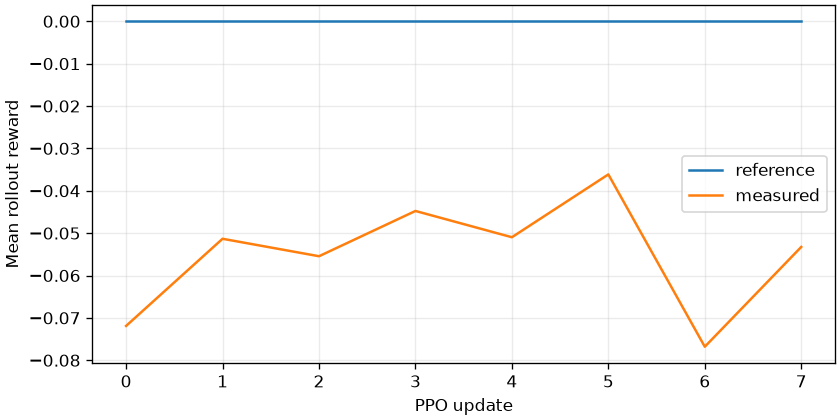

<!-- pal:language:start -->
<p align="right">
  <a href="core-fr3-08.md" lang="ko">한국어</a> | <a href="../../en/lessons/core-fr3-08.md" lang="en">ENGLISH</a>
</p>
<!-- pal:language:end -->

# core-fr3-08 — FR3 도달 과제 PPO

<!-- pal:metadata:start -->
| Field | Value |
|---|---|
| Stage / track | `core / fr3` |
| Legacy alias | `T24` |
| Platforms | `macos-arm64, linux-x86_64` |
| Capabilities | `python-3.12, numpy, mujoco` |
| Prerequisites | `core-fr3-07, core-rl-01` |
| Safety | `simulation` |
| Verification | `maintainer-checked` |
| Implementation | `implemented` |
<!-- pal:metadata:end -->

## Reader route

이 수업의 질문은 아래 목표를 실행 결과의 값과 연결해 설명할 수 있는가입니다. 먼저 Expected의 결과 기준을 읽고 실행한 뒤, 관찰·계산·코드를 순서대로 확인합니다.

[터미널 준비·재개·결과 열기·카메라 조작](../READER_GUIDE.md)

[강화학습 개념](../concepts/reinforcement-learning.md)을 읽고 “가중치가 바뀌었다”와 “새 목표를 안정적으로 달성한다”를 별개의 주장으로 나누어 봅니다. 이 수업은 짧은 학습·직렬화 경로와 독립 평가를 연결합니다.

## Learning goals

실제 FR3 도달 환경에서 PPO를 학습·저장·재로딩합니다.

## Preflight

장비 setup·매뉴얼 참조: [Franka Research 3](../setup/fr3.md).

처음이면 저장소 루트에서 `sh bootstrap.sh --plan`을 실행하고 계획을 읽은 뒤 `--apply`로 환경을 준비합니다. `source .venv/bin/activate` 후 아래 명령을 사용합니다. 이미 같은 이름의 실행 폴더가 있으면 02처럼 새 이름을 정합니다.

필요한 공개 모델을 한 번 준비합니다:

```bash
pal assets fetch mujoco-menagerie
```

```bash
pal host detect --json
pal lesson check core-fr3-08 --json
```

## Action

```bash
pal lesson run core-fr3-08 --headless --seed 7 --samples 64 --output-dir .local/runs/core-fr3-08/baseline-01 --json
```

## Expected

고정된 공개 모델로 실행해 검토한 예시입니다. 개인 실행 결과는 별도로 검사합니다.



policy-contract.json, 파라미터 변화, rollout 보상을 읽습니다. 학습률만 비교합니다. 보상은 변동할 수 있으며 별도 평가 기준을 충족하기 전에는 performance_verified를 false로 유지합니다.

공통 산출물은 summary.json, trace.csv, experiment.json, plot.png, run.json과 lesson-report.md입니다. 모델 수업에는 실제 frame.png 또는 외부 스택의 evaluation/isaac 이미지도 있습니다. 파일 크기만 보지 말고 그래프 축·단위·영상 구도를 직접 확인합니다.

```bash
pal lesson check core-fr3-08 --run-dir .local/runs/core-fr3-08/baseline-01 --json
```

## Observe

`evaluation.json`은 독립 목표 20개에서 10 mm 이내를 연속 10 제어 단계 유지한 횟수를 기록합니다. 16/20 미만이면 성능 미달이며 optimizer 검사 통과와 구분합니다. 이 기준은 실물 허용 오차가 아닙니다.

먼저 metric의 단위, observed_first/observed_last, checks를 읽습니다. inspection은 검증된 파일만 읽고 종료하며 진도를 완료하지 않습니다.

```bash
pal lesson inspect core-fr3-08 --run-dir .local/runs/core-fr3-08/baseline-01 --json
```

Mac 결과 그래프 열기(창을 닫아도 실행 기록은 유지됩니다):

```bash
open .local/runs/core-fr3-08/baseline-01/plot.png
```

다른 OS의 파일 관리자에서는 같은 PNG를 엽니다. 원시 수치는 아래 JSON에 있습니다.

```bash
python -m json.tool .local/runs/core-fr3-08/baseline-01/experiment.json
```

## How it works

### 관측·잠재 행동·관절 목표

정책의 입력은 $o=[q-q_{home},\;0.1\dot q,\;10(x^*-x)]$ 순서의 길이 17 배열입니다. 첫 7개는 관절 변위(rad), 다음 7개는 속도(rad/s)에 수치 스케일 0.1을 곱한 값, 마지막 3개는 세계 좌표계의 위치 오차(m)에 10을 곱한 값입니다. 이 스케일은 학습 입력의 수치 규약이며 원래 센서 단위와 구별합니다.

각 성분을 [-5, 5]로 제한하고 바이어스 1을 붙인 길이 18의 입력 $z$를 만듭니다. 가중치 $W$의 크기는 18×7입니다. 학습 중에는 다음처럼 가우시안 잠재 행동 $u$를 표본화하고, 환경에서 tanh를 적용합니다.

$$
\mu=zW,\qquad u\sim\mathcal N(\mu,0.3^2I_7),\qquad
q^*=\operatorname{clip}(q+0.03\tanh u,\;q_{min},q_{max}).
$$

$u$와 $\tanh u$는 정규화된 행동이고 0.03의 단위는 rad입니다. 계산 예시(측정값 아님): 한 성분의 $\tanh u=0.5$이면 목표 증분은 0.015 rad입니다. 평가에서는 잡음을 더하지 않고 $u=\mu$를 사용하지만 동일한 변환·관절 제한을 거칩니다.

### 학습 검사와 성능 검사를 나누기

PPO는 GAE로 계산한 이점을 사용하고 확률비를 [0.8, 1.2]로 제한한 목적을 계산합니다. `--samples 64`일 때 업데이트는 8회, 각 rollout은 128 전이이고 actor 갱신은 rollout당 4회입니다. 이 수업에서 samples는 수집한 전체 전이 수가 아닙니다. 손실이나 보상 곡선 하나가 매번 좋아져야 한다는 조건은 없습니다.

학습 환경의 보상은 $r=-\|x^*-x\|_2-0.001\sum_j u_j^2$입니다. 거리와 행동 비용을 수치적으로 결합한 교육용 보상이며 힘이나 에너지의 측정 단위가 아닙니다. 더 좋은 보상을 얻더라도 새 목표에서 거리 조건을 충분히 오래 유지하지 못할 수 있습니다.

## Code connection

[`learning.py`](../../../src/pai_lab/lessons/learning.py)의 `Reach.observation`, `Reach.step`, `ppo`를 [`runner.py`](../../../src/pai_lab/lessons/runner.py)의 실제 분기와 연결합니다. `Reach.step`은 관절 목표를 설정하고 MuJoCo 적분을 10회 수행합니다. `ppo`는 가중치를 `policy.npz`로 저장한 뒤 재로딩하여 배열 일치를 검사합니다.

[`arm.evaluate`](../../../src/pai_lab/lessons/arm.py)는 평가 난수 seed 10007로 20개의 새 목표를 생성합니다. 이 `Reach` 환경은 64 제어 단계에서 에피소드를 종료하므로 평가 루프의 최대 반복 수 160이 이 수업의 160단계 실행을 뜻하지 않습니다. 10 mm 이내를 연속 10단계 유지하면 한 목표의 성공이며, 16/20 이상이어야 `performance_verified`가 true입니다. 이 값은 시뮬레이션 목표 달성 판정이고 하드웨어 허용 오차가 아닙니다.

### 산출물별로 답할 질문

| 산출물 | 확인할 내용 |
|---|---|
| `experiment.json` | `parameter_delta`가 양수인가, `reload_max_error`가 0인가, `updates`의 보상·clip fraction은 어떤가 |
| `policy.npz` | `weights` 18×7, `value_weights` 길이 18, 잠재 행동 표준편차 `sigma` |
| `policy-contract.json` | 관측 17·행동 7·tanh·`training_scope=optimizer-smoke`, 성능 판정 |
| `evaluation.json` | 목표별 오차와 `success`, 전체 `successes`, `hold_steps`, `hardware_tolerance=false` |

관측 순서와 0.1·10 배율은 여기서 읽은 구현 규약입니다. 현재 `policy-contract.json`은 이 모든 성분별 배율을 담지 않으므로 그 파일만으로 독립 배포가 완성되었다고 설명하지 않습니다.

## Try it

같은 도달 환경에서 actor 경사 갱신 크기를 0.01 → 0.015로 바꿉니다. 짧은 실행의 보상 차이만으로 정책 품질을 판단하지 않습니다.

```bash
pal lesson run core-fr3-08 --headless --seed 7 --samples 64 --output-dir .local/runs/core-fr3-08/comparison-01 --variant 1.5 --json
```

seed·표본 수·variant 중 위 명령의 한 값만 바꿉니다. 기본 결과와 비교 결과의 수치·형상·한계를 설명합니다. 차이가 없으면 해당 변수가 이 실험에서 불변인 이유를 설명하고 성능 개선으로 꾸미지 않습니다.

```bash
pal lesson compare core-fr3-08 --run-dir .local/runs/core-fr3-08/baseline-01 --comparison-run-dir .local/runs/core-fr3-08/comparison-01 --output-dir .local/comparisons/core-fr3-08/comparison-01 --json
```

<details>
<summary>선택 심화: 가정이 깨지면 무엇이 달라질까요?</summary>

본문 식의 입력 하나를 고르고 단위를 적습니다. 그 값이 두 배일 때 출력이 두 배인지, 포화·정규화·좌표 변환 때문에 다른지 코드에서 확인합니다. 다른 가정이나 모델까지 동시에 바꾸면 한 변수 비교가 아니므로 별도 실행으로 기록합니다.

</details>

### 결과를 쓰는 순서

`--variant 1.5`는 `weights += 0.01 * variant * gradient`의 actor 학습률을 0.015로 바꿉니다. 환경 목표 범위·σ·평가 seed는 바꾸지 않습니다. 먼저 파라미터 변화량과 reload 일치를 확인하고, 다음으로 학습 보상, 마지막으로 독립 평가 성공 수를 비교합니다. 같은 seed의 한 쌍만으로 일반적인 성능 향상을 주장할 수 없습니다.

## Recovery

capability-unavailable이면 missing 목록에 나온 Python·모델·플랫폼·외부 스택을 준비한 뒤 같은 수업을 새 폴더에서 재실행합니다. 실패한 run.json과 수치를 보존합니다. 시스템 패키지·드라이버·CUDA·ROS·Isaac·대형 모델은 자동 설치하지 않습니다. 체크섬 오류는 vendor 소스를 수정하지 말고 고정 캐시를 복구합니다.

## Checkpoint

명령을 그대로 복사하기 전에 `--notes`를 자신이 관찰한 구체적인 수치와 해석으로 바꿉니다. 접수된 [개선점]을 먼저 저장·수정·재검증합니다. 미해결 개선점, 변경된 실행 코드, 손상된 산출물은 완료를 막습니다. 실행만으로 진도가 완료되지 않습니다. 완료 후 여기서 멈춥니다.

```bash
pal lesson review core-fr3-08 --run-dir .local/runs/core-fr3-08/baseline-01 --comparison-run-dir .local/runs/core-fr3-08/comparison-01 --notes "측정 결과와 한 변수 비교를 설명하고 그래프와 렌더링을 확인했습니다." --json
pal lesson finish core-fr3-08 --run-dir .local/runs/core-fr3-08/baseline-01 --json
```

### 이해 확인

1. 잠재 행동 $u$와 실제 관절 목표 $q^*$의 크기·단위·변환은 어떻게 다른가요?
2. `parameters_updated=true`, `reload_exact=true`, `performance_verified=false`가 동시에 나와도 모순이 아닌 이유는 무엇인가요?
3. 15/20 성공이나 10 mm 이내 9단계 유지가 왜 이 평가 기준을 통과하지 못하나요?

결과 보고에는 업데이트 수, 가중치 변화량, 재로딩 오차, 독립 평가 성공 수를 각각 적습니다. 짧은 학습 실행을 해결된 정책이나 실물 준비로 표현하지 않습니다.

답의 기준: 잠재 행동은 길이 7의 정규화 배열이며 tanh·0.03 rad 배율·관절 제한을 거쳐 목표가 됩니다. 파라미터 갱신과 정확한 저장 복구는 실행 경로를 검증하고, 16/20 및 연속 10단계 조건은 별도 성능 기준입니다. 한 조건이라도 부족하면 성능 판정은 false입니다.

<!-- pal:navigation:start -->
## Next lesson

[core-enlight-01](./core-enlight-01.md)

다음 항목은 목차 순서입니다. 실제 선택은 `pal course next --json`이 준비 상태로 결정합니다.
<!-- pal:navigation:end -->
