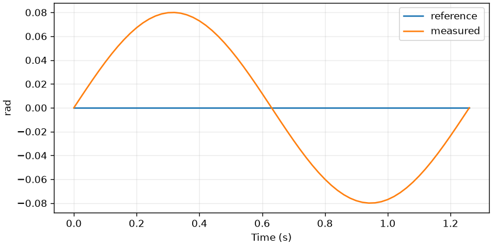
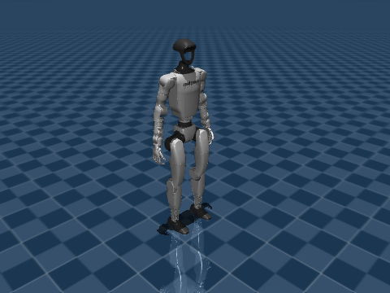

<!-- pal:language:start -->
<p align="right">
  <a href="core-g1-01.md" lang="ko">한국어</a> | <a href="../../en/lessons/core-g1-01.md" lang="en">ENGLISH</a>
</p>
<!-- pal:language:end -->

# core-g1-01 — Unitree G1 재생과 모션 데이터

<!-- pal:metadata:start -->
| Field | Value |
|---|---|
| Stage / track | `core / g1` |
| Legacy alias | `T25` |
| Platforms | `macos-arm64, linux-x86_64` |
| Capabilities | `python-3.12, numpy, mujoco` |
| Prerequisites | `core-03, core-04` |
| Safety | `simulation` |
| Verification | `maintainer-checked` |
| Implementation | `implemented` |
<!-- pal:metadata:end -->

## Reader route

이 수업의 질문은 아래 목표를 실행 결과의 값과 연결해 설명할 수 있는가입니다. 먼저 Expected의 결과 기준을 읽고 실행한 뒤, 관찰·계산·코드를 순서대로 확인합니다.

[터미널 준비·재개·결과 열기·카메라 조작](../READER_GUIDE.md)

먼저 [개념 교재: mobile-motion](../concepts/mobile-motion.md)를 읽고, [장비를 늘리는 학습 순서](../equipment-stages.md)에서 이 수업의 실행 단계를 확인합니다.

## Learning goals

제한된 G1 관절 모션 주기를 기록하고 재생합니다.

## Preflight

장비 setup·매뉴얼 참조: [Unitree G1](../setup/g1.md).

처음이면 저장소 루트에서 `sh bootstrap.sh --plan`을 실행하고 계획을 읽은 뒤 `--apply`로 환경을 준비합니다. `source .venv/bin/activate` 후 아래 명령을 사용합니다. 이미 같은 이름의 실행 폴더가 있으면 02처럼 새 이름을 정합니다.

필요한 공개 모델을 한 번 준비합니다:

```bash
pal assets fetch mujoco-menagerie
```

```bash
pal host detect --json
pal lesson check core-g1-01 --json
```

## Action

```bash
pal lesson run core-g1-01 --headless --seed 7 --samples 64 --output-dir .local/runs/core-g1-01/baseline-01 --json
```

## Expected

실제 개발 실행의 예시입니다. 가로축·세로축의 단위와 기준/측정 곡선의 차이를 먼저 읽습니다. 개인 실행 결과는 별도 검사합니다.



고정된 공개 모델로 실행해 검토한 예시입니다. 개인 실행 결과는 별도로 검사합니다.



joint_names, motion.npz, 주기 연결, 정확한 재생 오차를 읽습니다. variant 1.5는 hinge 진폭을 0.08 rad에서 0.12 rad로 바꿉니다.

공통 산출물은 summary.json, trace.csv, experiment.json, plot.png, run.json과 lesson-report.md입니다. 모델 수업에는 실제 frame.png 또는 외부 스택의 evaluation/isaac 이미지도 있습니다. 파일 크기만 보지 말고 그래프 축·단위·영상 구도를 직접 확인합니다.

```bash
pal lesson check core-g1-01 --run-dir .local/runs/core-g1-01/baseline-01 --json
```

## Observe

먼저 metric의 단위, observed_first/observed_last, checks를 읽습니다. inspection은 검증된 파일만 읽고 종료하며 진도를 완료하지 않습니다.

```bash
pal lesson inspect core-g1-01 --run-dir .local/runs/core-g1-01/baseline-01 --json
```

Mac 결과 그래프 열기(창을 닫아도 실행 기록은 유지됩니다):

```bash
open .local/runs/core-g1-01/baseline-01/plot.png
```

다른 OS의 파일 관리자에서는 같은 PNG를 엽니다. 원시 수치는 아래 JSON에 있습니다.

```bash
python -m json.tool .local/runs/core-g1-01/baseline-01/experiment.json
```

## How it works

공개 G1 모델의 floating base 때문에 qpos에는 quaternion이 포함됩니다. hinge 관절 주소만 바꾸고 저장된 전체 설정을 재생해 순기구학을 계산합니다. 정해진 모션 재생이며 학습된 보행이 아닙니다.

$$
q_h(t)=q_{home}+A\sin(\omega t)
$$

기호·단위·조건: qh: hinge rad; A: rad; ω: rad/s; 자유 base quaternion 보존.

손으로 계산하는 예시(실행 측정값이 아님): A=0.1 rad, phase=π/2 → offset 0.1 rad.

실전 연결: 지정한 FK 재생으로 균형이나 학습 보행을 입증할 수 없습니다.

### 입력에서 관측까지

모션 파일을 저장·재생하는 것은 학습이나 균형 제어에 앞서 상태 순서를 확인하는 단계입니다. 자유 베이스 qpos에는 위치와 quaternion이 포함되므로 hinge 관절만 따로 주소를 찾아야 합니다. 저장 행은 전체 nq 길이 배열이고 일부 회전 관절만 변합니다.

## Code connection

`examples/core-g1-01/run.py` → `src/pai_lab/lessons/runner.py` → `src/pai_lab/lessons/hands.py`. runner는 실행을 기록하고 실험 모듈이 실제 상태에서 수치를 계산합니다. `experiment.json`의 payload를 계산 코드와 대조합니다.

### 실제 코드와 산출물 읽기

[`hands.py`](../../../src/pai_lab/lessons/hands.py)와 [`runner.py`](../../../src/pai_lab/lessons/runner.py)의 dispatch를 대조합니다.

`hands.run`은 hinge id의 `jnt_qposadr`에 0.08×variant×sin(phase)를 더하고 한계로 자릅니다. 각 표본은 `mj_forward`로 평가하며 물리적 보행을 적분하지 않습니다. `motion.npz`의 qpos shape=(samples,nq), dt=0.02 s와 `replay_max_error`를 읽습니다. phase는 samples개 점에서 0~2π이므로 마지막 시각은 (samples-1)×0.02 s입니다. endpoint가 같은 자세라는 closed_cycle 검사와 재로딩 오차 검사는 다른 질문입니다.

scalar의 loop_error라는 이름은 현재 반환된 replay error를 나타내며 payload.loop_error의 endpoint 노름과 이름이 겹칩니다. 두 값을 필드 위치와 함께 보고합니다.

## Try it

힌지 운동 진폭을 0.08 → 0.12 rad로 바꾸고 모델의 관절 제한을 적용합니다. 부유 베이스의 쿼터니언은 보존합니다.

```bash
pal lesson run core-g1-01 --headless --seed 7 --samples 64 --output-dir .local/runs/core-g1-01/comparison-01 --variant 1.5 --json
```

seed·표본 수·variant 중 위 명령의 한 값만 바꿉니다. 기본 결과와 비교 결과의 수치·형상·한계를 설명합니다. 차이가 없으면 해당 변수가 이 실험에서 불변인 이유를 설명하고 성능 개선으로 꾸미지 않습니다.

```bash
pal lesson compare core-g1-01 --run-dir .local/runs/core-g1-01/baseline-01 --comparison-run-dir .local/runs/core-g1-01/comparison-01 --output-dir .local/comparisons/core-g1-01/comparison-01 --json
```

<details>
<summary>선택 심화: 가정이 깨지면 무엇이 달라질까요?</summary>

본문 식의 입력 하나를 고르고 단위를 적습니다. 그 값이 두 배일 때 출력이 두 배인지, 포화·정규화·좌표 변환 때문에 다른지 코드에서 확인합니다. 다른 가정이나 모델까지 동시에 바꾸면 한 변수 비교가 아니므로 별도 실행으로 기록합니다.

</details>

### 바꾸기 전에 예측하기

진폭 0.08→0.12 rad만 바꾸면 hinge 변위는 커지지만 free base는 고정입니다. loop_error나 replay 오차가 계속 0이어도 진폭 변화가 없었다는 뜻은 아닙니다. 최대 hinge 변위와 두 끝점을 따로 비교합니다.

## Recovery

capability-unavailable이면 missing 목록에 나온 Python·모델·플랫폼·외부 스택을 준비한 뒤 같은 수업을 새 폴더에서 재실행합니다. 실패한 run.json과 수치를 보존합니다. 시스템 패키지·드라이버·CUDA·ROS·Isaac·대형 모델은 자동 설치하지 않습니다. 체크섬 오류는 vendor 소스를 수정하지 말고 고정 캐시를 복구합니다.

## Checkpoint

명령을 그대로 복사하기 전에 `--notes`를 자신이 관찰한 구체적인 수치와 해석으로 바꿉니다. 접수된 [개선점]을 먼저 저장·수정·재검증합니다. 미해결 개선점, 변경된 실행 코드, 손상된 산출물은 완료를 막습니다. 실행만으로 진도가 완료되지 않습니다. 완료 후 여기서 멈춥니다.

```bash
pal lesson review core-g1-01 --run-dir .local/runs/core-g1-01/baseline-01 --comparison-run-dir .local/runs/core-g1-01/comparison-01 --notes "측정 결과와 한 변수 비교를 설명하고 그래프와 렌더링을 확인했습니다." --json
pal lesson finish core-g1-01 --run-dir .local/runs/core-g1-01/baseline-01 --json
```

### 이해 확인과 답의 기준

질문: loop가 닫히면 로봇이 넘어지지 않나요? 답: 동적 균형 검사가 없습니다. 질문: qvel에 같은 주소를 써도 되나요? 답: configuration·velocity 주소가 다를 수 있습니다. 다음 GPU 수업은 별도의 reference motion과 학습 환경을 요구합니다.

<!-- pal:navigation:start -->
## Next lesson

[core-il-01](./core-il-01.md)

다음 항목은 목차 순서입니다. 실제 선택은 `pal course next --json`이 준비 상태로 결정합니다.
<!-- pal:navigation:end -->
