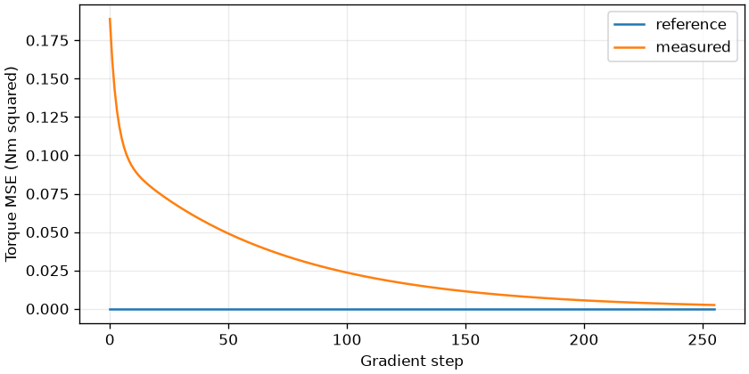

<!-- pal:language:start -->
<p align="right">
  <a href="core-il-01.md" lang="ko">한국어</a> | <a href="../../en/lessons/core-il-01.md" lang="en">ENGLISH</a>
</p>
<!-- pal:language:end -->

# core-il-01 — 행동 복제 기준선

<!-- pal:metadata:start -->
| Field | Value |
|---|---|
| Stage / track | `core / learning` |
| Legacy alias | `T29` |
| Platforms | `macos-arm64, linux-x86_64` |
| Capabilities | `python-3.12, numpy, mujoco` |
| Prerequisites | `core-data-01` |
| Safety | `simulation` |
| Verification | `maintainer-checked` |
| Implementation | `implemented` |
<!-- pal:metadata:end -->

## Reader route

이 수업의 질문은 아래 목표를 실행 결과의 값과 연결해 설명할 수 있는가입니다. 먼저 Expected의 결과 기준을 읽고 실행한 뒤, 관찰·계산·코드를 순서대로 확인합니다.

[터미널 준비·재개·결과 열기·카메라 조작](../READER_GUIDE.md)

먼저 [개념 교재: data-imitation](../concepts/data-imitation.md)를 읽고, [장비를 늘리는 학습 순서](../equipment-stages.md)에서 이 수업의 실행 단계를 확인합니다.

## Learning goals

완료한 에피소드 데이터셋으로 행동 복제를 학습합니다.

## Preflight

처음이면 저장소 루트에서 `sh bootstrap.sh --plan`을 실행하고 계획을 읽은 뒤 `--apply`로 환경을 준비합니다. `source .venv/bin/activate` 후 아래 명령을 사용합니다. 이미 같은 이름의 실행 폴더가 있으면 02처럼 새 이름을 정합니다.

```bash
pal host detect --json
pal lesson check core-il-01 --json
```

## Action

```bash
pal lesson run core-il-01 --headless --seed 7 --samples 64 --output-dir .local/runs/core-il-01/baseline-01 --json
```

## Expected

실제 개발 실행의 예시입니다. 가로축·세로축의 단위와 기준/측정 곡선의 차이를 먼저 읽습니다. 개인 실행 결과는 별도 검사합니다.



원본 데이터 해시, 학습 손실 감소, 0.1 미만의 heldout_mse, 저장 정책의 정확한 재로딩을 확인합니다. variant는 학습률만 바꿉니다.

공통 산출물은 summary.json, trace.csv, experiment.json, plot.png, run.json과 lesson-report.md입니다. 모델 수업에는 실제 frame.png 또는 외부 스택의 evaluation/isaac 이미지도 있습니다. 파일 크기만 보지 말고 그래프 축·단위·영상 구도를 직접 확인합니다.

```bash
pal lesson check core-il-01 --run-dir .local/runs/core-il-01/baseline-01 --json
```

## Observe

먼저 metric의 단위, observed_first/observed_last, checks를 읽습니다. inspection은 검증된 파일만 읽고 종료하며 진도를 완료하지 않습니다.

```bash
pal lesson inspect core-il-01 --run-dir .local/runs/core-il-01/baseline-01 --json
```

Mac 결과 그래프 열기(창을 닫아도 실행 기록은 유지됩니다):

```bash
open .local/runs/core-il-01/baseline-01/plot.png
```

다른 OS의 파일 관리자에서는 같은 PNG를 엽니다. 원시 수치는 아래 JSON에 있습니다.

```bash
python -m json.tool .local/runs/core-il-01/baseline-01/experiment.json
```

## How it works

선형 정책이 각도·속도·상수항으로 시연 토크를 회귀합니다. 0–5번 에피소드로 학습하고 6–7번은 평가에만 사용합니다. 모방 손실이 작아도 시연에서 방문하지 않은 상태의 안정성은 입증되지 않습니다.

$$
L=\frac1N\sum_i\|W^T[q_i,\dot q_i,1]-a_i\|^2
$$

기호·단위·조건: q rad; qdot rad/s; 행동 Nm; 손실 Nm²; 학습·평가 episode 분리.

손으로 계산하는 예시(실행 측정값이 아님): torque errors 1 and 2 Nm → MSE (1+4)/2=2.5 Nm².

실전 연결: 작은 모방 오차가 시연 분포 밖의 상태까지 보장하지는 않습니다.

### 입력에서 관측까지

행동 복제는 시연 상태에서 전문가 토크를 예측하는 회귀 문제입니다. 여기서 배운 것은 폐루프 정책의 안정성 전체가 아니라 저장된 분포에서의 입력-출력 관계입니다. x=[q,qdot,1]은 길이3, W는 3×1, 예측 토크는 길이1(Nm)입니다.

## Code connection

`examples/core-il-01/run.py` → `src/pai_lab/lessons/runner.py` → `src/pai_lab/lessons/learning.py`. runner는 실행을 기록하고 실험 모듈이 실제 상태에서 수치를 계산합니다. `experiment.json`의 payload를 계산 코드와 대조합니다.

### 실제 코드와 산출물 읽기

[`learning.py`](../../../src/pai_lab/lessons/learning.py)와 [`runner.py`](../../../src/pai_lab/lessons/runner.py)의 dispatch를 대조합니다.

`learning.previous_run`이 완료한 core-data-01의 해시 검증된 `episode.jsonl`을 읽습니다. episode0~5는 train,6~7은 heldout이며 `source_sha256`가 데이터 정체성을 남깁니다. `bc-loss.csv`는 train MSE(Nm²), `heldout_mse`는 다른 episode의 MSE이고 `reload_max_error`는 같은 입력에서 저장 전후 예측 차이입니다. samples64에서는 max(64,4samples)=256회 갱신입니다. 세 지표가 각각 일반화·직렬화의 다른 측면을 봅니다.

## Try it

회귀 학습률을 0.15 → 0.225로 바꿉니다. 저장된 데이터셋과 에피소드 분할은 동일합니다.

```bash
pal lesson run core-il-01 --headless --seed 7 --samples 64 --output-dir .local/runs/core-il-01/comparison-01 --variant 1.5 --json
```

seed·표본 수·variant 중 위 명령의 한 값만 바꿉니다. 기본 결과와 비교 결과의 수치·형상·한계를 설명합니다. 차이가 없으면 해당 변수가 이 실험에서 불변인 이유를 설명하고 성능 개선으로 꾸미지 않습니다.

```bash
pal lesson compare core-il-01 --run-dir .local/runs/core-il-01/baseline-01 --comparison-run-dir .local/runs/core-il-01/comparison-01 --output-dir .local/comparisons/core-il-01/comparison-01 --json
```

<details>
<summary>선택 심화: 가정이 깨지면 무엇이 달라질까요?</summary>

본문 식의 입력 하나를 고르고 단위를 적습니다. 그 값이 두 배일 때 출력이 두 배인지, 포화·정규화·좌표 변환 때문에 다른지 코드에서 확인합니다. 다른 가정이나 모델까지 동시에 바꾸면 한 변수 비교가 아니므로 별도 실행으로 기록합니다.

</details>

### 바꾸기 전에 예측하기

학습률 0.15→0.225만 바꾸어도 더 큰 update가 더 좋은 heldout 오차를 보장하지 않습니다. 원본 dataset 해시가 같아야 비교가 학습률 효과를 겨냥합니다. 시연 밖 상태나 실물 접촉으로 결과를 일반화하지 않습니다.

## Recovery

capability-unavailable이면 missing 목록에 나온 Python·모델·플랫폼·외부 스택을 준비한 뒤 같은 수업을 새 폴더에서 재실행합니다. 실패한 run.json과 수치를 보존합니다. 시스템 패키지·드라이버·CUDA·ROS·Isaac·대형 모델은 자동 설치하지 않습니다. 체크섬 오류는 vendor 소스를 수정하지 말고 고정 캐시를 복구합니다.

## Checkpoint

명령을 그대로 복사하기 전에 `--notes`를 자신이 관찰한 구체적인 수치와 해석으로 바꿉니다. 접수된 [개선점]을 먼저 저장·수정·재검증합니다. 미해결 개선점, 변경된 실행 코드, 손상된 산출물은 완료를 막습니다. 실행만으로 진도가 완료되지 않습니다. 완료 후 여기서 멈춥니다.

```bash
pal lesson review core-il-01 --run-dir .local/runs/core-il-01/baseline-01 --comparison-run-dir .local/runs/core-il-01/comparison-01 --notes "측정 결과와 한 변수 비교를 설명하고 그래프와 렌더링을 확인했습니다." --json
pal lesson finish core-il-01 --run-dir .local/runs/core-il-01/baseline-01 --json
```

### 이해 확인과 답의 기준

질문: reload 오차0이면 MSE도0인가요? 답: 같은 부정확한 예측을 정확하게 복구할 수도 있습니다. 질문: train loss 감소만으로 안정 제어기인가요? 답: 별도 rollout 평가가 필요합니다. train·heldout·reload 값을 나누어 적습니다.

<!-- pal:navigation:start -->
## Next lesson

[core-aloha-01](./core-aloha-01.md)

다음 항목은 목차 순서입니다. 실제 선택은 `pal course next --json`이 준비 상태로 결정합니다.
<!-- pal:navigation:end -->
