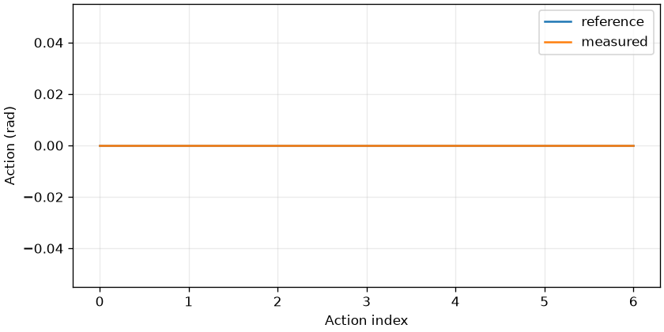

<!-- pal:language:start -->
<p align="right">
  <a href="core-vla-01.md" lang="ko">한국어</a> | <a href="../../en/lessons/core-vla-01.md" lang="en">ENGLISH</a>
</p>
<!-- pal:language:end -->

# core-vla-01 — VLA 프로토콜과 모의 정책 클라이언트

<!-- pal:metadata:start -->
| Field | Value |
|---|---|
| Stage / track | `core / vla` |
| Legacy alias | `T32A` |
| Platforms | `macos-arm64, linux-x86_64` |
| Capabilities | `python-3.12, numpy, mujoco` |
| Prerequisites | `core-data-01` |
| Safety | `simulation` |
| Verification | `maintainer-checked` |
| Implementation | `implemented` |
<!-- pal:metadata:end -->

## Reader route

이 수업의 질문은 아래 목표를 실행 결과의 값과 연결해 설명할 수 있는가입니다. 먼저 Expected의 결과 기준을 읽고 실행한 뒤, 관찰·계산·코드를 순서대로 확인합니다.

[터미널 준비·재개·결과 열기·카메라 조작](../READER_GUIDE.md)

먼저 [개념 교재: vla](../concepts/vla.md)를 읽고, [장비를 늘리는 학습 순서](../equipment-stages.md)에서 이 수업의 실행 단계를 확인합니다.

## Learning goals

명시적인 모의 VLA 프로토콜을 장치 없이 왕복시킵니다.

## Preflight

처음이면 저장소 루트에서 `sh bootstrap.sh --plan`을 실행하고 계획을 읽은 뒤 `--apply`로 환경을 준비합니다. `source .venv/bin/activate` 후 아래 명령을 사용합니다. 이미 같은 이름의 실행 폴더가 있으면 02처럼 새 이름을 정합니다.

```bash
pal host detect --json
pal lesson check core-vla-01 --json
```

## Action

```bash
pal lesson run core-vla-01 --headless --seed 7 --samples 64 --output-dir .local/runs/core-vla-01/baseline-01 --json
```

## Expected

실제 개발 실행의 예시입니다. 가로축·세로축의 단위와 기준/측정 곡선의 차이를 먼저 읽습니다. 개인 실행 결과는 별도 검사합니다.



요청·응답 필드와 단위를 확인합니다. 다른 seed에서도 이 결정론적 fixture 응답은 같아야 하며 로봇에 연결하지 않아야 합니다.

공통 산출물은 summary.json, trace.csv, experiment.json, plot.png, run.json과 lesson-report.md입니다. 모델 수업에는 실제 frame.png 또는 외부 스택의 evaluation/isaac 이미지도 있습니다. 파일 크기만 보지 말고 그래프 축·단위·영상 구도를 직접 확인합니다.

```bash
pal lesson check core-vla-01 --run-dir .local/runs/core-vla-01/baseline-01 --json
```

## Observe

먼저 metric의 단위, observed_first/observed_last, checks를 읽습니다. inspection은 검증된 파일만 읽고 종료하며 진도를 완료하지 않습니다.

```bash
pal lesson inspect core-vla-01 --run-dir .local/runs/core-vla-01/baseline-01 --json
```

Mac 결과 그래프 열기(창을 닫아도 실행 기록은 유지됩니다):

```bash
open .local/runs/core-vla-01/baseline-01/plot.png
```

다른 OS의 파일 관리자에서는 같은 PNG를 엽니다. 원시 수치는 아래 JSON에 있습니다.

```bash
python -m json.tool .local/runs/core-vla-01/baseline-01/experiment.json
```

## How it works

모의 클라이언트가 지시·이미지 fixture 식별자·상태·timeout을 직렬화하고 command-sink 표식과 제한된 행동을 돌려줍니다. 프로토콜 정확성과 신경망 정책 품질은 다릅니다. 모든 결과에 mock 표식을 유지합니다.

$$
\forall i,\quad a_i\in\mathbb R,\quad |a_i|\leq a_{max}
$$

기호·단위·조건: a: 모의 행동 rad; 제한: rad; 유한값 필수.

손으로 계산하는 예시(실행 측정값이 아님): limit 1.0, action 1.2 → reject.

실전 연결: 전송 검증은 신경망 정책의 성능 검증과 다릅니다.

### 입력에서 관측까지

언어·영상·상태를 정책에 보내는 통신 형식부터 확인하면, 잘못된 단위나 누락 필드를 학습 문제와 구분할 수 있습니다. 여기의 영상은 mock-image 식별자 fixture이고 실제 vision encoder 입력이 아닙니다. 상태7개도 모두0인 고정 배열입니다.

## Code connection

`examples/core-vla-01/run.py` → `src/pai_lab/lessons/runner.py` → `src/pai_lab/lessons/learning.py`. runner는 실행을 기록하고 실험 모듈이 실제 상태에서 수치를 계산합니다. `experiment.json`의 payload를 계산 코드와 대조합니다.

### 실제 코드와 산출물 읽기

[`learning.py`](../../../src/pai_lab/lessons/learning.py)와 [`runner.py`](../../../src/pai_lab/lessons/runner.py)의 dispatch를 대조합니다.

`learning.run`은 request를 JSON encode/decode하고 response.actions를 observation×variant로 구성합니다. actions shape는1×7, response units는 rad이며 `mock=true`, `command_sink=true`입니다. `vla-request-response.json`의 request timeout_s=0.1은 필드일 뿐 이 분기에 실제 HTTP 시간 초과 시험은 없습니다. schema_fields10은 request6개+response4개의 개수이며 정책의 정답률이 아닙니다. 경계1.0도 이 mock의 rad 숫자 한계입니다.

## Try it

seed를 7 → 8로 바꿉니다. 구조 검사·고정 모델 화면·결정론적 추론은 동일할 수 있습니다. 원격 서비스는 로컬 seed와 별개로 변할 수 있으므로 이 한계를 기록합니다.

```bash
pal lesson run core-vla-01 --headless --samples 64 --output-dir .local/runs/core-vla-01/comparison-01 --seed 8 --json
```

seed·표본 수·variant 중 위 명령의 한 값만 바꿉니다. 기본 결과와 비교 결과의 수치·형상·한계를 설명합니다. 차이가 없으면 해당 변수가 이 실험에서 불변인 이유를 설명하고 성능 개선으로 꾸미지 않습니다.

```bash
pal lesson compare core-vla-01 --run-dir .local/runs/core-vla-01/baseline-01 --comparison-run-dir .local/runs/core-vla-01/comparison-01 --output-dir .local/comparisons/core-vla-01/comparison-01 --json
```

<details>
<summary>선택 심화: 가정이 깨지면 무엇이 달라질까요?</summary>

본문 식의 입력 하나를 고르고 단위를 적습니다. 그 값이 두 배일 때 출력이 두 배인지, 포화·정규화·좌표 변환 때문에 다른지 코드에서 확인합니다. 다른 가정이나 모델까지 동시에 바꾸면 한 변수 비교가 아니므로 별도 실행으로 기록합니다.

</details>

### 바꾸기 전에 예측하기

seed7→8은 이 분기의 고정 상태나 출력을 바꾸지 않습니다. 0×variant도 항상0입니다. 한 변수 종이 계산으로 action1.2 rad만 바꾸어 생각하면 bound1.0을 넘지만 이것을 실제 서버 호출·학습 실행으로 기록하지 않습니다.

## Recovery

capability-unavailable이면 missing 목록에 나온 Python·모델·플랫폼·외부 스택을 준비한 뒤 같은 수업을 새 폴더에서 재실행합니다. 실패한 run.json과 수치를 보존합니다. 시스템 패키지·드라이버·CUDA·ROS·Isaac·대형 모델은 자동 설치하지 않습니다. 체크섬 오류는 vendor 소스를 수정하지 말고 고정 캐시를 복구합니다.

## Checkpoint

명령을 그대로 복사하기 전에 `--notes`를 자신이 관찰한 구체적인 수치와 해석으로 바꿉니다. 접수된 [개선점]을 먼저 저장·수정·재검증합니다. 미해결 개선점, 변경된 실행 코드, 손상된 산출물은 완료를 막습니다. 실행만으로 진도가 완료되지 않습니다. 완료 후 여기서 멈춥니다.

```bash
pal lesson review core-vla-01 --run-dir .local/runs/core-vla-01/baseline-01 --comparison-run-dir .local/runs/core-vla-01/comparison-01 --notes "측정 결과와 한 변수 비교를 설명하고 그래프와 렌더링을 확인했습니다." --json
pal lesson finish core-vla-01 --run-dir .local/runs/core-vla-01/baseline-01 --json
```

### 이해 확인과 답의 기준

질문: mock=true로 무엇을 확인하나요? 답: 데이터 경로·schema입니다. 질문: request에 instruction이 있으면 VLA 추론인가요? 답: 신경망이 실행되지 않습니다. 실제 SmolVLA와 remote 추론은 별도 준비·runtime 수업으로 연결합니다.

<!-- pal:navigation:start -->
## Next lesson

[sim-ros-01](./sim-ros-01.md)

다음 항목은 목차 순서입니다. 실제 선택은 `pal course next --json`이 준비 상태로 결정합니다.
<!-- pal:navigation:end -->
