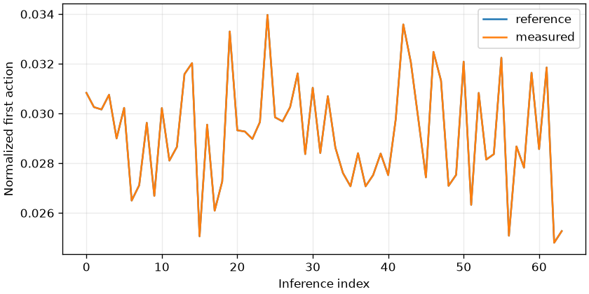

<!-- pal:language:start -->
<p align="right">
  <a href="hw-common-01.md" lang="ko">한국어</a> | <a href="../../en/lessons/hw-common-01.md" lang="en">ENGLISH</a>
</p>
<!-- pal:language:end -->

# hw-common-01 — 런타임 시작, 오프라인 재생과 명령 차단

<!-- pal:metadata:start -->
| Field | Value |
|---|---|
| Stage / track | `hardware / common` |
| Legacy alias | `T35B` |
| Platforms | `macos-arm64, linux-x86_64` |
| Capabilities | `python-3.12` |
| Prerequisites | `sim-deploy-01` |
| Safety | `offline` |
| Verification | `maintainer-checked` |
| Implementation | `implemented` |
<!-- pal:metadata:end -->

## Reader route

이 수업의 질문은 아래 목표를 실행 결과의 값과 연결해 설명할 수 있는가입니다. 먼저 Expected의 결과 기준을 읽고 실행한 뒤, 관찰·계산·코드를 순서대로 확인합니다.

[터미널 준비·재개·결과 열기·카메라 조작](../READER_GUIDE.md)

선행 [개념 장](../concepts/deployment-hardware.md)과 [장비 확장 순서](../equipment-stages.md)를 읽는다. 이 수업의 질문: 명령 차단 수신기는 물리 출력 없이 수신을 어떻게 확인하는가?

## Learning goals

추론 sink는 출력 경계를 드러내며 정책을 실행한다.

명령 차단 수신기는 물리 출력 없이 수신을 어떻게 확인하는가?

## Preflight

처음이면 저장소 루트에서 `sh bootstrap.sh --plan`을 실행하고 계획을 읽은 뒤 `--apply`로 환경을 준비합니다. `source .venv/bin/activate` 후 아래 명령을 사용합니다. 이미 같은 이름의 실행 폴더가 있으면 02처럼 새 이름을 정합니다.

```bash
pal host detect --json
pal lesson check hw-common-01 --json
```

## Action

준비된 환경을 활성화하고 새 출력 폴더를 쓴다. 반환 실행 경로를 보존하며 실행만으로 완료되지 않는다.

```bash
pal lesson run hw-common-01 --headless --seed 7 --samples 64 --output-dir .local/runs/hw-common-01/baseline-01 --json
```

## Expected

실제 개발 실행의 예시입니다. 가로축·세로축의 단위와 기준/측정 곡선의 차이를 먼저 읽습니다. 개인 실행 결과는 별도 검사합니다.



inference.json 행동 배열, 재생 일치, inference_count, emitted_command_count=0을 확인합니다. 휴대 가능한 오프라인 수업이며 실물 동작 승인을 부여하지 않습니다.

공통 산출물은 summary.json, trace.csv, experiment.json, plot.png, run.json과 lesson-report.md입니다. 모델 수업에는 실제 frame.png 또는 외부 스택의 evaluation/isaac 이미지도 있습니다. 파일 크기만 보지 말고 그래프 축·단위·영상 구도를 직접 확인합니다.

```bash
pal lesson check hw-common-01 --run-dir .local/runs/hw-common-01/baseline-01 --json
```

## Observe

먼저 metric의 단위, observed_first/observed_last, checks를 읽습니다. inspection은 검증된 파일만 읽고 종료하며 진도를 완료하지 않습니다.

```bash
pal lesson inspect hw-common-01 --run-dir .local/runs/hw-common-01/baseline-01 --json
```

Mac 결과 그래프 열기(창을 닫아도 실행 기록은 유지됩니다):

```bash
open .local/runs/hw-common-01/baseline-01/plot.png
```

다른 OS의 파일 관리자에서는 같은 PNG를 엽니다. 원시 수치는 아래 JSON에 있습니다.

```bash
python -m json.tool .local/runs/hw-common-01/baseline-01/experiment.json
```

### 산출물 읽기

`inference.json`의 `actions`, `replay`와 `experiment.json` → `payload`의 `command_sink=enabled`, `emitted_command_count=0`, `inference_count`, `manifest_sha256`, `replay_exact`를 확인한다. 지표는 의도적으로 실물 명령 0개다. 빈 반복을 근거로 가장하지 않게 추론이 비어 있지 않은지도 본다.

## How it works

### 직관

추론 sink는 출력 경계를 드러내며 정책을 실행한다. 검증된 후보를 불러와 저장 관측마다 두 번 평가하고 행동 배열을 메모리에 모아 저장한다. 의도적으로 publisher·소켓·SDK·실물 콜백이 없다. 하드웨어 단계에서 구현된 오프라인 예외다.

### 계산과 단위

$$
e_{replay}=\max_{i,j}|a^{first}_{ij}-a^{replay}_{ij}|
$$

두 배열의 크기는 (테스트 벡터 수, 7)이며 행동은 정규화 단위다. 결정론적 추론이 같으면 차이는 0이지만 행동 자체가 전부 0이라는 뜻은 아니다. 런타임 출력이 아닌 계산 예제에서 [0.2,-0.1]을 자신과 비교한 차이는 0이다.

```python
import numpy as np
a = np.array([0.2, -0.1])
assert np.max(np.abs(a - a.copy())) == 0.0
```

## Code connection

### 소스 추적

[`src/pai_lab/lessons/deployment.py`](https://github.com/terryum/tutorial-robotics/blob/main/src/pai_lab/lessons/deployment.py)

`examples/hw-common-01/run.py`는 공통 runner로 위임하며 runner는 카탈로그 구현·역량을 확인한 뒤 분기한다. 위 소스가 여기의 양을 계산한다. 메타데이터 파일 이름만으로 계산 내용을 판단하면 안 된다.

## Try it

### 통제된 비교

번들을 고정하고 문서 CLI 입력 하나만 바꾼다. 이 생산자는 매니페스트 테스트 벡터를 재생하며 `variant`·시드·`samples`를 사용하지 않아 정확한 불변이 예상된다. 다른 벡터 집합은 해시 번들을 몰래 편집하지 말고 상위 단계의 새 후보로 만든다.

```bash
pal lesson run hw-common-01 --headless --seed 8 --samples 64 --output-dir .local/runs/hw-common-01/comparison-01 --json
pal lesson check hw-common-01 --run-dir .local/runs/hw-common-01/baseline-01 --json
pal lesson check hw-common-01 --run-dir .local/runs/hw-common-01/comparison-01 --json
pal lesson compare hw-common-01 --run-dir .local/runs/hw-common-01/baseline-01 --comparison-run-dir .local/runs/hw-common-01/comparison-01 --output-dir .local/comparisons/hw-common-01/comparison-01 --json
```

## Recovery

capability-unavailable이면 missing 목록에 나온 Python·모델·플랫폼·외부 스택을 준비한 뒤 같은 수업을 새 폴더에서 재실행합니다. 실패한 run.json과 수치를 보존합니다. 시스템 패키지·드라이버·CUDA·ROS·Isaac·대형 모델은 자동 설치하지 않습니다. 체크섬 오류는 vendor 소스를 수정하지 말고 고정 캐시를 복구합니다.

## Checkpoint

### 이해 확인

추론은 0이 아닌데 명령 수는 0일 수 있는 이유는? 숫자를 계산하지만 실물 출력 경로가 없기 때문이다. 로봇 stop 회로를 검증하는가? 아니다.

두 실행의 실제 값·축·그림을 확인한다. 아래 notes를 측정값·해석으로 바꾸고 피드백을 해소한 다음 수업 하나를 review/finish한다. 역량이 없으면 unavailable이며 공개 배지가 자신의 완료는 아니다.

```bash
pal lesson review hw-common-01 --run-dir .local/runs/hw-common-01/baseline-01 --comparison-run-dir .local/runs/hw-common-01/comparison-01 --notes "REPLACE with actual measured values and interpretation" --json
pal lesson finish hw-common-01 --run-dir .local/runs/hw-common-01/baseline-01 --json
```

<!-- pal:navigation:start -->
## Next lesson

[hw-common-02](./hw-common-02.md)

다음 항목은 목차 순서입니다. 실제 선택은 `pal course next --json`이 준비 상태로 결정합니다.
<!-- pal:navigation:end -->
