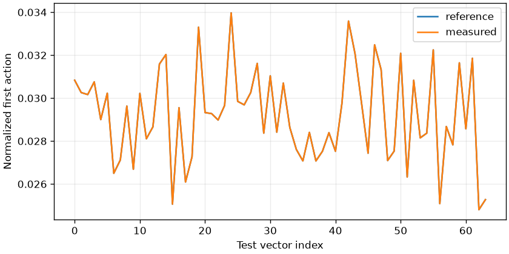

<!-- pal:language:start -->
<p align="right">
  <a href="sim-deploy-01.md" lang="ko">한국어</a> | <a href="../../en/lessons/sim-deploy-01.md" lang="en">ENGLISH</a>
</p>
<!-- pal:language:end -->

# sim-deploy-01 — 후보 배포 번들과 승격 게이트

<!-- pal:metadata:start -->
| Field | Value |
|---|---|
| Stage / track | `sim / deployment` |
| Legacy alias | `T35A` |
| Platforms | `macos-arm64, linux-x86_64` |
| Capabilities | `python-3.12` |
| Prerequisites | `core-fr3-08` |
| Safety | `offline` |
| Verification | `maintainer-checked` |
| Implementation | `implemented` |
<!-- pal:metadata:end -->

## Reader route

이 수업의 질문은 아래 목표를 실행 결과의 값과 연결해 설명할 수 있는가입니다. 먼저 Expected의 결과 기준을 읽고 실행한 뒤, 관찰·계산·코드를 순서대로 확인합니다.

[터미널 준비·재개·결과 열기·카메라 조작](../READER_GUIDE.md)

선행 [개념 장](../concepts/deployment-hardware.md)과 [장비 확장 순서](../equipment-stages.md)를 읽는다. 이 수업의 질문: 어떤 근거와 해시가 배포 후보의 재현성을 뒷받침하는가?필요한 경우 [NVIDIA 생태계 실습](../nvidia-ecosystem.md)을 참고하되, 이 수업이 쓰는 실제 엔진·프레임워크는 아래 생산자로 구별한다.

## Learning goals

패키징은 프로세스 경계를 넘어 학습 숫자의 뜻을 보존한다.

어떤 근거와 해시가 배포 후보의 재현성을 뒷받침하는가?

## Preflight

처음이면 저장소 루트에서 `sh bootstrap.sh --plan`을 실행하고 계획을 읽은 뒤 `--apply`로 환경을 준비합니다. `source .venv/bin/activate` 후 아래 명령을 사용합니다. 이미 같은 이름의 실행 폴더가 있으면 02처럼 새 이름을 정합니다.

```bash
pal host detect --json
pal lesson check sim-deploy-01 --json
```

## Action

준비된 환경을 활성화하고 새 출력 폴더를 쓴다. 반환 실행 경로를 보존하며 실행만으로 완료되지 않는다.

```bash
pal lesson run sim-deploy-01 --headless --seed 7 --samples 64 --output-dir .local/runs/sim-deploy-01/baseline-01 --json
```

## Expected

실제 개발 실행의 예시입니다. 가로축·세로축의 단위와 기준/측정 곡선의 차이를 먼저 읽습니다. 개인 실행 결과는 별도 검사합니다.



sample_candidate/manifest.json을 열고 완료된 core-fr3-08 정책 해시와 비교합니다. 모든 결정론적 test vector를 실행합니다. 이 결과로 승격이나 실물 제어 권한이 생기지 않습니다.

공통 산출물은 summary.json, trace.csv, experiment.json, plot.png, run.json과 lesson-report.md입니다. 모델 수업에는 실제 frame.png 또는 외부 스택의 evaluation/isaac 이미지도 있습니다. 파일 크기만 보지 말고 그래프 축·단위·영상 구도를 직접 확인합니다.

```bash
pal lesson check sim-deploy-01 --run-dir .local/runs/sim-deploy-01/baseline-01 --json
```

## Observe

먼저 metric의 단위, observed_first/observed_last, checks를 읽습니다. inspection은 검증된 파일만 읽고 종료하며 진도를 완료하지 않습니다.

```bash
pal lesson inspect sim-deploy-01 --run-dir .local/runs/sim-deploy-01/baseline-01 --json
```

Mac 결과 그래프 열기(창을 닫아도 실행 기록은 유지됩니다):

```bash
open .local/runs/sim-deploy-01/baseline-01/plot.png
```

다른 OS의 파일 관리자에서는 같은 PNG를 엽니다. 원시 수치는 아래 JSON에 있습니다.

```bash
python -m json.tool .local/runs/sim-deploy-01/baseline-01/experiment.json
```

### 산출물 읽기

`sample_candidate/manifest.json`의 정책 경로·해시, `files`, `test_vectors`, `observation_order`, `action_order`, `frame`, `rate_hz=50`, `rollback=command-sink`, `promotion=candidate-only`, `performance_verified=False`를 읽는다. `validate_candidate`는 번들 밖 경로와 테스트 벡터 추론 불일치도 거부한다. 50 Hz 선언은 오프라인 시간 벤치마크가 아니다.

## How it works

### 직관

패키징은 프로세스 경계를 넘어 학습 숫자의 뜻을 보존한다. `deployment.run`은 검증된 완료 FR3 PPO 근거를 읽고 정확한 정책·소스 계약을 복사하며 결정론적 관측·행동 테스트 벡터를 만든 뒤 후보 매니페스트를 검사한다. 구조가 유효한 번들이어도 독립 과제 성능은 부족할 수 있다.

### 계산과 단위

$$
a=\tanh([\operatorname{clip}(o,-5,5),1]W)
$$

관측 o는 17원소, 편향 입력은 18원소, W는 18×7이다. 행동은 정규화 변화량이며 시뮬레이터가 단위당 0.03 rad를 적용한다. 정책 측정이 아닌 계산 예제로 변환 전 값 0.5이면 tanh(0.5)≈0.462117이다. 해시는 정확한 바이트를 식별하며 실물 안전을 뜻하지 않는다.

```python
import numpy as np
raw = 0.5
assert np.isclose(np.tanh(raw), 0.46211715726000974)
```

## Code connection

### 소스 추적

[`src/pai_lab/lessons/deployment.py`](https://github.com/terryum/tutorial-robotics/blob/main/src/pai_lab/lessons/deployment.py)

`examples/sim-deploy-01/run.py`는 공통 runner로 위임하며 runner는 카탈로그 구현·역량을 확인한 뒤 분기한다. 위 소스가 여기의 양을 계산한다. 메타데이터 파일 이름만으로 계산 내용을 판단하면 안 된다.

## Try it

### 통제된 비교

지원되는 비교는 정책 바이트·계약을 고정하고 문서의 테스트 벡터 난수 시드만 바꾼다. 입력은 달라져도 재로딩 일치는 정확할 수 있다. 생산자는 `variant`를 사용하지 않는다. 패키징으로 제어가 좋아졌다고 하지 말고 불변을 설명한다.

```bash
pal lesson run sim-deploy-01 --headless --seed 8 --samples 64 --output-dir .local/runs/sim-deploy-01/comparison-01 --json
pal lesson check sim-deploy-01 --run-dir .local/runs/sim-deploy-01/baseline-01 --json
pal lesson check sim-deploy-01 --run-dir .local/runs/sim-deploy-01/comparison-01 --json
pal lesson compare sim-deploy-01 --run-dir .local/runs/sim-deploy-01/baseline-01 --comparison-run-dir .local/runs/sim-deploy-01/comparison-01 --output-dir .local/comparisons/sim-deploy-01/comparison-01 --json
```

## Recovery

capability-unavailable이면 missing 목록에 나온 Python·모델·플랫폼·외부 스택을 준비한 뒤 같은 수업을 새 폴더에서 재실행합니다. 실패한 run.json과 수치를 보존합니다. 시스템 패키지·드라이버·CUDA·ROS·Isaac·대형 모델은 자동 설치하지 않습니다. 체크섬 오류는 vendor 소스를 수정하지 말고 고정 캐시를 복구합니다.

## Checkpoint

### 이해 확인

정확한 해시 검사가 보존하는 것은? 바이트 식별이다. 무엇을 입증하지 못하는가? 독립 과제 성능·정확한 실물 보정·장치 명령 권한이다.

두 실행의 실제 값·축·그림을 확인한다. 아래 notes를 측정값·해석으로 바꾸고 피드백을 해소한 다음 수업 하나를 review/finish한다. 역량이 없으면 unavailable이며 공개 배지가 자신의 완료는 아니다.

```bash
pal lesson review sim-deploy-01 --run-dir .local/runs/sim-deploy-01/baseline-01 --comparison-run-dir .local/runs/sim-deploy-01/comparison-01 --notes "REPLACE with actual measured values and interpretation" --json
pal lesson finish sim-deploy-01 --run-dir .local/runs/sim-deploy-01/baseline-01 --json
```

<!-- pal:navigation:start -->
## Next lesson

[sim-enlight-01](./sim-enlight-01.md)

다음 항목은 목차 순서입니다. 실제 선택은 `pal course next --json`이 준비 상태로 결정합니다.
<!-- pal:navigation:end -->
